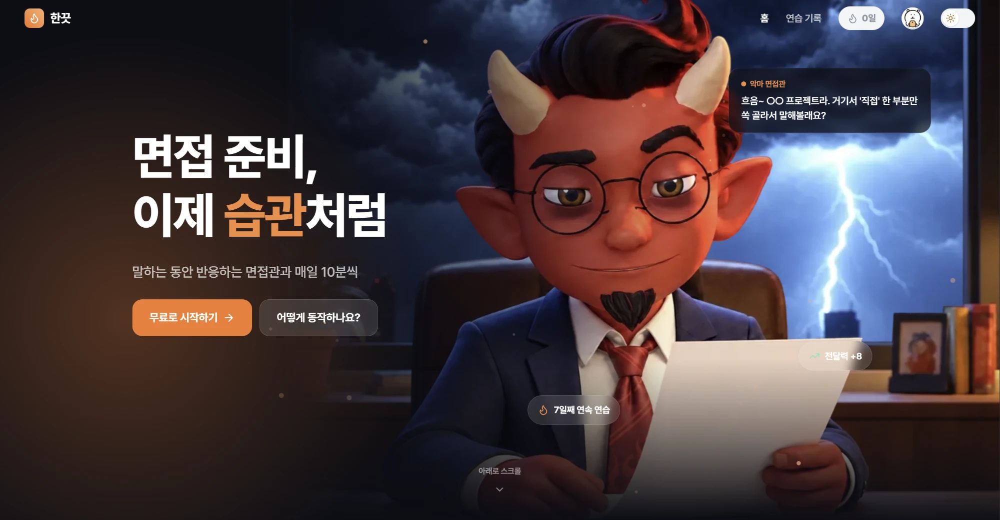
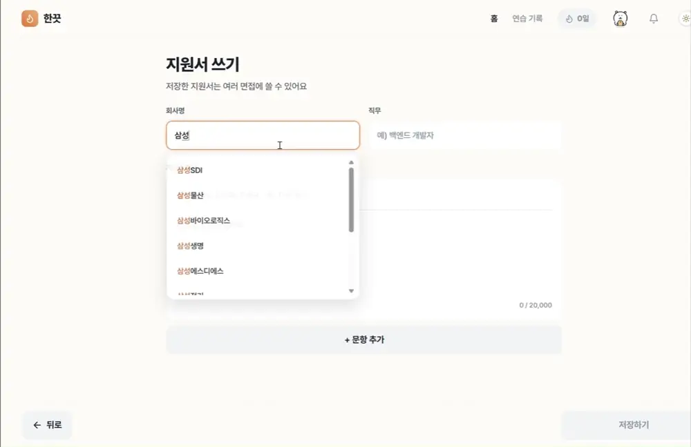
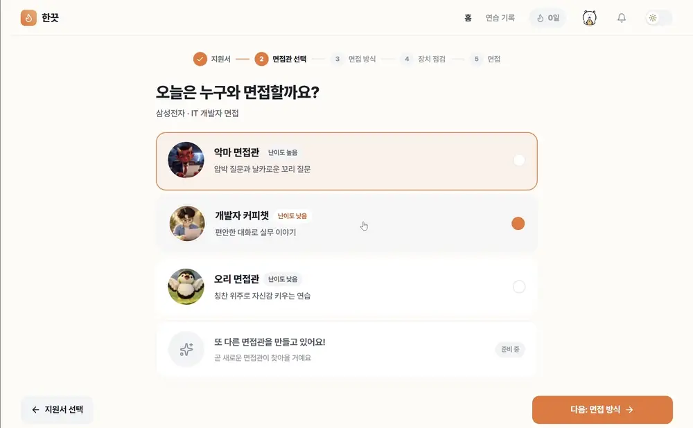
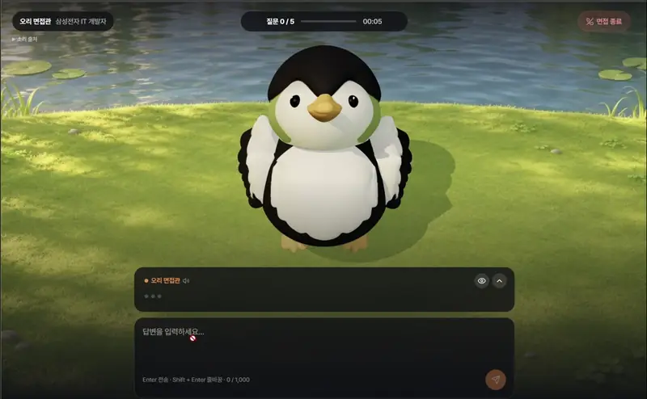
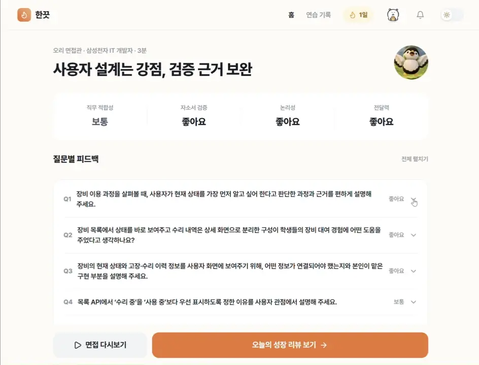
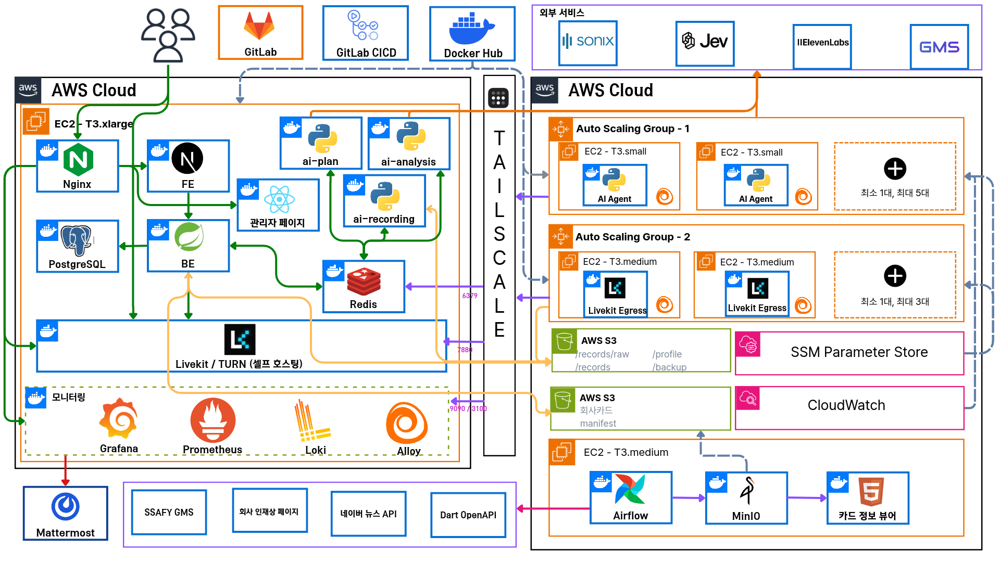

# 한끗
**AI 기반 실전 모의면접 서비스**

> 실시간으로 반응하는 AI 면접관과 매일 연습하는 모의면접 서비스

지원할 회사와 자기소개서를 넣으면, 그 자기소개서를 근거로 한 질문으로 면접관이 면접을 봅니다.

면접관은 내가 말하는 동안 고개를 끄덕이거나 갸웃하며 반응하고, 면접이 끝나면 어느 답변의 어느 장면이 왜 아쉬웠는지 피드백으로 돌려줍니다.

## 기획 배경

모의면접 서비스는 많지만, 연습을 마치고 나면 "그래서 잘한 건가?"라는 질문이 남습니다.
누구에게나 나올 법한 질문을 받고, 점수만 받고, 말하는 동안 면접관은 아무 반응이 없습니다.

한끗은 실제 면접에 가까운 연습을 위해 네 가지 가치를 제공합니다.

- **자기소개서를 바탕으로 질문합니다.** 
  - 일반 질문 대신, 내가 쓴 자기소개서와 지원 직무를 근거로 질문하고 답변을 파고드는 꼬리질문을 이어 갑니다.
- **회사에 맞는 답인지 평가합니다.** 
  - 점수만 주지 않고, 답변이 직무와 자기소개서에 맞는지 근거와 함께 알려 줍니다.
- **장면 단위로 피드백합니다.** 
  - "시선 72점" 같은 숫자 대신, 녹화 영상의 어느 순간에 무엇이 아쉬웠는지 짚어 줍니다.
- **듣는 중에 반응하는 면접관과 연습합니다.** 
  - 내가 말하는 동안 면접관이 끄덕이고 갸웃하며 실제 면접의 긴장감을 제공합니다.

## 주요 기능

### 지원서 등록

회사명, 직무, 자기소개서 문항을 입력하면, 면접 전에 기본 질문과 채점 기준을 미리 만들어 둡니다.
질문을 만들 수 없을 만큼 내용이 부족한 자기소개서는 저장 전에 알려 줍니다.

### 면접관 선택

연습 목적에 맞춰 면접관을 고릅니다. 면접관마다 질문 수준과 평가 관점이 다릅니다.

| 면접관 | 스타일 |
| --- | --- |
| 악마 면접관 | 압박 질문과 날카로운 꼬리 질문 |
| 개발자 커피챗 | 편안한 대화로 실무 이야기 |
| 오리 면접관 | 칭찬 위주로 자신감 키우는 연습 |

### 실시간 모의면접

화상 면접은 카메라, 마이크를 켜고 음성으로 답하고, 
채팅 면접은 면접관 음성을 들으며 채팅으로 답합니다.
면접관은 답변을 듣는 동안 실시간으로 반응하고, 답변 내용에 따라 꼬리질문을 던집니다.

<table>
  <tr>
    <td align="center"></td>
    <td align="center"></td>
  </tr>
  <tr>
    <td align="center"><b>화상 면접</b> 음성으로 답하면 면접관이 듣는 중에 반응합니다</td>
    <td align="center"><b>채팅 면접</b> 면접관 음성을 듣고 글로 답합니다</td>
  </tr>
</table>

### 피드백 결과

면접이 끝나면 한 줄 총평, 기준별 점수와 코멘트, 답변마다 잘한 점 · 고칠 점을 보여 줍니다.
답변이 자기소개서 내용과 맞는지도 함께 확인합니다.

### 면접 다시보기

화상 면접은 녹화 영상으로 다시 볼 수 있습니다. 질문 타임라인을 눌러 원하는 장면으로 바로 이동합니다.

<!-- TODO: 타임라인 클릭 → 장면 이동 GIF -->

### 연습 기록 · 성장 리뷰

<table>
  <tr>
    <td align="center"></td>
    <td align="center"></td>
  </tr>
  <tr>
    <td align="center"><b>연습 기록</b> 달력에서 날짜를 골라 그날 본 면접을 모아 봅니다</td>
    <td align="center"><b>성장 리뷰</b> 하루치 면접을 돌아보고 다음에 해 볼 것을 알려 줍니다</td>
  </tr>
</table>

## 기술 스택

| 영역 | 사용 기술 |
| --- | --- |
| Frontend | Next.js 16, React 19, TypeScript, Tailwind CSS 4, Three.js(면접관 아바타), MediaPipe Tasks Vision, LiveKit Client, Zustand, Vitest · Playwright |
| Admin | React 19, Vite, TypeScript |
| Backend | Java 21, Spring Boot 4.1, Spring Security(OAuth2 Resource Server), JPA, Flyway, PostgreSQL 18, Redis, LiveKit Server SDK, AWS S3 |
| AI | Python 3.13, FastAPI, LiveKit Agents, Redis 작업 큐, uv / Soniox(STT) · ElevenLabs(TTS) · Jev(면접관 반응 · 인상 판단) · GMS(LLM) |
| Infra | AWS EC2 · Auto Scaling Group · S3, LiveKit 셀프 호스팅(TURN · Egress 녹화), Docker Compose, Nginx, Tailscale, GitLab CI · Docker Hub, Prometheus · Grafana · Loki · Alloy, SonarQube |

## 시스템 아키텍처

- **화면 · CRUD**: 브라우저 → Nginx → FE(Next.js) → BE → PostgreSQL · Redis. 브라우저는 BE만 보고, AI 서버나 외부 API에 직접 붙지 않습니다.
- **면접방**: BE가 LiveKit 입장 토큰을 발급하고 AI 에이전트를 방에 배정합니다. 에이전트가 사용자 음성을 받아 STT → 반응 판단 → TTS로 면접을 진행합니다.
- **채점 · 녹화**: BE와 AI는 HTTP 대신 Redis 큐로만 주고받습니다. 질문 생성 · 채점 · 결과 · 녹화 합치기를 큐마다 나눈 작업자가 처리합니다.

## 핵심 설계

### 면접 중 응답 지연 줄이기

기본 질문과 채점 기준은 면접 전에 미리 만들어 두고, 면접 중에는 STT · 반응 판단 · TTS만 실시간으로 돕니다.
LLM은 답변을 파고드는 꼬리질문에만 쓰고, 다음 질문 앞에서 기다리지 않도록 필요한 시점에 미리 만들어 둡니다.

### AI 에이전트 · 녹화 서버 오토스케일링

부하 테스트에서 면접 중 CPU를 가장 많이 쓴 AI 에이전트와 녹화(Egress)를 메인 서버에서 떼어, 동시 면접 수에 따라 대수가 늘고 줄도록 Auto Scaling Group으로 옮겼습니다.
축소할 때는 진행 중인 면접 · 녹화가 끊기지 않도록 끝날 때까지 기다렸다가 내려갑니다.

### 부하 테스트와 모니터링

시나리오별 부하 테스트로 서버 한계를 측정하고, 서버 · 컨테이너 · LiveKit 지표와 로그를 Grafana 한곳에서 볼 수 있습니다. 장애는 Mattermost 알림으로 받습니다.

<!-- TODO: Grafana 대시보드 캡처 (loadtest/report/img/ 재사용 가능, 선택) -->

## 팀원

<!-- TODO: 역할은 docs/전체기획.md 초기 분담 기준. 실제 역할로 고치고 사진 추가 -->

|                                                     | 이름  | 역할                          | 학습 기록                      |
|:---------------------------------------------------:|-----|-----------------------------|----------------------------|
|    | 박다빈 | 면접 AI · 질문 생성 · 답변 평가      | [Readme](박다빈/Readme.md) |
|   | 박연수 | 면접관 아바타 · TTS               | [Readme](박연수/Readme.md) |
|  | 이정복 | 화면 · Frontend                | [Readme](이정복/Readme.md) |
|   | 이해준 | 언어 · 비언어 피드백 · Infra        | [Readme](이해준/Readme.md) |
|  | 전지웅 | 면접관 반응 로직                    | [Readme](전지웅/Readme.md) |
|    | 한결  | 면접관 아바타                      | [Readme](한결/Readme.md)  |

## Repository

- `frontend/`: Next.js 사용자 화면
- `admin/`: React + Vite 관리 페이지
- `backend/`: Spring Boot API 서버
- `ai/`: 면접 에이전트(LiveKit Agents)와 질문 생성 · 채점 · 녹화 합치기 작업자
- `company-pipeline/`: 회사 카드 파이프라인(Airflow · MinIO, MVP 범위 밖)
- `mock/`: FE 개발용 목 API 서버
- `deploy/`: 개발 · 운영 서버 compose, ASG 실행 키트, 모니터링 설정
- `loadtest/`: 부하 테스트 시나리오와 결과 보고서
- `docs/`: 기획 · 명세 · 협업 문서