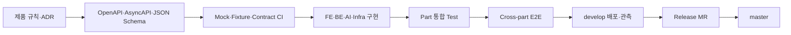

# A301 Git 사용 및 협업 가이드

이 문서는 A301 실시간 AI 면접 프로젝트의 Git 브랜치, 커밋, Merge Request와 Release 규칙을 정의한다. 상세 구현 방식은 CONVENTION 등 관련 문서를 따른다.

## 목차

1. [핵심 원칙](#1-핵심-원칙)
2. [브랜치 전략](#2-브랜치-전략)
3. [병합 순서](#3-병합-순서)
4. [커밋 메시지](#4-커밋-메시지)
5. [Merge Request 절차](#5-merge-request-절차)
6. [Part별 추가 MR 기준](#6-part별-추가-mr-기준)
7. [음성·WebSocket·AI Job 금지사항](#7-음성websocketai-job-금지사항)
8. [충돌 해결과 변경 관리](#8-충돌-해결과-변경-관리)
9. [Release 흐름](#9-release-흐름)
10. [빠른 확인 Checklist](#10-빠른-확인-checklist)
11. [Jira Issue와 Story Point](#11-jira-issue와-story-point)
12. [코딩 컨벤션과 자동 검사](#12-코딩-컨벤션과-자동-검사)

## 1. 핵심 원칙

```
실행 Jira 1개 = 작업 Branch 1개 = MR 1개
```

- `master`와 `develop`에 직접 Push하지 않는다.
- Epic은 Release·사용자 여정의 집계 단위이므로 Branch를 만들지 않는다.
- Story·Task를 실행 단위로 관리하며, 독립 MR이 필요한 이슈는 별도 브랜치로 분리한다.
- 모든 변경은 Jira에 연결된 작업 Branch에서 수행한다.
- 한 Jira는 1~3일 안에 구현·검토·병합할 수 있는 단위로 나눈다.
- 한 MR은 하나의 사용자 가치 또는 하나의 기술적 검토 목적만 가진다.
- 공통 계약과 Mock을 구현보다 먼저 병합한다.
- 정상 경로뿐 아니라 실패·Timeout·중복·재시도·복구를 함께 구현한다.
- AI 출력은 Candidate로 취급하며 근거·Version·평가 결과를 남긴다.
- Release/E2E Branch에서는 새 제품 기능을 구현하지 않는다. 누락된 기능은 해당 Part의 별도 Jira로 되돌린다.

## 2. 브랜치 전략

A301은 `master`와 `develop`을 중심으로 단순화한 Git Flow를 사용한다.

```
master                          # 시연·운영 가능한 Release
└─ develop                      # 다음 Release 통합·검증
   ├─ S15P31A301-42/ai/feature/answer-evaluator
   ├─ S15P31A301-43/be/feature/interview-turn-job
   ├─ S15P31A301-44/fe/feature/audio-answer-upload
   ├─ S15P31A301-45/common/feature/realtime-contract
   └─ S15P31A301-46/infra/fix/stt-timeout-alert
```

### 2.1 브랜치 이름

```
S15P31A301-<Jira 번호>/<part>/<type>/<slug>
```

예시:

```
S15P31A301-42/ai/feature/answer-evaluator
S15P31A301-43/be/feature/interview-turn-job
S15P31A301-44/fe/feature/audio-answer-upload
S15P31A301-45/common/feature/realtime-contract
S15P31A301-46/infra/docs/stt-runbook
```

규칙:

- Jira가 발급한 실제 번호를 사용한다.
- `slug`는 영문·숫자와 하이픈(`-`)·언더스코어(`_`)로 작성한다. `/`는 쓸 수 없다.
- `develop`, `master`, GitLab Revert 버튼이 만드는 `revert-<sha>` 브랜치는 이 규칙에서 제외한다.
- 개인 이름이나 담당자 이름을 Branch에 넣지 않는다.
- 한 Branch에서 관련 없는 기능을 함께 수정하지 않는다.
- 장기간 유지하는 개인별 `FE`, `BE`, `AI` Branch를 만들지 않는다.

### 2.2 Part

| part | 담당 영역 |
| --- | --- |
| `fe` | React 면접 화면, LiveKit 접속·미디어 송출·메시지 수신, 리포트 UX |
| `be` | 인증, 지원정보, 면접 Session·Turn·Answer, LiveKit 입장 토큰·방·에이전트 배정, AI 작업 요청·결과 저장, Storage |
| `ai` | 질문 생성·평가·리포트 작업, LiveKit 에이전트의 STT·TTS·Jev, 결과 큐 전송 |
| `infra` | 로컬 환경, CI/CD, 배포, Secret, Storage, 관측, 비용·복구 |
| `common` | 제품 규칙, OpenAPI·AsyncAPI·JSON Schema, Mock, Cross-part E2E |

- 공통 계약·Mock·Cross-part E2E: `common`
- Domain Logic와 API: `be`
- 화면과 Client 연동: `fe`
- AI Pipeline과 평가: `ai`
- Runtime과 배포 검증: `infra`

### 2.3 Type

| type | 사용 시점 | 예시 |
| --- | --- | --- |
| `feature` | 기능·계약·테스트 체계를 새로 구현 | `S15P31A301-42/ai/feature/answer-evaluator` |
| `fix` | 개발·Staging에서 발견한 일반 결함 수정 | `S15P31A301-43/be/fix/duplicate-answer-job` |
| `hotfix` | `master`의 중대 운영 장애 긴급 수정 | `S15P31A301-44/infra/hotfix/audio-upload-outage` |
| `docs` | 코드 변경 없는 공식 문서 작업 | `S15P31A301-45/common/docs/update-data-policy` |

브랜치 Type은 `feature`, `fix`, `hotfix`, `docs`만 사용한다. `test`, `refactor`, `style`, `chore`는 별도 브랜치 Type이 아니라 관련 작업 브랜치 안의 Commit Type으로 사용한다. 테스트나 리팩터링 자체가 독립 Jira·MR 작업이라면 목적에 따라 `feature` 또는 `fix` 브랜치를 만들고, 내부 Commit에 `test` 또는 `refactor`를 사용한다.

### 2.4 Branch 생성 기준

일반 작업은 최신 `develop`에서 시작한다.

```bash
git switch develop
git pull --ff-only origin develop
git switch -c S15P31A301-42/ai/feature/answer-evaluator
```

다음 중 하나라도 해당하면 Jira와 Branch를 분리한다.

- 예상 작업 시간이 3일을 넘는다.
- 독립적으로 배포·실패·Rollback할 수 있는 구성요소가 둘 이상이다.
- 서로 다른 Provider, 모델 계열, 파일 형식 또는 사용자 Journey를 함께 구현한다.
- 계약·DB·Runtime·UI를 모두 새로 만들면서 수직 단위로 분리할 수 있다.
- MR 제목을 `A와 B와 C 구현`이라고 작성해야 설명되는 범위다.

## 3. 병합 순서



### 3.1 공통 계약 변경

공통 계약은 `common/feature` Branch에서 먼저 변경한다.

```
계약·Example·실패 응답
→ Mock·Fixture·호환성 검사
→ 계약 MR 병합
→ generated client 갱신
→ FE·BE·AI 구현 MR
```

- FE·BE·AI가 같은 Field를 각자 문서로 재정의하지 않는다.
- 파괴적 변경은 기존 Field를 즉시 삭제하지 않고 Version·Migration·호환 기간을 정의한다.
- 계약 변경 MR은 영향을 받는 Part에서 각각 한 명 이상 확인한다.
- Contract MR에 Domain 구현을 함께 넣지 않는다.

### 3.2 Feature와 Fix

- `feature`, 일반 `fix`, `docs`는 최신 `develop`에서 생성한다.
- CI와 Review를 통과한 뒤 `develop`에 병합한다.
- 병합 전에 최신 `develop`과의 충돌 및 계약 호환성을 확인한다.
- 이미 Review가 시작된 Commit History를 불필요하게 다시 작성하지 않는다.

### 3.3 Hotfix

운영 또는 시연용 `master`의 Blocker/Critical 장애에만 사용한다.

```
master
→ hotfix Branch
→ 재현 Test와 최소 수정
→ master 병합·배포 확인
→ 동일 변경을 develop에도 즉시 반영
```

- 일반 기능 추가를 Hotfix에 포함하지 않는다.
- 장애 재현 Test를 먼저 추가한다.
- 임시 우회라면 제거 조건과 후속 Jira를 기록한다.
- Hotfix를 `master`에 병합한 뒤 동일한 수정 사항을 `develop`에도 병합하여 다음 Release에서 장애가 다시 발생하지 않도록 한다.

## 4. 커밋 메시지

### 4.1 형식

```
<type>(<scope>): <subject> [S15P31A301-번호]

<body>  # 필요한 경우 변경 이유·제약·호환성 설명
```

예시:

```
feat(interview): 면접 Turn 상태 전이 구현 [S15P31A301-43]
feat(speech): STT Provider adapter 추가 [S15P31A301-47]
test(realtime): WebSocket 재연결 회귀 테스트 추가 [S15P31A301-48]
fix(report): 평가 근거 누락 처리 수정 [S15P31A301-49]
docs(contract): Answer Event 오류 예시 보완 [S15P31A301-50]
```

규칙:

- `(<scope>)`와 `[S15P31A301-번호]`는 생략할 수 있다. 예: `docs: 회의록 정리`
- Jira 번호를 적을 때는 제목 끝에 `[S15P31A301-번호]`로 쓰는 것을 권장한다. CI는 이 표기를 검사하지 않는다.
- `scope`는 영문·숫자와 `.`, `_`, `/`, `-`만 사용한다.
- `:` 뒤에는 공백 한 칸을 둔다.
- `git revert`나 GitLab Revert 버튼이 만드는 `Revert "..."` 커밋은 그대로 허용한다.

### 4.2 Commit Type

| type | 의미 |
| --- | --- |
| `feat` | 사용자 또는 시스템 기능 추가 |
| `fix` | 오류 수정 |
| `docs` | 문서만 변경 |
| `style` | 동작 변화 없는 Formatting |
| `refactor` | 동작 변화 없는 구조 개선 |
| `test` | Test·Fixture·평가셋 추가 또는 수정 |
| `chore` | Build·의존성·환경·생성물 관리 |

### 4.3 Scope 예시

```
contract, interview, answer, realtime, media, speech,
retrieval, blueprint, evaluation, followup, jev, report,
analytics, privacy, deploy, observability
```

### 4.4 Commit 단위

Commit 개수 자체가 목표는 아니지만, 각 Commit은 독립적으로 읽고 검토할 수 있어야 한다.

권장 순서:

```
1. 계약·Fixture·실패 조건
2. 최소 정상 경로
3. 상태 전이·오류·Timeout·중복·재시도
4. 권한·개인정보·안전 통제
5. Unit·Integration·Evaluation Test
6. Metric·Alert·Rollback·문서
```

금지 예시:

- 전체 기능을 `작업 완료` Commit 하나로 올림
- Formatting과 기능 변경을 같은 Commit에 혼합
- 서로 관련 없는 FE·BE·AI 기능을 한 Commit에 혼합
- Test를 통과시키기 위해 검증 기준을 이유 없이 낮춤
- Secret·Token·실제 사용자 음성·자소서를 Commit

## 5. Merge Request 절차

### 5.1 MR 제목

201의 실제 PR 기록과 동일하게 커밋 메시지 형식을 사용한다.

```text
<type>(<scope>): <subject> [S15P31A301-번호]
```

예시:

```text
feat(interview): 면접 Turn AI Job 상태 전이를 구현함 [S15P31A301-43]
fix(speech): STT 실패 시 재시도 상태를 바로잡음 [S15P31A301-47]
docs(contract): Answer Event 오류 계약을 보완함 [S15P31A301-50]
```

MR에 여러 Commit이 포함되더라도 제목은 Commit 목록을 나열하지 않고 MR 전체의 핵심 변경 한 가지를 표현한다.

### 5.2 MR 필수 내용

MR 본문은 [`.gitlab/merge_request_templates/Default.md`](../.gitlab/merge_request_templates/Default.md) 템플릿을 사용한다. 파일 이름이 `Default.md`이므로 GitLab에서 MR을 생성하면 Description에 자동으로 채워진다.

템플릿은 관련 이슈, 변경 유형, 작업 내용, 스크린샷·테스트 결과, 리뷰 포인트, 체크리스트로 구성된다.

계약·DB Migration·AI 평가·관측·Rollback은 모든 MR에 작성하지 않고, 해당 변경이나 위험이 있을 때만 `작업 내용`, `테스트 결과`, `리뷰 포인트`에 기록한다.

### 5.3 Ready for Review

- Jira 이슈와 인수 조건이 최신이다.
- Branch가 최신 `develop`과 통합 가능하다.
- 불필요한 Debug Code와 임시 Secret이 없다.
- 생성 파일과 실제 사용자 데이터가 Commit되지 않았다.
- 관련 Test를 로컬에서 통과했다.
- MR 본문에 변경 목적, 주요 변경, 검증 결과와 미검증 범위를 적었다.

### 5.4 승인 기준

- 작성자 외 최소 1명의 승인을 받아야 한다.
- Cross-part 변경은 영향을 받는 Part가 각각 확인한다.
- 계약 변경은 FE·BE·AI 중 실제 소비 Part가 호환성을 확인한다.
- 보안·개인정보·삭제 정책 변경은 해당 내용을 검토할 수 있는 팀원이 확인한다.
- CI가 실패하거나 Blocker Review가 남아 있으면 병합하지 않는다.

### 5.5 병합 조건

- 해당 변경에 필요한 Build·Lint·Test와 CI 통과
- 계약 변경 시 Contract Compatibility 통과
- 연동 변경 시 Integration·E2E 통과
- AI 동작 변경 시 AI Evaluation 통과
- DB Migration 변경 시 Forward와 Rollback 또는 복구 절차 검증
- Blocker/Critical 결함 0건
- 사용자 흐름 변경 시 오류 UX 확인
- 배포 영향이 있을 때 Rollback 방법 확인
- Jira와 MR에 필요한 검증 Evidence 연결

## 6. Part별 추가 MR 기준

### 6.1 FE

- Loading·Empty·Error·Retry 상태가 있다.
- 마이크 권한 거부, Upload 실패, WebSocket 재연결을 처리한다.
- 중복 클릭으로 Answer·Job이 중복 생성되지 않는다.
- Keyboard·접근성·Chrome/Edge 주요 흐름을 확인한다.
- GMS·STT·TTS·Jev는 AI 서버가 호출한다. FE는 BE API로 업무를 처리하고, BE가 발급한 면접방 입장 토큰으로 LiveKit에 접속해 미디어·메시지를 주고받는다. AI 서버에 업무 HTTP API를 추가하지 않는다.

### 6.2 BE

- Session·Turn·Answer·Job 상태 전이를 검증한다.
- 요청 멱등성과 Event Outbox를 적용한다.
- Presigned URL의 사용자·Object 소유권과 만료를 검증한다.
- AI Timeout·실패·재시도·Dead Letter와 사용자 상태가 일치한다.
- DB Migration의 Forward와 Rollback 또는 복구 절차를 제공한다.

### 6.3 AI

모든 AI MR은 가능한 항목을 다음과 같이 기록한다.

```
inputSchemaVersion
outputSchemaVersion
promptVersion
modelVersion
rubricVersion
policyVersion
datasetVersion
traceId
latencyMs
estimatedCost
```

추가 기준:

- 입력·출력 Schema와 실패 유형을 먼저 고정한다.
- Unit Test에서 실제 Provider 대신 Fake·Recorded Fixture를 사용한다.
- Golden Set 전체와 주요 Slice 결과를 비교한다.
- 평균 성능이 좋아져도 치명 Slice가 악화되면 승격하지 않는다.
- 근거 없는 평가·질문은 `abstain` 또는 Fallback으로 처리한다.
- Prompt·Model·Rubric·Policy 변경은 각각 추적 가능해야 한다.
- 교육생 GPU 결과를 운영 서비스나 운영 Job에 직접 연결하지 않는다.

### 6.4 Infra

- Secret을 Repository·Log·CI Artifact에 출력하지 않는다.
- 환경별 설정과 Resource 이름을 분리한다.
- 배포·Rollback·Backup Restore를 실제 명령으로 검증한다.
- FE→BE→AI의 Trace를 연결한다.
- STT·GMS 장애, Rate Limit과 비용 상한을 관측한다.
- 교육생 GPU 환경이 운영 Queue와 Credential을 사용하지 못하게 한다.

### 6.5 Common

- 계약은 정상 Example뿐 아니라 오류·Timeout·중복·순서 역전 Example을 포함한다.
- Mock과 Fixture는 FE·BE·AI가 공동으로 사용한다.
- Cross-part E2E는 제품 기능을 새로 구현하지 않는다.
- 계약이 변경되면 Consumer Compatibility 결과를 MR에 첨부한다.

## 7. 음성·WebSocket·AI Job 금지사항

- 브라우저 음성·영상은 LiveKit으로 송출한다. 에이전트가 마이크를 구독해 Soniox WebSocket으로 전달하며, 별도 BE·AI 업무 WebSocket으로 음성을 중계하지 않는다.
- 음성 Binary를 BE Application Body로 중계하지 않는다.
- 실제 사용자 음성·Transcript·자소서를 Git·Fixture·CI Artifact에 넣지 않는다.
- 답변 저장·면접 진행의 확정 상태는 BE API로 복구할 수 있어야 한다. 실시간 STT 표시는 저장 성공을 의미하지 않으며, 현재 새로고침 후 이전 자막은 복원하지 않는다.
- 동일 `idempotencyKey`로 Answer·AI Job이 중복 생성되지 않아야 한다.
- FE에서 GMS·STT·TTS Provider Credential을 보유하지 않는다.
- 면접 AI 에이전트·분석 작업자는 사용자 DB에 직접 접속하거나 로그인 JWT를 검증하지 않는다. BE가 인증·소유권을 확인하고 필요한 입력을 작업 메시지·에이전트 배정 정보로 전달한다. DB 저장과 면접 상태 변경도 BE가 담당한다.
- 미등록 Prompt·Model·Rubric Version으로 운영 요청을 처리하지 않는다.

## 8. 충돌 해결과 변경 관리

- 충돌을 해결하기 전에 양쪽 변경의 Jira와 계약 의도를 확인한다.
- 다른 사람의 변경을 임의로 삭제하거나 되돌리지 않는다.
- DB·계약 충돌은 단순 Text Merge로 끝내지 않고 Migration·Consumer Test를 다시 실행한다.
- 큰 Rebase나 History Rewrite가 필요하면 MR 참여자에게 먼저 알린다.
- 이미 공유된 Branch에는 강제 Push를 피한다.
- 긴급하지 않은 대규모 Refactor는 기능 MR과 분리한다.

## 9. Release 흐름

```
작업 Branch
→ develop MR
→ Staging 배포
→ Contract·E2E·AI Regression
→ 실패·부하·비용·개인정보 확인
→ Release MR
→ master
→ Smoke·관측
→ 문제 발생 시 Rollback 또는 Hotfix
```

`master`에는 항상 시연하거나 배포할 수 있는 상태만 둔다. Release MR에는 포함 Jira, Migration, AI Config Version, 알려진 제한, Rollback 절차와 검증 Evidence를 기록한다.

## 10. 빠른 확인 Checklist

### Branch 시작 전

```
[ ] Jira 인수 조건과 비범위가 명확한가?
[ ] 1~3일 안에 완료 가능한가?
[ ] 선행 계약과 Mock이 병합됐는가?
[ ] 별도 배포·실패·Rollback 경계가 섞이지 않았는가?
```

### MR 생성 전

```
[ ] 정상·실패·Timeout·중복·재시도를 검증했는가?
[ ] 계약과 Migration 호환성을 확인했는가?
[ ] Log·Artifact에 Secret·PII·원문 데이터가 없는가?
[ ] Metric·Trace·Rollback 방법이 있는가?
[ ] 확인하지 못한 범위를 MR에 적었는가?
```

### 병합 전

```
[ ] 작성자 외 승인이 있는가?
[ ] 영향을 받는 Part가 계약을 확인했는가?
[ ] 필수 CI와 AI Regression이 통과했는가?
[ ] Blocker/Critical Issue가 없는가?
[ ] Jira·MR·Evidence가 연결됐는가?
```

## 11. Jira Issue와 Story Point

| Issue Type | 사용 기준 | Branch |
| --- | --- | --- |
| Epic | Release 또는 여러 Sprint에 걸친 사용자 여정 | 만들지 않음 |
| Story | 사용자가 확인할 수 있는 기능·가치 | 1개 |
| Bug | 기대 동작과 실제 동작의 재현 가능한 차이 | 1개 |
| Task | Infra·계약·데이터·문서 실행 작업 | 독립 Merge 시 1개 |
| Sub-task | 부모 Issue의 세부 작업 | 독립 MR이 필요할 때만 1개 |

정확한 연결 규칙은 다음과 같다.

```
Epic = 계획·진척 집계 단위, Branch 없음
실행 Issue = Jira 1개 ↔ Branch 1개 ↔ MR 1개
```

실행 Issue에는 Summary, 목적, 범위·비범위, Acceptance Criteria, Assignee, Story Point, 선행 Issue, Release와 완료 Evidence를 입력한다. Assignee는 Issue의 완료를 추적하고 필요한 협업을 요청하는 직접 Owner다.

Story Point는 시간이나 개인 생산성이 아니라 노력·복잡도·불확실성의 상대값이다.

```
1, 2, 3, 5, 8, 13
```

| Point | Anchor |
| --- | --- |
| 1 | 방법이 명확하고 영향 범위가 작은 단순 작업 |
| 2 | 작은 구현·Test가 필요하지만 연동 위험이 낮음 |
| 3 | 경험 있는 기능이며 여러 파일·Test에 일정한 작업량 필요 |
| 5 | 처음 다루는 기술·Provider·연구성 AI 평가 등 불확실성이 큼 |
| 8 | 한 Sprint 안 완료 위험이 높으므로 분할 |
| 13 | Epic·조사 수준이므로 실행 Issue로 투입 금지 |

Planning Poker에서는 최저·최고 Point를 낸 사람이 전제와 위험을 설명하고 다시 추정한다. Point를 개인 평가나 근무시간 환산에 사용하지 않는다.

프로젝트 초기 Sprint는 1주를 권장한다. 2주를 선택하면 프로젝트 중간에 이유 없이 혼용하지 않는다. Ready 조건을 통과한 Issue만 Sprint에 넣고 Sprint Goal은 Ticket 수가 아니라 실제 동작하는 사용자 Flow로 정한다.

## 12. 코딩 컨벤션과 자동 검사

### 12.1 공통 Formatting

```
charset                 UTF-8
line ending             LF
indent                  Space
final newline           필수
trailing whitespace     금지
```

Makefile처럼 문법상 Tab이 필요한 파일만 예외다. 줄 정렬을 위해 임의 공백을 반복 삽입하지 않고 Formatter 결과를 따른다. D2Coding 같은 고정폭 글꼴은 권장할 수 있지만 개인 IDE 설정이며 팀 품질 기준이 아니다.

### 12.2 Part별 도구

| Part | Format | Lint·Static Analysis | Test |
| --- | --- | --- | --- |
| FE | Prettier | ESLint, TypeScript strict | Vitest/Jest, React Testing Library, 접근성 검사 |
| BE | Spotless 또는 Google Java Format | Checkstyle, SpotBugs/PMD | JUnit, Spring 통합·Migration Test |
| AI | Ruff format 또는 Black | Ruff, mypy | pytest, Schema·Golden·Regression |
| Infra | IaC별 Formatter | Hadolint, ShellCheck, YAML lint, IaC validate | Compose, Health, 배포·Rollback Smoke |
| Common | 파일별 Formatter | OpenAPI·AsyncAPI·JSON Schema lint | Compatibility, Mock·Example 검증 |

CI 순서는 다음을 기본으로 한다.

```
format check
→ lint/static analysis
→ unit test
→ contract/schema compatibility
→ integration test
→ build
→ secret·dependency scan
```

SonarQube를 사용할 수 있으면 중복·복잡도·잠재 결함과 Coverage 추세를 보조적으로 확인한다. SonarQube 점수나 자동 Lint만으로 Merge를 승인하지 않으며, 사람은 요구사항·Domain 경계·상태 전이·복구·보안·AI 근거를 검토한다.

### 12.3 Naming

| 대상 | 규칙 | 예시 |
| --- | --- | --- |
| React Component·Java Class | PascalCase | `InterviewRoom`, `TurnStatus` |
| TypeScript·Java 함수/변수 | camelCase | `submitAnswer`, `sessionId` |
| Python 함수·변수·Module | snake_case | `evaluate_answer` |
| 환경 변수·Event Type | UPPER_SNAKE_CASE | `GMS_TIMEOUT_MS`, `TURN_EVALUATED` |
| REST Resource | 복수 명사·kebab-case | `/interview-sessions/{sessionId}/turns` |
| JSON Field | camelCase | `promptVersion` |
| DB Table·Column | snake_case | `interview_session`, `created_at` |

`data`, `info`, `manager`, `util`, `temp`, `flag`처럼 역할이 불명확한 이름을 피한다. Boolean은 `isRecording`, `hasEvidence`, `canRetry`, `shouldGenerateFollowUp`처럼 질문으로 읽히게 작성한다.

### 12.4 자동 검사·배포(CI)

CI는 MR을 열거나 MR에 Commit을 Push할 때, 그리고 `develop`에 Push(MR 병합)될 때 실행된다. 설정은 [`.gitlab-ci.yml`](../.gitlab-ci.yml)에 있고, 프로젝트에 할당한 Runner(태그 `s15p31a301`)에서 실행된다. 배포 Job만 미니PC의 배포 전용 Runner(태그 `a301-mock-deploy`)에서 실행된다.

`convention` → `build` → `test` → `sonar` → `deploy` 순서로 돈다.

- MR: 규칙 검사는 모든 MR에서, 파트 Job은 해당 폴더(`backend/`, `frontend/`, `ai/`, `mock/`)나 `.gitlab-ci.yml`이 바뀐 MR에서만 실행된다. Pact 계약 Job(`fe-pact` · `be-pact`)은 FE의 API 호출 코드(`frontend/src/lib/`) · API 타입(`frontend/src/types/api/`) · 계약 테스트 설정이나 `backend/`가 바뀐 MR에서 함께 실행된다.
- `develop` Push: `mock/`이나 `deploy/mock/`이 바뀌면 목 서버를 배포한다. 검사는 MR에서 끝냈으므로 다른 Job은 실행되지 않는다.

| Job | 검사 내용 | 기준 |
| --- | --- | --- |
| `branch-name` | Source Branch 이름 | [2.1 브랜치 이름](#21-브랜치-이름) |
| `target-branch` | `master`에는 `develop` 또는 `hotfix` Branch만 병합 | [3. 병합 순서](#3-병합-순서) |
| `commit-message` | MR에 새로 추가된 Commit 제목(Merge Commit 제외) | [4.1 형식](#41-형식) |
| `be-build` · `be-test` | Spotless·Checkstyle·빌드, 테스트·JaCoCo | [12.2 Part별 도구](#122-part별-도구) |
| `fe-build` · `fe-test` | Prettier·ESLint·TypeScript·빌드, Vitest·lcov | [12.2 Part별 도구](#122-part별-도구) |
| `ai-test` | Ruff·mypy, pytest·coverage | [12.2 Part별 도구](#122-part별-도구) |
| `mock-build` · `mock-test` | Spotless·Checkstyle·빌드, 테스트 | [12.2 Part별 도구](#122-part별-도구)의 BE와 같음 |
| `fe-pact` · `be-pact` | FE 조회 · 서버 액션 함수로 Pact 계약을 만들고(`npm run test:pact`), 실제로 띄운 BE로 검증(`./gradlew contractTest`) | FE가 기대하는 요청 · 응답과 BE가 다르면 실패 |
| `be-sonar` · `fe-sonar` · `ai-sonar` | SonarQube 분석 결과 업로드 (`A301-be`, `A301-fe`, `A301-ai`). 수동 실행 | 보조 지표. 실패해도 MR을 막지 않는다 |
| `mock-deploy` | `develop` 병합 시 목 서버 이미지 빌드·배포, Health 확인 (빌드·테스트 Job을 다시 돌리지 않음) | [목 서버 배포](../mock/README.md#배포) |

실패하면 Job Log에 위반 항목과 올바른 형식이 출력된다. Commit 메시지는 `git commit --amend` 또는 `git rebase -i`로 고친 뒤 `git push --force-with-lease`로 다시 올린다. Branch 이름이 틀렸다면 올바른 이름으로 새 Branch를 만들어 MR을 다시 연다.

`sonar` Job은 자동으로 돌지 않고, 파이프라인의 ▶ 버튼을 눌러야 실행된다. 병합 전에 누르면 분석이 끝날 때까지 파이프라인이 다시 running이 되어 병합을 기다려야 한다. 분석 결과를 업로드하면 Quality Gate 판정을 기다리지 않고 끝난다. `allow_failure: true`라서 SonarQube 서버에 접속하지 못해도 경고(주황)로만 표시된다. Quality Gate 판정은 서버가 처리한 뒤 Webhook으로 Mattermost에 알리며, 알림에는 MR 번호·제목·작성자가 함께 표시된다. SonarQube Community Build는 Branch를 하나만 저장하므로 대시보드에는 마지막으로 분석한 MR 결과가 보인다. MR별 판정은 Mattermost 알림으로 확인한다.

`fe-pact` · `be-pact`는 FE와 BE가 주고받는 요청 · 응답이 어긋나는 것을 막는다. 계약은 FE의 `*.pact.test.ts`가 정한다. FE가 실제로 부르는 API와 FE가 읽는 필드만 넣는다. 오류는 API마다 FE의 처리 분기(이동 · 다시 그리기 · 화면 상태 등)마다 예시 하나를 넣고(`code`를 값까지 비교), 서버 문구만 보여 주는 오류는 그 API에 다른 오류 예시가 없을 때만 하나 넣는다(`code`는 모양만 비교). 한 요청에 여러 요청이 이어지는 흐름(로그아웃 중 토큰 만료 → 재발급 → 다시 로그아웃)은 Pact 상호작용 하나로 표현할 수 없어 넣지 않는다. 응답은 모양(타입)으로 비교하되 FE가 값으로 분기하는 값(면접 · 문의 · 홈 상태, 첫 연습 여부, null 여부, 오류 `code` · `errors[].field` 등)만 값까지 비교한다. 요청은 정확한 값으로 비교하되, BE 상황이 만드는 값(id · 토큰 · 이메일 · 날짜)은 상황이 돌려준 값을 넣는다. 상황(`given`)에 맞는 데이터는 BE 검증 테스트(`backend/src/test/java/com/ssafy/a301/contract/`)가 BE 서비스를 불러 만든다. 계약 파일은 저장소에 커밋하지 않고 같은 파이프라인에서 `fe-pact` 결과물로 `be-pact`에 넘긴다. 로컬에서는 `frontend`에서 `npm run test:pact` 뒤 `backend`에서 `./gradlew contractTest`(PostgreSQL · Redis 필요)로 확인한다.

배포 방식, Health 확인 기준, Rollback 방법은 [목 서버 배포](../mock/README.md#배포)를 따른다.
