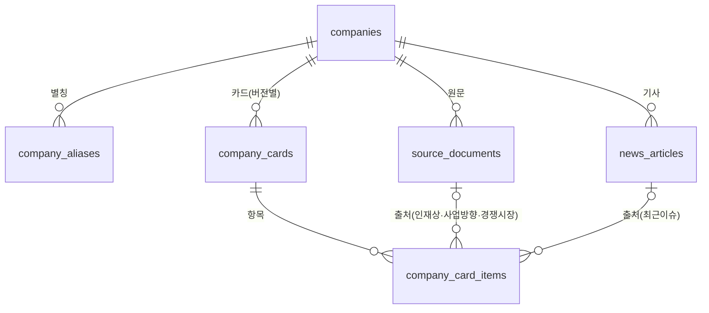

# 회사 카드 ERD

회사 카드 파이프라인 결과를 메인 DB에 저장할 테이블 설계다. API 명세 B-9의 "회사 요약 Table"에 해당한다.
ERDCloud 가져오기용 SQL은 [ERD-회사카드.sql](ERD-회사카드.sql)이다(ERDCloud가 잘 읽는 MySQL 문법).

## 흐름

파이프라인(교보재 EC2: Airflow·MinIO, [company-pipeline](../company-pipeline/pipeline/README.md))이 원문·기사·카드를 만들어 S3에 올리면, Python worker가 메인 DB(PostgreSQL)에 넣는다(적재는 고도화 때).
BE는 회사·회사별칭·회사카드·회사카드항목을 읽고, 카드항목의 출처는 원문기록·뉴스기사를 FK로 따라가 얻는다.



| 테이블 | 한국어 이름 | 하는 일 |
|---|---|---|
| companies | 회사 | 카드를 만드는 회사. DART 고유번호, 회사명, 상장 여부 |
| company_aliases | 회사별칭 | 지원서 회사명 검색·매칭용 이름 (네이버 → NAVER) |
| company_cards | 회사카드 | 카드 한 장. 프롬프트·모델 버전, 최신 여부. 만들 때마다 쌓인다 |
| company_card_items | 회사카드항목 | 카드 내용 한 줄: 인재상·사업방향·경쟁·시장·최근이슈, 원문 인용, 출처 |
| source_documents | 원문기록 | 받아 온 사업보고서·인재상 페이지 기록. 파일은 MinIO/S3 |
| news_articles | 뉴스기사 | 날마다 모으는 기사 제목·요약·링크(본문 없음), 같은 사건 묶음 번호 |

FK는 표에서 🔑로 표시했다. 상태 같은 종류 값은 팀 ERD 규칙대로 코드값 + 그룹코드 두 칸으로 공통코드를 참조한다.
`common_codes`는 팀 공통코드 테이블 자리표시라 실제 이름으로 바꾼다.

## 모든 테이블 공통 컬럼

| 논리명 | 물리명 | 타입 | NULL | 설명 |
|---|---|---|---|---|
| 생성일시 | created_at | DATETIME | NOT NULL | 생성 일시. 회사카드는 카드를 만든 시각, 원문기록·뉴스기사는 받아 온 시각이다 |
| 수정일시 | updated_at | DATETIME | NOT NULL | 수정 일시 (ON UPDATE CURRENT_TIMESTAMP) |
| 삭제일시 | deleted_at | DATETIME | NULL | 데이터가 삭제 처리된 시각이다. 삭제되지 않은 데이터는 비어 있다. |
| 삭제여부 | is_deleted | BOOLEAN | NOT NULL | 데이터가 삭제 처리되었는지 나타낸다. 삭제 처리 시 참으로 변경하고 삭제일시에 처리 시각을 기록한다. |

아래 표에는 공통 컬럼을 빼고 테이블마다 다른 컬럼만 적는다.

## 회사 `companies`

| 논리명 | 물리명 | 타입 | NULL | 설명 |
|---|---|---|---|---|
| 🔑 회사ID | id | INT | NOT NULL | 회사 ID |
| DART고유번호 | corp_code | VARCHAR(8) | NOT NULL | DART 공시 회사 고유번호 8자리. 중복 불가 |
| 회사명 | name | VARCHAR(100) | NOT NULL | DART에 등록된 회사명 (예: 삼성에스디에스). AI 명세 §7 companyName |
| 상장여부 | is_listed | BOOLEAN | NOT NULL | 종목코드가 있으면 참. 비상장사도 사업보고서를 내면 카드를 만든다 |
| 기사검색어 | news_query | VARCHAR(100) | NULL | 기사에서 부르는 이름이 회사명과 다를 때만 쓴다 (예: 삼성SDS, 네이버, 현대차) |

## 회사별칭 `company_aliases`

| 논리명 | 물리명 | 타입 | NULL | 설명 |
|---|---|---|---|---|
| 🔑 별칭ID | id | INT | NOT NULL | 별칭 ID |
| 🔑 회사 | company_id | INT | NOT NULL | 회사 FK |
| 별칭 | alias | VARCHAR(100) | NOT NULL | 사용자가 지원서에 쓸 수 있는 회사 이름. 띄어쓰기를 지우고 소문자로 맞춰 저장한다 (예: 네이버, naver, 삼성sds). 지원서 회사명(applications.company_name)을 회사에 잇는 데 쓴다. 중복 불가 |

## 회사카드 `company_cards`

| 논리명 | 물리명 | 타입 | NULL | 설명 |
|---|---|---|---|---|
| 🔑 카드ID | id | INT | NOT NULL | 카드 ID |
| 🔑 회사 | company_id | INT | NOT NULL | 회사 FK |
| 프롬프트버전 | prompt_version | VARCHAR(20) | NOT NULL | 카드를 만든 프롬프트 버전 (예: card-v4) |
| 모델 | model | VARCHAR(50) | NOT NULL | 카드를 만든 LLM (예: qwen3-8b-ctx) |
| 최신여부 | is_current | BOOLEAN | NOT NULL | BE가 읽을 최신 카드인지 나타낸다. 회사당 하나만 참이다 |

## 회사카드항목 `company_card_items`

| 논리명 | 물리명 | 타입 | NULL | 설명 |
|---|---|---|---|---|
| 🔑 카드항목ID | id | INT | NOT NULL | 카드 항목 ID |
| 🔑 카드 | card_id | INT | NOT NULL | 회사카드 FK |
| 순서 | seq | INT | NOT NULL | 같은 항목유형 안의 순서 (1부터). 카드·항목유형·순서 조합은 중복 불가 |
| 요약 | summary | VARCHAR(255) | NOT NULL | 항목 요약. 인재상은 키워드 |
| 원문인용 | quote | TEXT | NOT NULL | 근거 원문 문장 그대로. 원문에 있는지 검증을 통과한 것만 저장한다 |
| 🔑 출처원문 | source_document_id | INT | NULL | 원문기록 FK. 인재상(채용 페이지), 사업방향·경쟁시장(사업보고서) 항목에 채운다. 출처 제목·링크·날짜는 원문기록에서 가져온다 (AI 명세 §7 sources) |
| 🔑 출처기사 | news_article_id | INT | NULL | 뉴스기사 FK. 최근이슈 항목에 채운다. 출처원문·출처기사 중 하나만 채운다 |
| 같은사건기사수 | article_count | INT | NULL | 최근이슈만 쓴다. 카드를 만든 시점에 같은 사건을 다룬 기사 수이며 클수록 크게 다뤄진 이슈다. 사건묶음번호는 날마다 다시 계산되므로 이 값은 카드에 따로 남긴다 |
| 🔑 항목유형 | item_type | VARCHAR(50) | NOT NULL | 카드 항목 종류. CARD_ITEM_TYPE - TALENT(인재상) / DIRECTION(사업방향) / MARKET(경쟁·시장) / RECENT(최근이슈) |
| 🔑 항목유형그룹 | item_type_group | VARCHAR(50) | NOT NULL | 그룹코드 고정 'CARD_ITEM_TYPE' |

## 원문기록 `source_documents`

| 논리명 | 물리명 | 타입 | NULL | 설명 |
|---|---|---|---|---|
| 🔑 원문ID | id | INT | NOT NULL | 원문 ID |
| 🔑 회사 | company_id | INT | NOT NULL | 회사 FK |
| 원문제목 | title | VARCHAR(255) | NOT NULL | 예: 사업보고서 (2025.12), 미래에셋그룹 경영 철학. 카드항목 출처 제목으로 보인다 |
| 외부식별자 | external_id | VARCHAR(100) | NULL | DART 접수번호 등. 인재상 페이지는 비어 있을 수 있다 |
| 원문링크 | url | VARCHAR(500) | NULL | 원문 페이지 주소 |
| 저장위치 | storage_key | VARCHAR(500) | NULL | 원문 파일의 S3/MinIO 위치. 파일 자체는 DB에 넣지 않는다 |
| 공개일자 | published_at | DATE | NULL | 공시일 |
| 🔑 원문유형 | document_type | VARCHAR(50) | NOT NULL | 원문 종류. SOURCE_DOCUMENT_TYPE - ANNUAL_REPORT(사업보고서) / TALENT_PAGE(인재상 페이지) |
| 🔑 원문유형그룹 | document_type_group | VARCHAR(50) | NOT NULL | 그룹코드 고정 'SOURCE_DOCUMENT_TYPE' |

## 뉴스기사 `news_articles`

| 논리명 | 물리명 | 타입 | NULL | 설명 |
|---|---|---|---|---|
| 🔑 기사ID | id | INT | NOT NULL | 기사 ID |
| 🔑 회사 | company_id | INT | NOT NULL | 회사 FK |
| 기사제목 | title | VARCHAR(300) | NOT NULL | 기사 제목 |
| 기사요약 | summary | TEXT | NULL | 네이버 검색 API가 주는 1~2문장 요약. 저작권 때문에 본문은 저장하지 않는다 |
| 기사링크 | url | VARCHAR(500) | NOT NULL | 언론사 원문 링크. 없으면 네이버 뉴스 링크. 회사·링크 조합은 중복 불가 |
| 기사일자 | published_at | DATE | NOT NULL | 기사 날짜. 기사는 지우지 않고 쌓으며, 카드에는 최근 30일 기사만 쓴다(이 칸으로 거름) |
| 사건묶음번호 | event_group | INT | NULL | 같은 사건 기사끼리 같은 번호 (제목 임베딩 유사도 0.65 기준). 최근 30일 기사끼리 날마다 다시 계산한다. 그보다 오래된 기사는 마지막 번호가 그대로 남는다 |

## 공통코드에 추가할 값

| 그룹코드 | 코드 | 코드명 |
|---|---|---|
| CARD_ITEM_TYPE | TALENT | 인재상 |
| CARD_ITEM_TYPE | DIRECTION | 사업방향 |
| CARD_ITEM_TYPE | MARKET | 경쟁·시장 |
| CARD_ITEM_TYPE | RECENT | 최근이슈 |
| SOURCE_DOCUMENT_TYPE | ANNUAL_REPORT | 사업보고서 |
| SOURCE_DOCUMENT_TYPE | TALENT_PAGE | 인재상 페이지 |

## 팀과 정할 것

1. 지원서와 회사 연결: `applications`에 `company_id`(NULL 허용) 추가 vs 매번 `company_aliases`로 찾기
2. AI 명세 §7(요약 한 덩어리 + 출처 목록) 대신 항목별 출처 형식을 써도 되는지
3. 지난 카드 보관 기간
4. 중복 불가 조건과 소프트 삭제: 삭제 처리된 행이 남아 있으면 같은 별칭·고유번호를 다시 못 넣는다. 팀에서 이 경우를 어떻게 처리하는지 (삭제되지 않은 행만 중복 검사 등)
5. 레포 규칙과 차이: `V1__init.sql`은 `BIGINT IDENTITY`·`TIMESTAMPTZ`·소프트 삭제 없음이고 공통코드 테이블이 없다. 이 문서는 팀 ERD 규칙(INT·DATETIME·`is_deleted`·공통코드)을 따랐다. 마이그레이션 때 어느 쪽으로 맞출지

## 마이그레이션 때 추가할 제약 (PostgreSQL)

ERDCloud용 SQL(MySQL 문법)에는 넣지 못한 규칙이다. 실제 마이그레이션에는 넣는다.

```sql
-- 카드항목 출처는 원문기록·뉴스기사 중 하나만
ALTER TABLE company_card_items ADD CONSTRAINT ck_company_card_items_one_source
    CHECK ((source_document_id IS NULL) <> (news_article_id IS NULL));

-- 회사당 최신 카드는 하나만
CREATE UNIQUE INDEX uk_company_cards_current ON company_cards (company_id)
    WHERE is_current AND NOT is_deleted;

-- 카드항목 출처로 찾을 때 (PostgreSQL은 FK에 인덱스를 자동으로 만들지 않음)
CREATE INDEX ix_company_card_items_source_document ON company_card_items (source_document_id);
CREATE INDEX ix_company_card_items_news_article ON company_card_items (news_article_id);
```
