# S1 웹 · API 혼합 결과 (2026-11-02)

[부하 테스트 계획](../../이해준/load_test_plan/README.md) 6장의 S1 첫 회차다. 면접 없이 화면을 둘러보는 요청만 초당 수를 정해 5 → 30 → 60 req/s로 올렸다(가설 H4 · H5). 외부 API는 쓰지 않았다.

## 요약

- **먼저 막힌 곳은 FE(Next.js 서버 렌더링, Node 프로세스 1개)다(H5 맞음).** 30 req/s에서 FE CPU가 이미 0.95코어로 1코어를 거의 다 썼고, 60 req/s를 보내도 실제로는 **초당 약 39건**만 처리하며 p95가 **8초**로 늘었다
- BE · DB는 화면 조회만으로는 여유가 있다. 60 req/s 단계에서도 BE 평균 응답 4.9ms, BE CPU 0.67코어, DB 연결 풀 최대 3개 사용 · 대기 0(**H4는 조회만으로는 문제없음**)
- k6 쪽 오류는 끝까지 0건이다(요청 48,282개, 60초까지 기다림). 서버가 넘쳐도 오류를 내지 않고 **응답이 느려지는 쪽으로** 막힌다. 다만 서버 안 감시 검사(FE 첫 화면, 제한 5초)는 **60 req/s 단계 10분 내내 실패**였다. 새로 들어온 사용자 기준으로는 FE가 응답하지 않는 상태였다(4장)
- 한계(계획 5.1)

  | 한계 | 화면 요청/초 | 근거 |
  |---|---|---|
  | 지속 가능 한계(서버 CPU 평균 40%) | **약 19 req/s**(5와 30 사이를 이어 계산) | 5 req/s 18%, 30 req/s 56% |
  | 품질 한계(화면 p95 1.5초) | **30~39 req/s 사이** | 30 req/s p95 0.53초, 60 req/s를 보내면 39 req/s에서 포화 · p95 8초 |
  | 기능 한계(오류 1%) | k6 기준으로는 나오지 않음 | 60 req/s 단계도 오류 0. 단 감시 검사(5초 제한)는 60 req/s 단계에서 계속 실패 |

- **로그인이 몰리면 BE와 DB 풀이 막힌다(H3 · H4 신호).** 60 req/s로 올리는 순간 k6가 VU를 약 280개 늘리며 각 VU가 처음 한 번 로그인해, 5분 안에 로그인 약 296건이 몰렸다. 로그인 1건 평균 **30초**(최대 46초), DB 연결 풀 대기 최대 **52**, 서버 CPU 99%. S2(로그인 몰림)에서 제대로 잰다

## 1. 환경 · 방법

| 항목 | 값 |
|---|---|
| 시각 | 2026-11-02 13:22:27~13:55:35(1,988초) |
| 대상 | 테스트 서버 `https://lt.hangguet.co.kr`(EC2 `t3.xlarge`, 이미지 `e9874c74`) |
| 발생기 | 인프라 PC 1대, Docker k6 `2.3.0`, SSAFY 네트워크 |
| 스크립트 | `loadtest/scenarios/s1-web-mix.js`, 기본값(`RATES=5,30,60` · `HOLD=10m` · `RAMP=1m` · `MAX_VUS=300`) |
| 부하 모양 | `ramping-arrival-rate`: 단계마다 1분 동안 올리고 10분 유지. 응답이 느려져도 보내는 양을 줄이지 않는다 |
| 요청 | FE 화면으로 보낸다(`hk_access` 쿠키). 70%는 화면 이동과 같은 RSC 요청(`RSC: 1` + `_rsc`), 30%는 전체 HTML |
| 화면 비율 | 홈 25 · 기록 20 · 결과 20 · 마이페이지 15 · 성장 리뷰 10 · 다시보기 10(%). 모든 화면은 레이아웃에서 내 정보 · 공지도 부른다 |
| 계정 · 데이터 | 테스트 계정 4개, 계정마다 끝낸 화상 면접 3건(결과 · 다시보기 · 성장 리뷰가 실제 데이터를 그린다) |
| 서버 지표 | 서버 Prometheus. 단계 수치는 유지 10분 중 앞 1분을 뺀 9분(`server/resources.sh`). 화면은 테스트 서버 Grafana 대시보드 "A301 운영 서버" 캡처(4장), 단계 구간을 칠한 그래프는 부록(`report/charts.mjs`) |
| CPU 크레딧 | 확인하지 않음(서버를 만든 지 약 4시간). steal이 대부분 1% 아래라 크레딧이 바닥난 흔적은 없다 |

## 2. k6 결과(단계별)

| 단계 | 보낸 요청 | 실제 처리량 | 실패 | 평균 | 중앙값 | p95 | 최대 |
|---|---|---|---|---|---|---|---|
| 5 req/s | 3,000 | 5.0 req/s | 0 | 349ms | 341ms | **402ms** | 857ms |
| 30 req/s | 17,987 | 30.0 req/s | 0 | 385ms | 362ms | **528ms** | 2.79초 |
| 60 req/s | 23,619 | **39.4 req/s** | 0 | 7.34초 | 7.37초 | **8.0초** | 12.6초 |

- 60 req/s 단계는 VU 300개가 모두 응답을 기다려 **13,547건을 보내지 못했다**(`dropped_iterations`). 서버가 처리할 수 있는 양이 초당 약 39건에서 막혔다는 뜻이다
- 전체 최대 46.8초는 60 req/s로 올리는 구간(로그인 몰림, 5장)에서 나왔다
- 화면별 p95(전체 구간): 홈 7.82초 · 기록 7.78초 · 결과 7.83초 · 마이페이지 7.91초 · 성장 리뷰 7.71초 · 다시보기 7.86초. 60 req/s 단계가 섞여 모두 비슷하다. 화면 종류보다 **FE가 밀린 것**이 원인이다
- 5 · 30 req/s의 300ms대는 대부분 노트북 → Cloudflare → 서버 왕복 시간이다(S0의 API 응답도 300ms대)

## 3. 서버 자원(단계별)

| 단계 | 서버 CPU 평균(최대) | FE CPU | BE CPU | postgres CPU | steal 최대 | FE 메모리 최대 |
|---|---|---|---|---|---|---|
| 대기 | 9%(10%) | 0.00 | 0.00 | – | 0.4% | 89MB |
| 5 req/s | 18%(23%) | 0.19 | 0.09 | – | 0.6% | 109MB |
| 30 req/s | **56%**(64%) | **0.95** | 0.50 | – | 1.0% | 133MB |
| 60 req/s | **72%**(97%) | **1.19~1.27** | 0.67 | 약 0.26(그래프) | 4.7% | 215MB |

| 단계 | BE 요청/초 | 화면 1건당 BE 호출 | BE 평균 응답 | DB 풀 사용 최대 · 대기 최대 | DB 커밋/초 |
|---|---|---|---|---|---|
| 5 req/s | 32 | 6.4 | 3.6ms | 0 · 0 | 약 80 |
| 30 req/s | 195 | 6.5 | 3.9ms | 3 · 0 | 약 450 |
| 60 req/s | 263 | 6.7 | 4.9ms | 3 · 0 | 약 620 |

- **화면 1건당 FE CPU 약 0.03코어.** Node는 렌더링을 프로세스 하나에서 하므로 1코어 근처(약 30 req/s)가 실질 상한이다. 60 req/s에서 1.2코어대까지 간 것은 가비지 컬렉션 등 보조 스레드 몫이다
- **화면 1건당 서버 CPU 약 1.6%p**(대기 9% 위로). 이 중 FE가 절반 이상이고 BE · DB · Nginx · cloudflared가 나머지다
- BE는 화면 1건에 6~7번 불린다(레이아웃의 내 정보 · 공지 + 화면 데이터). 그래도 BE 응답은 5ms 안팎으로 빠르다
- 메모리는 문제가 아니다. FE 215MB(상한 512MB의 42%), BE 701MB(1280MB의 55%), 서버 전체 20%
- 서버 보내기 네트워크는 30 req/s에서 약 3Mbps, 60 req/s(실제 39)에서 약 4.1Mbps

## 4. Grafana 화면

테스트 서버 Grafana의 대시보드 "A301 운영 서버"를 S1 구간(13:20:27~13:56:35)으로 맞춰 패널별로 캡처했다. 대시보드는 rate()에 5분을 써서 단계가 바뀌는 곳이 완만하게 보인다. 단계 시각: 5 req/s 13:23:32~13:33:32, 30 req/s 13:34:32~13:44:32, 60 req/s 13:45:32~13:55:32(각 1분 올림 뒤 10분 유지).

### 서버 CPU 사용률

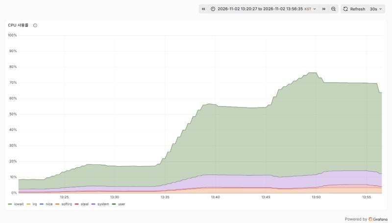

- 5 req/s 약 18%, 30 req/s 약 55%, 60 req/s 약 70%. 30 req/s에서 이미 기준치 40%를 넘는다. 대부분 user(앱 코드)이고 steal은 바닥에 붙어 있다

### Load average

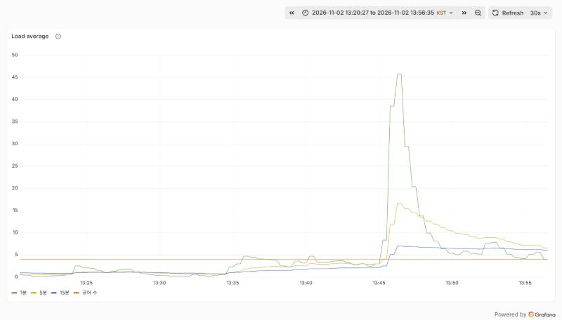

- 30 req/s까지는 코어 수(4) 근처다. 13:45~13:46 로그인 몰림 때 1분 평균이 **45**까지 치솟았다(실행을 기다리는 일이 코어의 11배). 60 req/s 유지 중에도 5~8로 코어 수를 넘는다

### 컨테이너별 CPU

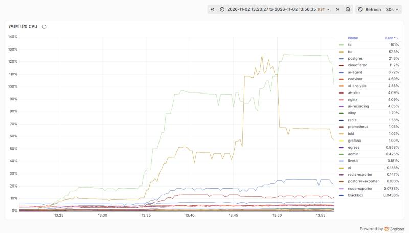

- **FE(연두)가 30 req/s에서 약 95%(1코어 가까이), 60 req/s에서 약 125%로 붙어 더 오르지 못한다.** 이것이 처리량 상한이다
- BE(주황)는 30 req/s에서 약 50%, 60 req/s 유지 중 약 65%. 13:45~13:50의 높은 구간(최대 약 125%)은 로그인 몰림이다(5분 평균이라 길게 보인다)
- postgres 약 20%, cloudflared 약 11% 순이다

### BE 프로세스 CPU 사용률

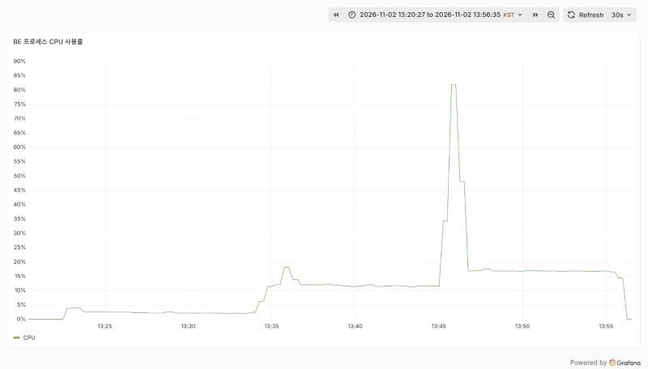

- 서버 전체 대비 비율이다. 30 · 60 req/s 유지 중 12~17%(0.5~0.7코어)인데, 로그인 몰림 때 **82%**(약 3.3코어)까지 튄다

### BE 요청 수 / 초

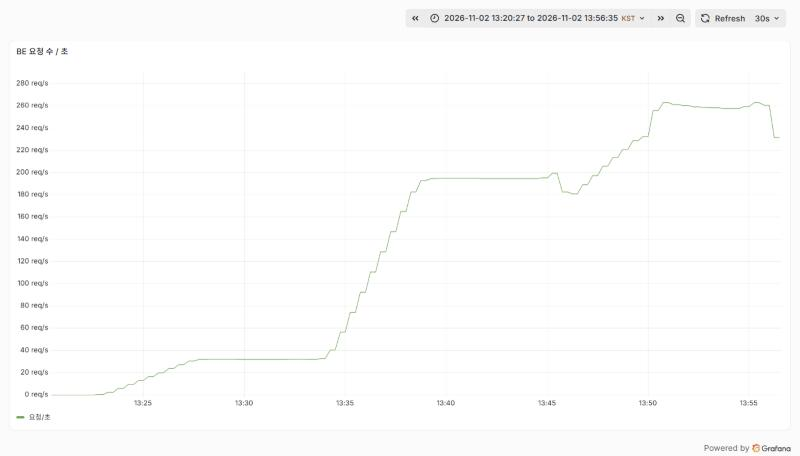

- 5 req/s → 약 32, 30 req/s → 약 195, 60 req/s(실제 39 화면/초) → 약 260. 화면 1건이 BE를 6~7번 부른다

### BE 평균 응답 시간

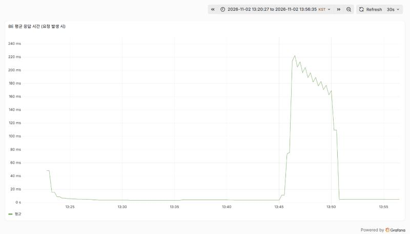

- 유지 구간은 바닥(약 4~5ms)이다. 로그인 몰림 때만 약 220ms로 오른다(5분 평균. 1분 평균으로는 약 2초)

### BE DB 연결 풀

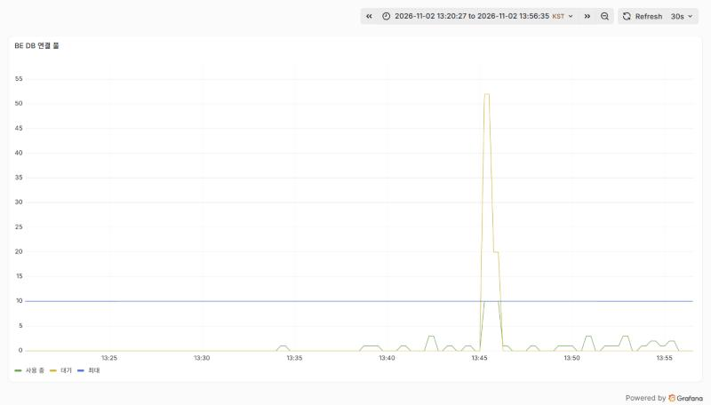

- 유지 구간은 사용 0~3개 · 대기 0이다. **13:45 로그인 몰림 때 대기가 52까지 쌓였다**(최대 10개)

### PostgreSQL 트랜잭션 / 초

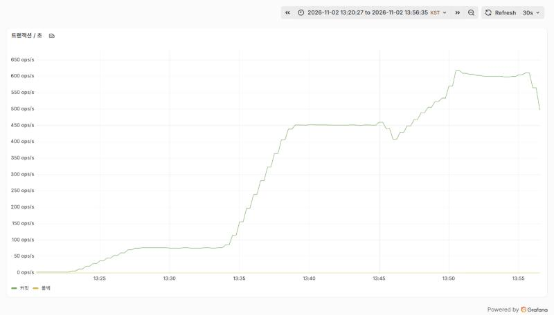

- 커밋 약 75 → 450 → 610. 롤백 0. DB는 여유가 있다(postgres CPU 약 20%)

### 컨테이너별 메모리

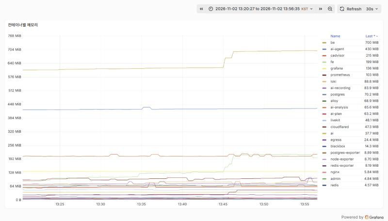

- BE 약 610 → 700MiB(상한 1280MB), FE 약 90 → 200MiB(상한 512MB). 메모리는 한계 요인이 아니다

### FE 첫 화면 응답 시간 · 실패(서버 안 감시 검사)

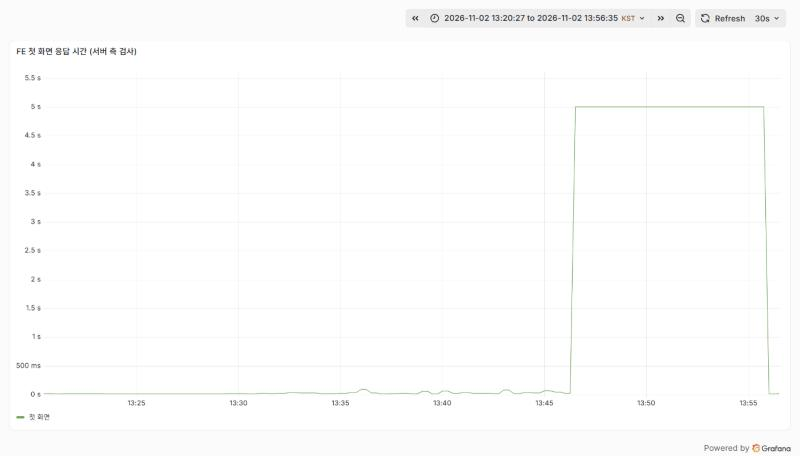

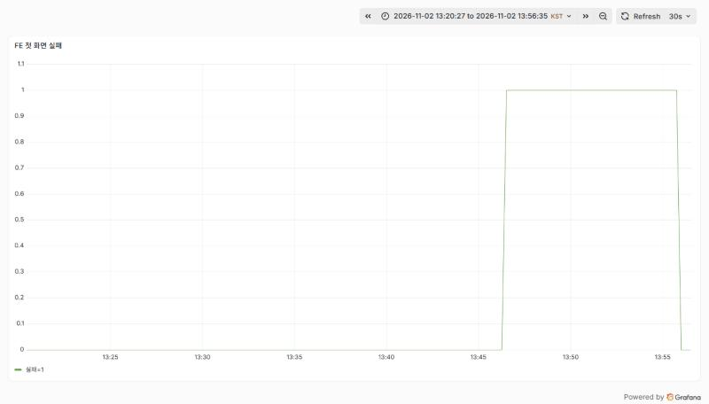

- 서버 안의 blackbox가 30초마다 FE 첫 화면을 열어 본다(제한 5초). 30 req/s까지는 수십 ms였다가, **60 req/s 단계 10분 내내 5초 제한에 걸려 "실패"였다**
- k6는 60초까지 기다려 오류 0으로 나왔지만, 새로 들어온 사용자는 첫 화면을 5초 넘게 기다렸다는 뜻이다. **감시 기준으로는 이 10분 동안 FE가 응답하지 않는 상태**였다

## 5. 로그인 몰림(60 req/s로 올리는 구간)

k6 `ramping-arrival-rate`는 응답이 느려지면 VU를 늘려 보내는 양을 맞춘다. 30 → 60 req/s로 올리자 FE가 밀리면서 VU가 약 20개에서 300개로 늘었고, 스크립트가 **새 VU마다 처음 한 번 로그인**하도록 되어 있어 로그인이 한꺼번에 몰렸다.

| 항목(13:43~13:48) | 값 |
|---|---|
| 로그인 | 약 296건(회차 전체 304건 중 대부분) |
| 로그인 응답 | 평균 **30초**, 최대 45.7초 |
| DB 연결 풀 | 10개 모두 사용, 대기 최대 **52** |
| BE 평균 응답(1분) | 62ms(평소 4~5ms) |
| 서버 CPU | 최대 99% |

- 비밀번호 해시(PBKDF2-SHA256 310,000회, H3)가 BE CPU를 쓰는 동안 DB 연결을 잡고 있어 풀이 비지 않은 것으로 보인다(H4). 1분에 수백 건의 로그인은 계획의 L2(1분에 100건)보다 많지만, 로그인이 몰리면 다른 API까지 느려진다는 신호다
- 테스트 설계에서 생긴 부작용이기도 하다. 다음 S1 회차는 로그인을 시작 전에 끝내 두고(토큰을 VU끼리 나눠 씀) 화면 부하만 보도록 고친다. 로그인 몰림은 S2에서 따로 잰다

## 6. 가설 판단

| 가설 | 판단 | 근거 |
|---|---|---|
| H5 FE 서버 렌더링이 먼저 막힌다 | **맞음** | FE CPU 30 req/s 0.95코어 → 60 req/s 1.2코어대에서 포화, 처리량 39 req/s에서 멈춤 · p95 8초, FE 첫 화면 감시 검사 10분 내내 실패. BE · DB는 여유 |
| H4 요청마다 회원 조회 + 풀 10개라 풀 대기가 생긴다 | **조회만으로는 틀림, 로그인 몰림 때는 맞음** | 유지 구간 풀 사용 최대 3 · 대기 0. 로그인 몰림 때 대기 52 |
| H3 로그인이 몰리면 CPU를 다 쓴다 | 신호 있음(S2에서 확인) | 로그인 약 296건/5분에 로그인 평균 30초, 다른 BE 응답도 느려짐 |
| H12 Cloudflare가 발생기 요청을 막는다 | 틀림 | IP 하나에서 초당 39~60건을 30분 넘게 보냈지만 403 · 429 없음(오류 0) |

## 7. 해석 · 다음

- **화면 조회만으로는 이 서버의 상한이 초당 약 30~39 화면이다.** 2초 폴링(질문 준비 · 결과 분석 대기)도 같은 FE 화면 다시 그리기라 사용자 1명이 기다리는 동안 0.5 req/s를 쓴다. 단순 계산으로 화면을 기다리는 사용자 약 60명이면 FE가 찬다
- 화면 부하만으로 서버 CPU가 30 req/s에서 56%다. 여기에 화상 면접(1건당 서버 CPU 약 8%p, [S0 보고서](s0-2026-11-02.md) 7장)이 더해지면 같은 4코어를 나눠 쓴다. 예를 들어 화면 15 req/s(약 33%) + 면접 4건(약 32%)이면 이미 70% 근처다
- 스케일 아웃 후보(대응은 이 문서 범위 밖)
  - **FE**: Node 프로세스를 늘리거나(여러 컨테이너 · 클러스터), FE만 다른 서버로 뺀다. 1코어당 약 30 req/s
  - 화면 렌더링 줄이기: 폴링 간격 · 캐시 · 정적으로 그릴 수 있는 부분
  - 로그인: 해시 비용 · 해시 중 DB 연결을 잡는지 확인(S2)
- 다음 회차
  - **S1 다시**: 로그인을 시작 전에 끝내고, 30~40 req/s 사이를 촘촘하게(예: 30 · 35 · 40) 올려 품질 한계를 좁힌다
  - **S2 로그인 몰림**: 이번에 본 로그인 30초가 몇 건/분부터 생기는지 잰다

## 부록 A: 단계 구간을 칠한 그래프

Grafana 대시보드와 같은 질의를 rate 1분(컨테이너 CPU는 2분)으로 다시 그려 단계 구간을 색으로 표시했다(`report/charts.mjs`). Grafana 화면보다 단계 경계가 또렷하다.

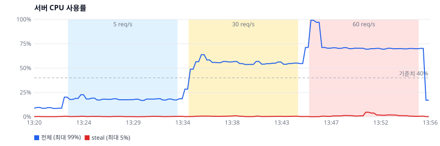
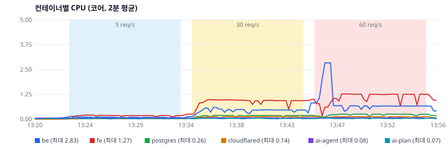
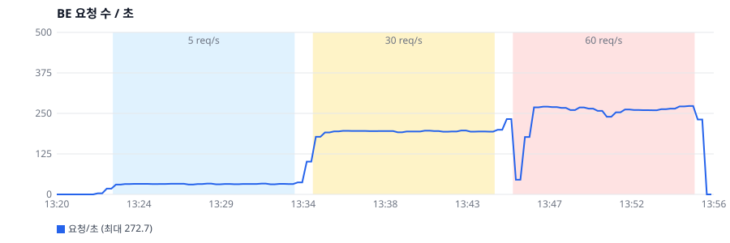
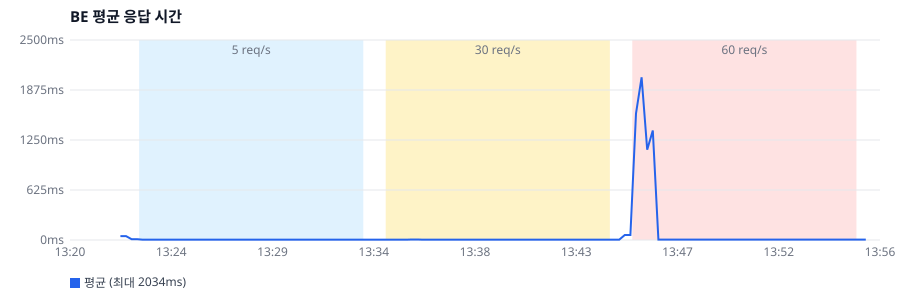
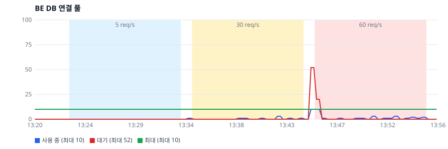
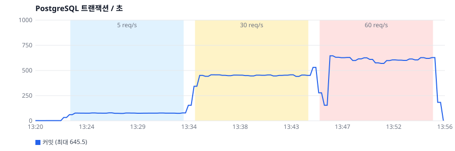
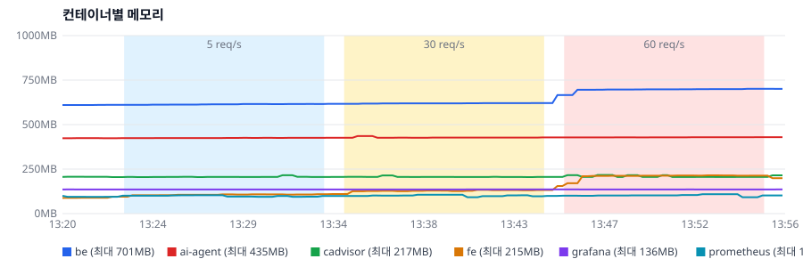
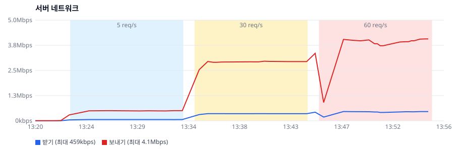

## 부록 B: 다시 보는 법

Grafana 패널 하나만 크게(메뉴 없이) 여는 주소: `https://grafana-lt.hangguet.co.kr/d/a301-prod?from=1793593227000&to=1793595395000&timezone=Asia%2FSeoul&viewPanel=panel-<패널 id>&kiosk&theme=light`. 이 보고서의 패널 id: CPU 사용률 112 · Load average 113 · 컨테이너별 CPU 141 · BE 프로세스 CPU 13 · BE 요청 수 3 · BE 평균 응답 4 · BE DB 연결 풀 11 · 트랜잭션 134 · 컨테이너별 메모리 143 · FE 첫 화면 16 · FE 첫 화면 실패 17.

```bash
bash loadtest/run.sh scenarios/s1-web-mix.js
node loadtest/report/charts.mjs 1793593227 1793595395 loadtest/report/img/s1-2026-11-02 \
  '[{"from":1793593412,"to":1793594012,"label":"5 req/s"},{"from":1793594072,"to":1793594672,"label":"30 req/s"},{"from":1793594732,"to":1793595332,"label":"60 req/s"}]'
```

서버에서 단계별 자원: `bash ~/a301/loadtest/server/resources.sh 9m <끝 유닉스초>`(5 req/s `1793593997` · 30 req/s `1793594657` · 60 req/s `1793595317`, 대기 `5m 1793593337`). 테스트 서버를 지우기 전까지만 다시 볼 수 있다.
