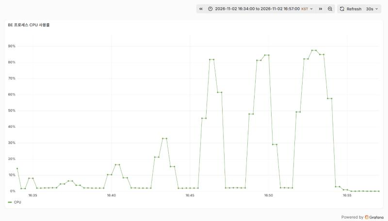
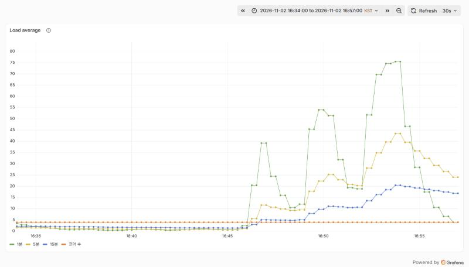
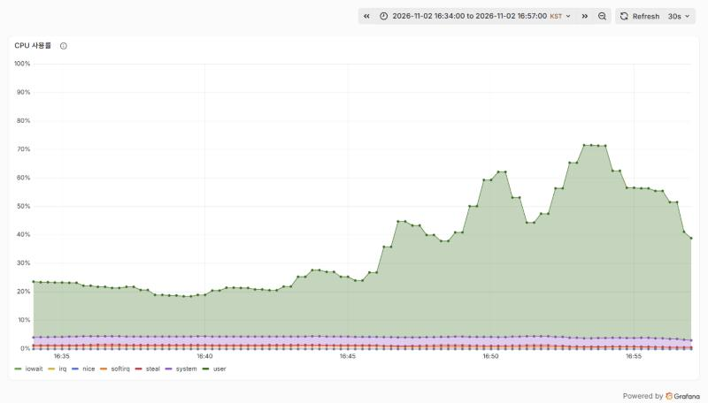
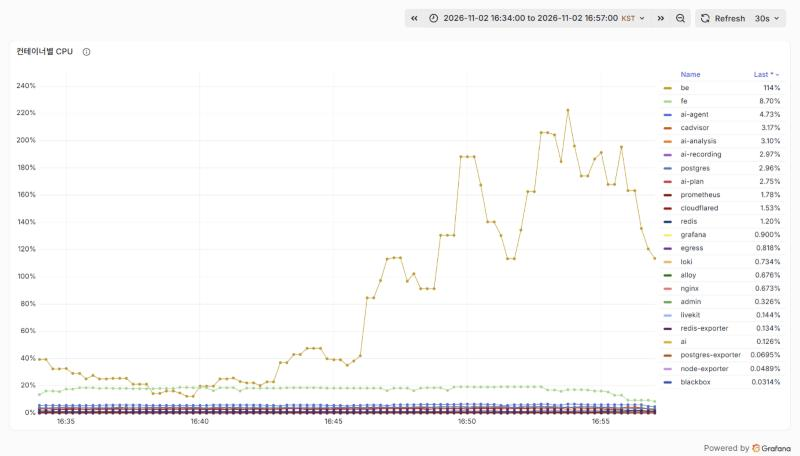
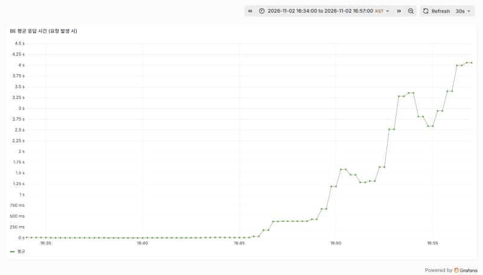
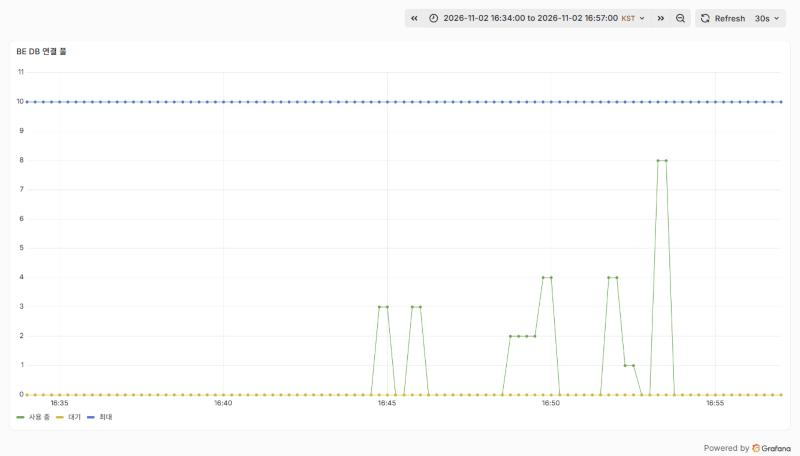
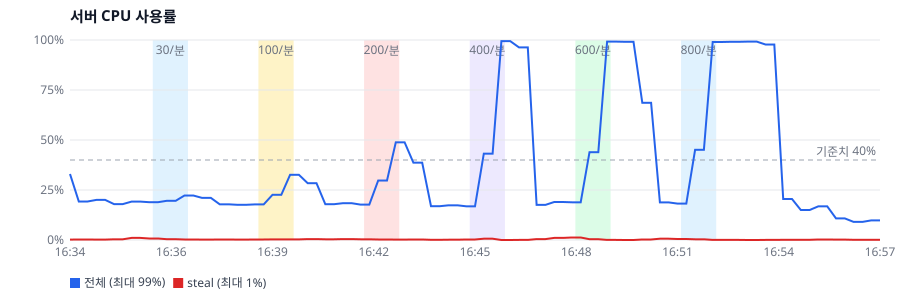
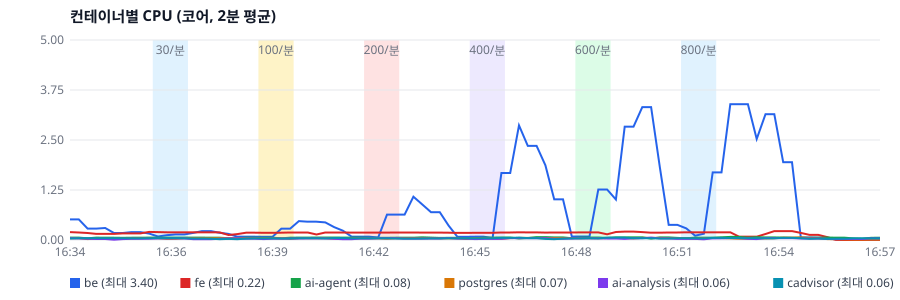
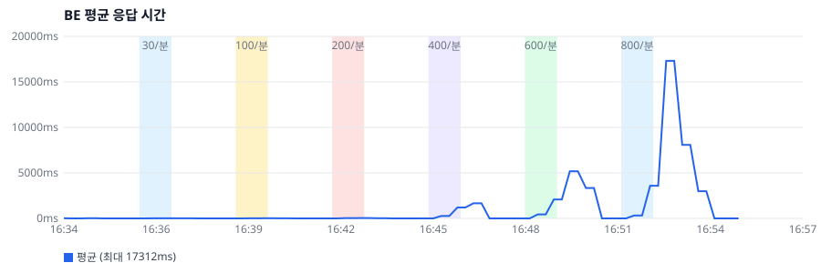
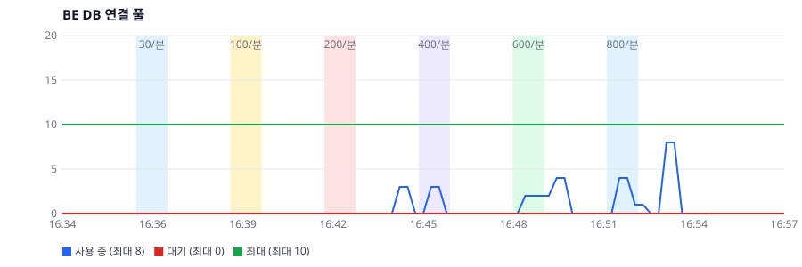

# S2 로그인 몰림 결과 (2026-11-02)

[부하 테스트 계획](../../이해준/load_test_plan/README.md) 6장의 S2 첫 회차다. 1분 동안 로그인 N건을 고르게 보내는 단계를 분당 30 · 100 · 200 · 400 · 600 · 800건으로 올리고, 같은 시간에 S1 화면 부하를 L1(5 req/s)로 깔아 다른 화면이 같이 느려지는지 봤다(가설 H3). 외부 API는 쓰지 않는다.

## 요약

- **로그인 처리 상한은 분당 약 290~340건(초당 5~6건)이다.** 그 위로 보내면 처리량은 늘지 않고 기다리는 줄만 길어진다. 로그인 1건이 서버에서 0.35초(비밀번호 해시 PBKDF2 310,000회)이고, 몰리면 BE가 CPU 약 3.3~3.5코어 · 서버 CPU 99%를 쓴다
- **H3 맞음: 로그인이 몰리면 다른 화면도 같이 느려진다.** 배경 화면 p95가 0.42초(기준)에서 분당 400건 0.61초 → 600건 **5.6초** → 800건 **42초**가 됐다. 로그인 요청이 CPU와 BE 요청 스레드(Tomcat 200개)를 다 차지해 다른 요청이 줄을 선다. 800건에서는 처리 중 요청이 200개(스레드 상한)에 닿았다
- **DB 연결 풀은 원인이 아니다(H4 아님).** 풀 대기는 내내 0, 사용 중 최대 8/10이다. 비밀번호 확인 중에는 DB 연결을 잡지 않는다(OSIV 꺼짐)
- **로그인은 몰리지 않아도 1초 기준에 가깝다.** 부하가 거의 없을 때도 로그인 p95가 0.75~0.82초다(서버 0.35초 + 노트북 → Cloudflare → 서버 왕복 약 0.3초)
- 한계(계획 5.1)

  | 한계 | 분당 로그인 | 근거 |
  |---|---|---|
  | 품질 한계(로그인 p95 ≥ 1초) | **200~400건 사이(처리 상한 약 290건)** | 200건 p95 0.90초, 400건 p95 15.6초 |
  | 품질 한계(다른 화면 p95 ≥ 1.5초) | **400~600건 사이** | 400건 0.61초, 600건 5.6초 |
  | 기능 한계(오류율 ≥ 1%) | **800건** | 로그인 11.9% 실패(k6 60초 제한 초과), 배경 화면 실패는 0 |
  | 지속 가능 한계 | 해당 없음 | 1분짜리 몰림이라 10분 평균으로 보지 않는다. 몰리는 동안 서버 CPU는 99% |

## 1. 환경 · 방법

| 항목 | 값 |
|---|---|
| 시각 | 2026-11-02 16:34:21~16:54:21(단계별 시각은 부록) |
| 대상 | 테스트 서버 `https://lt.hangguet.co.kr`(EC2 `t3.xlarge` 4 vCPU, 이미지 `e9874c74`) |
| 스크립트 | `loadtest/scenarios/s2-login-burst.js`(`LOGINS=30,100,200,400,600,800`) |
| 로그인 | 단계마다 1분 동안 `constant-arrival-rate`로 고르게 보낸다. 단계 사이 2분 쉰다. 계정 300개(101~400번, 지원서 없음)를 단계마다 다른 곳부터 돌려 쓴다 |
| 배경 부하 | S1 화면 둘러보기(`lib/web-mix.js`) 5 req/s, 계정 1~4. 로그인 전 2분은 배경만 돌아 기준값(`base`)을 만든다 |
| 발생기 | 인프라 노트북 1대, Docker k6 `2.3.0`. 400건 이상 단계에서 k6가 VU를 늦게 만들어 **보내지 못한 로그인**이 있다(2장). 스크립트는 고쳤다 |
| 네트워크 | SSAFY 네트워크 → Cloudflare → Tunnel |
| 서버 지표 | Prometheus에서 15초 간격으로 BE 로그인 처리량 · 서버 쪽 로그인 시간 · 처리 중 요청 · DB 풀을 뽑았고(`results/s2-be-timeline.txt`), 단계마다 2분(로그인 1분 + 밀린 처리 1분) 서버 자원을 `server/resources.sh`로 요약했다 |

## 2. 단계별 결과(k6)

| 분당 로그인 | 보낸 로그인 | 버림(발생기) | 로그인 p95 | 로그인 평균(최대) | 로그인 실패 | **배경 화면 p95** | 배경 화면 실패 |
|---|---|---|---|---|---|---|---|
| 배경만 | – | – | – | – | – | 0.42초 | 0 |
| 30 | 30 | 0 | 0.82초 | 0.70초(0.90초) | 0 | 0.40초 | 0 |
| 100 | 101 | 0 | 0.75초 | 0.69초(1.29초) | 0 | 0.39초 | 0 |
| 200 | 201 | 0 | 0.90초 | 0.74초(1.08초) | 0 | 0.43초 | 0 |
| 400 | 350 | 51 | **15.6초** | 10.3초(17.3초) | 0 | 0.61초 | 0 |
| 600 | 430 | 171 | **40.3초** | 26.8초(50.3초) | 0 | **5.6초** | 0 |
| 800 | 536 | 265 | **60초(제한)** | 40.1초(60초) | **64(11.9%)** | **41.9초** | 0 |

- 로그인 실패 64건은 모두 k6 요청 제한(60초)을 넘긴 것이다. 서버가 거절한 것이 아니라 줄을 서다 시간이 다 됐다. 실제 사용자는 그 전에 다시 누르거나 떠날 가능성이 크다
- **버림**: `constant-arrival-rate`가 실행 중에 VU를 새로 만드는 동안 보낼 차례의 로그인을 버렸다. 그래서 400 · 600 · 800건 단계에 실제로 보낸 양은 분당 약 350 · 430 · 536건이다. 이것도 서버 처리 상한(약 290~340건)보다 많아서 결론은 같다. 다음 실행부터는 VU를 미리 넉넉히 만든다
- 배경 화면은 실패 없이 느려지기만 했다. 800건 단계 배경 요청이 252개로 줄어든 것(다른 단계 300개)은 응답이 느려 그 단계 안에 끝나지 못한 요청이 있어서다

## 3. 서버 쪽(BE · 자원)

| 분당 로그인 | 서버 CPU 평균(최대) | BE CPU 최대 | **로그인 처리량 최대(분당)** | 서버 쪽 로그인 시간(1분 평균, 최대) | 처리 중 요청 최대 | Load 1분 최대 | DB 풀 대기 |
|---|---|---|---|---|---|---|---|
| 배경만 | 19%(20%) | 0.08코어 | – | – | 0 | 약 1 | 0 |
| 30 | 20%(22%) | 0.26코어 | 30 | 0.35초 | 0 | 약 1 | 0 |
| 100 | 25%(33%) | 0.66코어 | 100 | 0.35초 | 0 | 약 1 | 0 |
| 200 | 34%(49%) | 1.31코어 | 200 | 0.42초 | 2 | 약 2 | 0 |
| 400 | 64%(99%) | 3.28코어 | **288** | 13.3초 | 71 | 39 | 0 |
| 600 | 65%(99%) | 3.39코어 | **284** | 32.4초 | 180 | 54 | 0 |
| 800 | 65%(99%) | 3.50코어 | **396**(밀린 처리 포함 순간값) | 36.6초 | **200**(스레드 상한) | 75 | 0 |

- 서버 CPU 평균은 단계마다 2분(로그인 1분 + 밀린 처리 1분)이다. 로그인이 몰린 동안은 99%다
- BE CPU는 BE 프로세스 CPU 사용률 × 4코어(15초 간격 최대값)다. 서버 쪽 로그인 시간 · 처리량은 BE 요청 지표(`http_server_requests_seconds{uri="/api/v1/auth/login"}`)다
- **처리량이 분당 약 290건에서 멈춘다.** 400건이든 600건이든 서버가 끝낸 로그인은 분당 약 285~290건이다(800건은 줄이 길어 단계가 끝난 뒤까지 처리해 순간값이 더 높다). 몰리지 않을 때 로그인 1건은 0.35초인데, 몰리면 BE가 3.3코어를 쓰면서도 초당 약 4.8건만 끝낸다(1건에 CPU 약 0.7초). `t3.xlarge`의 4 vCPU는 물리 코어 2개의 하이퍼스레드라 해시처럼 계산만 하는 일은 vCPU 4개만큼 빨라지지 않는 것으로 보인다(추정)
- **다른 화면이 느려지는 방식**: 로그인 요청이 들어온 만큼 BE 요청 스레드가 해시 계산을 기다리며 쌓인다(처리 중 요청 71 → 180 → 200). 200개는 Tomcat 기본 상한이라 800건에서는 새 요청이 스레드를 받으려고 줄을 선다. 그래서 BE 자체 측정(요청을 받은 뒤부터)으로 다른 API 평균은 최대 약 0.2초인데, 화면 p95는 42초까지 늘었다
- DB 풀 대기는 모든 단계에서 0이다. S1 보고서 5장의 "로그인 몰림 때 DB 풀 대기 52"는 이번에 다시 나오지 않았다. S1은 로그인 직후 각 VU가 달력 · 목록 조회를 한꺼번에 보내는 흐름이었다(차이는 S6에서 다시 본다)
- 메모리는 거의 그대로다(BE 698 → 745MB, 상한 대비 58%)

## 4. Grafana 화면

테스트 서버 Grafana "A301 운영 서버"를 16:34~16:57로 캡처했다. 로그인 단계: 16:36 30건 · 16:39 100건 · 16:42 200건 · 16:45 400건 · 16:48 600건 · 16:51 800건(각 1분). 대시보드는 rate()에 5분을 써서 값이 완만하다(1분 단위 그래프는 부록).

### BE 프로세스 CPU 사용률



- 4코어 대비 비율이다. 200건 33%, 400 · 600 · 800건은 82~87%로 같은 높이에서 멈춘다. 더 보내도 BE가 더 쓰지 못한다

### Load average



- 1분 평균이 400건 39 · 600건 54 · 800건 75(코어 4). 해시 계산을 기다리는 스레드가 그만큼 쌓였다

### 서버 CPU 사용률



- 5분 평균이라 몰림 1분이 퍼져 보인다(최대 약 71%). 1분 단위로는 99%다(부록)

### 컨테이너별 CPU



- 노랑이 BE다. 다른 컨테이너는 거의 그대로다. 로그인 몰림은 BE 혼자 CPU를 쓰는 일이다

### BE 평균 응답 시간



- 400건부터 오르기 시작해 800건 뒤 약 4초까지 올라간다(5분 평균, 로그인 포함)

### BE DB 연결 풀



- 대기(노랑) 0, 사용 중 최대 8/10이다. 풀은 막히지 않았다

## 5. 가설 판단

| 가설 | 판단 | 근거 |
|---|---|---|
| H3 로그인이 몰리면 비밀번호 해시가 CPU를 다 쓴다(로그인뿐 아니라 모든 API가 느려진다) | **맞음** | 분당 약 290건에서 BE가 3.3~3.5코어 · 서버 CPU 99%로 처리량이 멈춤. 배경 화면 p95 0.42초 → 5.6초(600건) → 42초(800건) |
| H4 커넥션 풀 대기 | **로그인 몰림에서는 틀림** | 풀 대기 0, 사용 중 최대 8/10 |

## 6. 발견한 것

1. **로그인 몰림을 막는 장치가 없다.** 로그인 요청이 들어오는 대로 스레드를 받아 해시 계산을 시작하므로, 상한(분당 약 290건)을 넘으면 로그인 하나하나가 느려질 뿐 아니라 다른 모든 요청이 같은 CPU · 스레드를 두고 경쟁한다. 동시에 계산하는 로그인 수를 코어 수 정도로 제한하면(나머지는 줄을 세우거나 바로 "잠시 후 다시" 응답) 다른 화면은 지킬 수 있다
2. **해시 비용이 로그인 상한을 정한다.** PBKDF2-SHA256 310,000회는 Spring Security 5.8 기본값이다. 보안 권장(반복 수를 더 높이는 쪽)과 맞물려 있어 반복 수를 낮추는 것은 보안 파트와 같이 정해야 한다
3. **로그인은 혼자서도 무겁다.** 부하 없이 서버 0.35초 · 사용자 기준 0.7~0.8초다. 화면 이동(서버 4ms 안팎)과 비교하면 요청 1건이 약 100배 CPU를 쓴다
4. 이 상한을 실제 상황으로 옮기면 "1분 안에 약 300명이 로그인"이다. 발표 직후처럼 사람이 한꺼번에 들어오는 순간(S6 L2 "발표 직후")이 여기에 걸린다. 액세스 토큰이 만료돼 다시 로그인하는 흐름(S1의 `relogins`)도 같은 비용을 쓴다

## 7. 해석 · 다음

- **지금 구성의 로그인 한계는 분당 약 290건이다.** 그 아래(분당 200건)에서는 로그인 p95 0.9초 · 다른 화면 영향 없음, 그 위에서는 로그인 대기가 10초 이상으로 뛰고 분당 600건부터 다른 화면도 쓸 수 없을 만큼 느려진다
- 스케일 아웃 · 개선 후보(대응은 이 문서 범위 밖)
  - **BE 여러 대**: 로그인 상한은 BE가 쓸 수 있는 CPU에 비례한다. 같은 서버 안에서 BE를 늘려도 CPU를 나눠 쓰므로 서버를 나누거나 키워야 한다
  - **로그인 동시 계산 수 제한**: 다른 화면을 지키는 가장 작은 변경(BE)
  - **해시 비용**: 보안 파트와 함께 판단
- 다음 회차
  - **S2 다시(선택)**: 고친 스크립트로 분당 250 · 300 · 350건을 촘촘히 돌려 상한을 좁힌다
  - **S6 혼합**: S1 · S2 · S4 · S5를 함께. 이번 결과로 보면 로그인 몰림이 면접 진행(에이전트 · 녹화)과 CPU를 나눠 쓰는 것이 가장 위험하다

## 부록: 단계별 시각 · 다시 보는 법

| 단계 | 로그인 시작 | 로그인 끝 |
|---|---|---|
| 배경만 | 16:34:21 | 16:36:21 |
| 30건/분 | 16:36:21 | 16:37:21 |
| 100건/분 | 16:39:21 | 16:40:21 |
| 200건/분 | 16:42:21 | 16:43:21 |
| 400건/분 | 16:45:21 | 16:46:21 |
| 600건/분 | 16:48:21 | 16:49:21 |
| 800건/분 | 16:51:21 | 16:52:21 |

단계 구간을 색으로 칠한 그래프(Grafana와 같은 질의, rate 1분 · 컨테이너 CPU 2분):






```bash
COUNT=300 START=101 WITH_APPLICATION=0 ACCOUNTS_FILE=seed/accounts-s2.json bash loadtest/run.sh seed/seed.js
bash loadtest/run.sh scenarios/s2-login-burst.js
node loadtest/report/charts.mjs 1793604840 1793606220 loadtest/report/img/s2-2026-11-02 '<단계 JSON>'
```

Grafana 패널 주소: `https://grafana-lt.hangguet.co.kr/d/a301-prod?from=1793604840000&to=1793606220000&timezone=Asia%2FSeoul&viewPanel=panel-<id>&kiosk&theme=light`. 패널 id: CPU 112 · Load 113 · 컨테이너 CPU 141 · BE 프로세스 CPU 13 · BE 평균 응답 4 · BE DB 연결 풀 11. k6 원본 출력은 `loadtest/results/s2-full.log`, BE 지표 15초 흐름은 `loadtest/results/s2-be-timeline.txt`(커밋하지 않음)에 있다.
