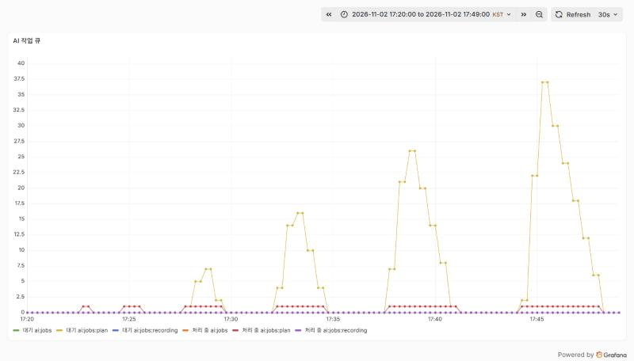
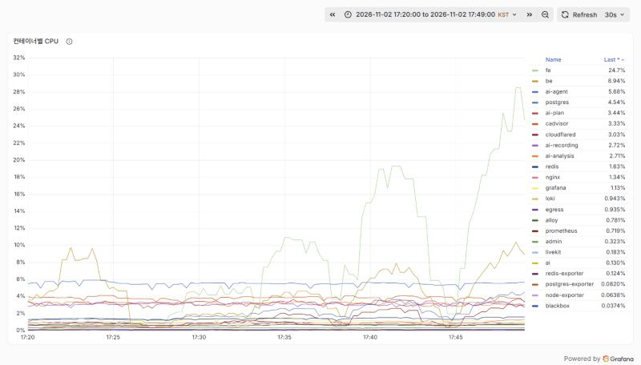

# S4 면접 만들기 몰림 결과 (2026-11-02)

[부하 테스트 계획](../../이해준/load_test_plan/README.md) 6장의 S4 첫 회차다. 단계마다 1분 동안 면접 N건을 만들고(5 · 10 · 20 · 30 · 40 · 50건), 사용자마다 질문 준비가 끝날 때까지 장치 점검 화면을 화면처럼 2초마다 다시 그렸다(가설 H1 · H5). 질문 준비는 실제 GMS를 불렀다. 면접 시작(5.4)은 하지 않아 에이전트 · TTS · STT는 쓰지 않았다.

## 요약

- **H1 맞음: 질문 준비가 한 줄로 선다.** ai-plan 작업자 1개가 1건씩 GMS를 2번(약 2.5초씩) 불러 질문 준비 1건이 약 5초, **처리량은 분당 약 12건**이다. 1분에 그보다 많이 만들면 줄이 쌓여 마지막 사용자의 질문 준비 시간이 7.6초(10건) → 48초(20건) → 100초(30건) → 145초(40건) → **182초(50건)**로 늘었다
- **기능 한계는 1분에 약 45~50건이다.** 질문 준비는 요청부터 3분이 마감이라, **50건에서 2건이 `FAILED(TIMED_OUT)`**("면접 준비에 실패했어요")가 됐다. 대기열 최대 37건
- **GMS와 서버는 원인이 아니다.** GMS 1번 호출은 몰려도 평균 2.4~2.7초로 그대로였다(한 번에 1건씩만 부르므로 GMS 쪽은 몰림이 아니다). 서버 CPU는 최대 28%, ai-plan은 0.05코어 이하다
- **H5(폴링이 FE를 쓴다)는 신호만 있다.** 기다리는 사용자가 늘수록 FE CPU가 0.01 → 0.42코어로 오르고 화면 다시 그리기 p95가 0.38초 → 1.15초(50건)로 늘었다. 품질 기준(1.5초)은 넘지 않았다. 기다리는 사람이 많아질수록(줄이 길수록) 폴링도 길어져 두 문제가 겹친다
- 한계(계획 5.1)

  | 한계 | 1분에 만든 면접 | 근거 |
  |---|---|---|
  | 기능 한계(질문 준비 마감 3분 초과) | **50건(계산상 약 45~48건)** | 50건 중 2건 `TIMED_OUT` |
  | 품질 한계(화면 p95 ≥ 1.5초) | 50건까지 안 나옴 | 50건 p95 1.15초(오르는 중) |
  | 지속 가능 한계 | 해당 없음 | 서버 CPU 최대 28% |
  | **계속 만들 때의 상한** | **분당 약 12건** | 그 이상이 몇 분 이어지면 대기열이 끝없이 늘어 3분 마감을 넘긴다 |

## 1. 환경 · 방법

| 항목 | 값 |
|---|---|
| 시각 | 2026-11-02 17:21:49~17:48:05(단계별 시각은 부록) |
| 대상 | 테스트 서버 `https://lt.hangguet.co.kr`(EC2 `t3.xlarge`, 이미지 `e9874c74`) |
| 스크립트 | `loadtest/scenarios/s4-plan-burst.js`(`RATES=5,10,20,30,40,50`) |
| 만들기 | 단계마다 1분 동안 `constant-arrival-rate`로 고르게 5.1(커피챗 · 화상)을 부른다. 단계 사이는 줄이 빠질 시간 + 1분 쉰다 |
| 기다리기 | 화면(`plan-progress.tsx`)처럼 `/practice/devices?sessionId=…`를 처음엔 전체 HTML, 그 뒤 2초마다 RSC로 다시 그린다. 응답의 `planStatus`가 `GENERATING`이 아니면 끝 |
| 계정 | S2 계정 앞 30개(S3에서 만든 지원서 사용)를 돌려 쓴다. setup에서 미리 로그인 |
| 외부 API | 실제 GMS(질문 준비 1건에 2번: 주장 추출 → 질문 생성) |
| 발생기 | 인프라 노트북 1대, Docker k6 `2.3.0` |
| 서버 쪽 | ai-plan 로그(작업 시작 `waitMs` = 큐 대기, GMS 호출 시간, `TIMED_OUT`), `server/resources.sh`, Grafana |

질문 준비 흐름(코드): BE가 `ai:jobs:plan`에 넣는다 → **ai-plan 작업자 1개**가 하나씩 꺼내 GMS를 부른다 → 진행률 50%, 완료를 결과 큐로 보낸다. **요청 시각부터 180초**(`PLAN_TIMEOUT_SECONDS`, 큐 대기 포함)가 지나면 GMS를 부르기 전에 멈추고 `TIMED_OUT`으로 실패시킨다.

## 2. 단계별 결과(k6)

| 1분에 만든 면접 | 질문 준비 성공 | 실패 | 질문 준비 중간값 | p95 | 최대 | 화면 다시 그리기 p95 |
|---|---|---|---|---|---|---|
| 5 | 6 | 0 | 7.4초 | 7.7초 | 7.8초 | 0.44초 |
| 10 | 10 | 0 | 5.1초 | 7.5초 | 7.6초 | 0.50초 |
| 20 | 20 | 0 | 26.1초 | 47.3초 | 48.0초 | 0.40초 |
| 30 | 30 | 0 | 53.0초 | 94.7초 | 99.5초 | 0.38초 |
| 40 | 41 | 0 | 79.6초 | 139.0초 | 145.3초 | 0.81초 |
| 50 | 48 | **2** | 91.2초 | 173.5초 | **181.7초** | **1.15초** |

- 질문 준비 시간은 사용자 기준(면접 만들기 뒤 화면에 준비 완료가 보일 때까지)이다. 2초 폴링이라 최대 2초 늦게 본다
- `constant-arrival-rate`가 5 · 40건 단계에 1건씩 더 보냈다(6 · 41건)
- 면접 만들기(5.1) · 화면 요청 실패는 0이다(4,358개). 폴링 요청 3,984개
- 실패 2건은 화면에 "면접 준비에 실패했어요"와 [다시 시도]가 나오는 상태다(5.3으로 다시 요청하면 또 줄 끝에 선다)

## 3. 서버 쪽

### 3.1 질문 준비 큐(ai-plan 로그)

| 1분에 만든 면접 | 작업 | 큐 대기 중간값 | 큐 대기 최대 | GMS 호출 | GMS 1번 평균(최대) | 1건 GMS 합 | `TIMED_OUT` |
|---|---|---|---|---|---|---|---|
| 5 | 6 | 0초 | 0초 | 12 | 2.70초(4.29초) | 5.4초 | 0 |
| 10 | 10 | 0초 | 0.1초 | 20 | 2.49초(4.18초) | 5.0초 | 0 |
| 20 | 20 | 21.0초 | 42.7초 | 40 | 2.60초(7.10초) | 5.2초 | 0 |
| 30 | 30 | 48.8초 | 92.9초 | 60 | 2.60초(4.07초) | 5.2초 | 0 |
| 40 | 41 | 72.0초 | 138.9초 | 82 | 2.47초(4.30초) | 4.9초 | 0 |
| 50 | 50 | 90.8초 | **178.9초** | 98 | 2.44초(4.68초) | 4.8초 | **2** |

- **GMS 시간은 몰려도 그대로다.** 질문 준비 시간이 늘어난 것은 거의 다 큐 대기다
- 처리량: 1건 약 5초 → 분당 약 12건. 10건까지는 들어오는 속도(6초에 1건)보다 처리가 빨라 줄이 생기지 않는다. 20건부터 들어오는 만큼 쌓인다
- 50건 단계의 실패 2건은 큐에서 179초를 기다린 뒤 첫 GMS 호출(주장 추출)을 하고, 두 번째 호출 전에 마감(180초)이 지나 멈췄다. **실패한 면접도 GMS를 1번씩 불렀다**(98번 = 48 × 2 + 2)
- 계산상 1분에 N건이 고르게 들어오면 마지막 사용자는 약 `N × 5초 − 60초`를 기다린다. 180초를 넘는 N은 약 48건이다

### 3.2 자원(단계마다 4분)

| 1분에 만든 면접 | 서버 CPU 평균(최대) | FE CPU 평균(최대) | BE CPU 최대 | ai-plan CPU 최대 |
|---|---|---|---|---|
| 5 | 11%(15%) | 0.01(0.01) | 0.01 | 0.05 |
| 10 | 9%(10%) | 0.00(0.00) | 0.01 | 0.03 |
| 20 | 11%(15%) | 0.04(0.09) | 0.04 | 0.03 |
| 30 | 14%(21%) | 0.14(0.15) | 0.09 | 0.06 |
| 40 | 18%(27%) | 0.19(0.30) | 0.13 | 0.04 |
| 50 | 20%(28%) | 0.29(**0.42**) | 0.17 | 0.04 |

- 질문 준비는 GMS 응답을 기다리는 일이라 CPU를 거의 쓰지 않는다
- **FE가 기다리는 사람 수만큼 오른다.** 50건 단계에서 동시에 기다리는 사용자가 최대 약 39명이고, 각자 2초마다 화면을 다시 그려 FE가 0.42코어를 썼다(S1 화면 부하 30 req/s에서 FE 0.95코어와 같은 흐름). 줄이 길어지면 기다리는 사람도 많아져 FE 부담이 같이 커진다
- 메모리는 거의 그대로다(FE 102 → 131MB, BE 732 → 736MB)

## 4. Grafana 화면

테스트 서버 Grafana "A301 운영 서버"를 17:20~17:49로 캡처했다. 단계: 17:21 5건 · 17:24 10건 · 17:27 20건 · 17:31 30건 · 17:37 40건 · 17:44 50건.

### AI 작업 큐



- 노랑(대기 `ai:jobs:plan`)이 단계마다 7 → 16 → 26 → **37**로 쌓였다가 1분에 약 12개씩 빠진다. 빨강(처리 중)은 내내 1이다. 작업자 1개가 한 번에 하나만 처리하는 모양이다

### 컨테이너별 CPU



- 초록(FE)이 30건부터 오르기 시작해 50건에서 약 28%(5분 평균)까지 올라간다. 2초 폴링 때문이다. 나머지 컨테이너는 거의 그대로다

## 5. 가설 판단

| 가설 | 판단 | 근거 |
|---|---|---|
| H1 질문 준비(PLAN) 작업자가 1개라 몰리면 줄을 선다 | **맞음** | 처리량 분당 약 12건, 대기열 최대 37, 50건에서 마감(3분) 초과 2건. GMS 시간은 그대로 |
| H5 2초 폴링이 FE 서버 렌더링을 쓴다 | **신호 있음(한계 전)** | 기다리는 사람 약 39명에서 FE 0.42코어, 화면 p95 1.15초. 1.5초 기준은 넘지 않음 |

## 6. 해석 · 다음

- **면접을 1분에 약 45명 넘게 한꺼번에 만들면 일부가 "면접 준비에 실패했어요"를 본다.** 그보다 적어도 줄 뒤쪽 사용자는 1~3분을 기다린다(20건이면 최대 48초, 30건이면 100초)
- **계속 들어오는 경우는 분당 약 12건이 상한이다.** 예를 들어 분당 15건이 10분 이어지면 대기열이 약 30건 쌓여 뒤쪽 사용자가 2분 반을 기다리고, 15분이면 마감(3분)을 넘긴다. S5(동시 화상 면접)의 결과 · 채점 작업자 1개(1건 약 20초, 분당 약 3건)와 함께 **AI 작업자 1개 구조가 처리량을 정한다**
- 개선 후보(대응은 이 문서 범위 밖)
  - **ai-plan 작업자 늘리기**(AI · 인프라): CPU · 메모리를 거의 쓰지 않으므로(0.05코어 · 94MB) 같은 서버에 2~4개를 띄워도 부담이 작다. 처리량이 그만큼 는다. GMS 공용 한도는 확인 필요
  - **마감이 가까운 작업은 첫 GMS 호출도 하지 않기**(AI): 이번 실패 2건은 첫 호출을 하고 두 번째 전에 멈춰 GMS를 1번씩 헛되이 불렀다. 1건 예상 시간(약 5초)보다 마감이 적게 남았으면 바로 실패시키면 아낀다
- 다음 회차: **S6 피크 혼합**(S1 + S2 + S4 + S5). 이번 결과로는 AI 작업 줄(질문 준비 · 채점)과 로그인 CPU가 겹치는 곳이 먼저 볼 곳이다

## 부록: 단계별 시각 · 다시 보는 법

| 단계 | 만들기 시작(유닉스 초) | 시각 |
|---|---|---|
| 5건 | 1793607709 | 17:21:49 |
| 10건 | 1793607864 | 17:24:24 |
| 20건 | 1793608054 | 17:27:34 |
| 30건 | 1793608314 | 17:31:54 |
| 40건 | 1793608644 | 17:37:24 |
| 50건 | 1793609044 | 17:44:04 |

```bash
bash loadtest/run.sh scenarios/s4-plan-burst.js
bash loadtest/server/ssh.sh "docker logs --since 2026-11-02T08:21:00Z --until 2026-11-02T08:49:00Z a301-prod-ai-plan 2>&1 | grep -E '작업 시작 jobType=PLAN|GMS 호출 완료|TIMED_OUT'"
```

Grafana 패널 주소: `https://grafana-lt.hangguet.co.kr/d/a301-prod?from=1793607600000&to=1793609340000&timezone=Asia%2FSeoul&viewPanel=panel-<id>&kiosk&theme=light`. 패널 id: AI 작업 큐 14 · 컨테이너 CPU 141. k6 원본 출력은 `loadtest/results/s4-full.log`(커밋하지 않음)에 있다. 만든 면접 157건은 `READY`(실패 2건은 플랜 `FAILED`)로 남아 있다(테스트 서버 정리 때 같이 지운다).
