# S5 동시 화상 면접 결과 (2026-11-02)

[부하 테스트 계획](../../이해준/load_test_plan/README.md) 6장의 S5 첫 회차다. 계정마다 실제 화면(k6 browser, 가짜 카메라 · 마이크)으로 화상 면접 1건씩을 3초 간격으로 시작해 동시 1 · 3 · 5 · 8 · 10건으로 올렸다(가설 H6 · H7 · H8 · H9). 외부 API는 모두 실제 API다.

## 요약

- **먼저 막힌 곳은 녹화(다시보기)다.** 동시 5건부터 **녹화가 끝까지 된 면접이 4건에서 멈췄다**(5건 중 4 · 8건 중 4 · 10건 중 4). 녹화 서버(Egress)가 녹화 시작 요청에 응답하지 않아(`StartEgress … no response from servers`) 트랙 하나가 빠졌고, 면접이 끝난 뒤 합치기가 `TRACK_NOT_FOUND`로 실패해 다시보기가 "녹화를 불러오지 못했어요"가 됐다. **BE는 녹화 시작 실패를 로그로 남기지 않았다**
- **원인은 서버 용량이 아니라 Egress 기본 설정이다(7장).** Egress는 트랙 녹화 1개를 0.5코어로 15초 동안 예약하고 4코어 × 80% = 3.2코어까지만 받는다. 그래서 **15초 안에 녹화 6~7개**를 넘으면 거절한다. 실제 트랙 녹화는 1개에 약 0.02~0.03코어만 쓴다. 면접이 몰려 시작하면(면접 1건 = 녹화 3개) 운영에서도 똑같이 생긴다
- **면접 자체는 10건까지 모두 끝까지 진행됐다.** 첫 질문 4~7초, 질문 간격 20~22초가 1건일 때와 같았고 면접관 입장 실패(H6)는 없었다. 미디어 품질도 기준 안이다(패킷 손실 최대 0.14%, 지터 p95 최대 약 20ms)
- **AI 작업은 한 줄로 밀린다(H8 · H9 · H1 맞음).** 작업자가 1개라 면접이 몰려 끝나면 결과를 차례로 만든다. 결과 대기 최대 18초(1건) → 48초(3건) → 79초(5건) → 136초(8건) → **204초(10건)**. 질문 준비도 최대 7초 → 19초, 녹화 합치기도 최대 1초 → 167초로 늘었다. 아직 코드 마감(질문 3분 · 결과 10분 · 합치기 15분)은 넘지 않았다
- **서버 CPU**(면접 진행 2분 평균, 최대): 1건 17%(20%) · 3건 31%(40%) · 5건 39%(57%) · 8건 60%(74%) · 10건 55%(86%). **지속 가능 한계(40%)는 약 5건**이다. 가장 많이 쓰는 것은 면접 에이전트(10건 1.64코어)다
- 한계(계획 5.1)

  | 한계 | 동시 화상 면접 | 근거 |
  |---|---|---|
  | **기능 한계(녹화)** | **5건** | 5건부터 녹화 실패, 녹화 성공은 4건에서 멈춤 |
  | 지속 가능 한계(서버 CPU 평균 40%) | **약 5건** | 5건 39%, 8건 60% |
  | 품질 한계(첫 질문 · 질문 간격) | 10건까지 안 나옴 | 첫 질문 최대 6.7초, 질문 간격 p95 약 22초로 그대로 |
  | 기능 한계(면접 진행 · 면접관 입장) | 10건까지 안 나옴 | 10건 모두 `COMPLETED`, 입장 실패 0 |

## 1. 환경 · 방법

| 항목 | 값 |
|---|---|
| 시각 | 2026-11-02 14:21~15:34(단계 사이 2분 쉼, 단계별 시각은 부록) |
| 대상 | 테스트 서버 `https://lt.hangguet.co.kr`(EC2 `t3.xlarge`, 이미지 `e9874c74`) |
| 스크립트 | `loadtest/scenarios/s5-interview-browser.js`, 단계 실행 `loadtest/s5-levels.sh`(`LEVELS="1 3 5"` 뒤 `LEVELS="8 10" CONTINUE=1`) |
| 면접 | 개발자 커피챗, 화상, 질문 5개. 면접마다 3초 간격으로 시작(10건이면 27초 안에 모두 시작) |
| 가짜 미디어 | `media/answer.wav`(지어낸 한국어 답변 약 14초 + 침묵 8초 반복), `media/camera.y4m`(얼굴 아닌 단순 영상). 에이전트가 7초 침묵에서 답변을 제출해 질문 간격이 약 20~22초다 |
| 발생기 | 인프라 노트북 1대(Core Ultra 7 155H 22스레드 · 32GB), Docker k6 `2.3.0-with-browser`, Chromium WebGL 끔(면접관 3D는 정지 이미지). 10건에서 노트북 CPU 최대 14코어(64%) · 메모리 4.3GB로 **80% 기준 아래**라 모든 단계를 쓴다 |
| 네트워크 | SSAFY 네트워크. 미디어가 UDP와 TURN 중 어느 경로로 갔는지는 확인하지 않음 |
| 외부 API | 실제 GMS · Soniox · ElevenLabs · Jev |
| 서버 지표 | 단계마다 면접이 진행된 2분(`server/resources.sh`), 녹화 · 큐는 Prometheus, 화면은 Grafana "A301 운영 서버" 캡처(4장) |

## 2. 단계별 결과

| 동시 | 면접 완료 | **녹화 성공** | 첫 질문 최대 | 질문 간격 p90 | 질문 준비 최대 | **결과 대기 최대** | 다시보기 대기 최대 |
|---|---|---|---|---|---|---|---|
| 1 | 1/1 | 1 | 4.2초 | 22.1초 | 6.8초 | 17.8초 | 0.7초 |
| 3 | 3/3 | 3 | 4.2초 | 22.1초 | 9.4초 | 48.2초 | 1.2초 |
| 5 | 5/5 | **4** | 6.7초 | 22.3초 | 11.8초 | 79.2초 | 21.5초 |
| 8 | 8/8 | **4** | 4.4초 | 22.2초 | 17.3초 | 136.2초 | 135.7초 |
| 10 | 10/10 | **4** | 4.3초 | 22.2초 | 18.6초 | **204.4초** | 167.0초 |

- 면접 완료 · 녹화 성공은 서버 DB(`interview_sessions` · `recordings`)로 셌다. 10건까지 모든 면접이 `COMPLETED`다
- 첫 질문 · 질문 간격 · 결과 대기는 **녹화가 성공한 면접만** 들어 있다(이번 실행은 다시보기에서 실패하면 그 면접의 앞선 측정값까지 버렸다. 스크립트를 고쳐 다음부터는 남는다, 6장). 서버 쪽 결과 큐 기록으로 보면 실패한 면접의 결과 대기도 같은 흐름이다(채점 큐 최대 18)
- 결과 대기가 면접 수만큼 늘어난 이유: 면접이 거의 동시에 끝나면 채점 · 결과 작업이 큐에 한꺼번에 쌓이고, 작업자 1개가 차례로 처리한다. 결과 1건에 약 20초씩 밀린다
- 다시보기 대기(8 · 10건 최대 2~3분)는 녹화 합치기 작업자(1코어 · 1개)가 차례로 처리해서다(합치기 1건 약 9~10초)

## 3. 서버 자원(단계별, 면접 진행 2분)

| 동시 | 서버 CPU 평균(최대) | ai-agent CPU · 메모리 | egress CPU · 메모리 | livekit CPU | steal 최대 | 녹화 동시 최대 | 참가자 최대 | 채점 큐 최대 | 합치기 큐 최대 |
|---|---|---|---|---|---|---|---|---|---|
| 1 | 17%(20%) | 0.21 · 483MB | – | – | 0.4% | 3 | 5 | 0 | 0 |
| 3 | 31%(40%) | 0.37 · 567MB | 0.34 · 225MB | – | 2.3% | 9 | 15 | 4 | 1 |
| 5 | 39%(57%) | 0.94 · 652MB | 0.32 · 340MB | – | 4.8% | **14**(15개여야 함) | 24 | 6 | 2 |
| 8 | 60%(74%) | 1.20 · 787MB | 0.48 · 446MB | 0.24 | 1.0% | **19**(24개여야 함) | 35 | 11 | 5 |
| 10 | 55%(86%) | 1.64 · 880MB | 0.16 · 512MB | 0.27 | 1.1% | **22**(30개여야 함) | 42 | 18 | 7 |

- 면접 1건은 트랙 녹화 3개(지원자 영상 · 지원자 음성 · 면접관 음성)를 쓴다. 5건부터 녹화 수가 모자란다
- **egress 자체 CPU는 0.2~0.5코어로 낮은데도 새 녹화를 받지 않았다.** 원인은 Egress의 수락 판정(녹화 1개를 0.5코어로 15초 예약, 상한 3.2코어)이다. 면접이 3초 간격으로 시작돼 15초 안에 녹화 요청이 최대 15개 몰려 한도(약 6개)를 넘었다(7장)
- 에이전트 메모리는 1건당 약 40~45MB(483 → 880MB, 상한 4GB의 21%). 메모리는 한계 요인이 아니다
- 서버 CPU 평균이 8건 60%보다 10건 55%가 낮은 것은 2분 구간에 면접이 끝나 가는 시간이 섞여서다. 최대값(74% → 86%)과 Load average(6.8 → 11)는 10건이 더 높다

## 4. Grafana 화면

테스트 서버 Grafana의 "A301 운영 서버"를 14:20~15:20으로 캡처했다. 대시보드는 rate()에 5분을 써서 값이 완만하다. 산 모양이 단계다: 14:21 1건 · 14:26 3건 · 14:31 5건 · 14:52 8건 · 15:13 10건.

### 서버 CPU 사용률

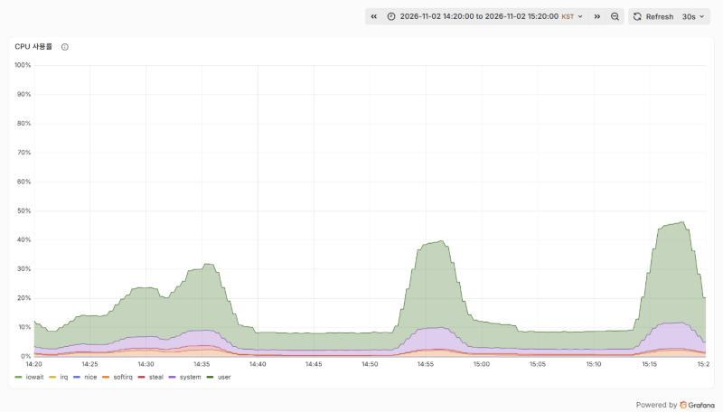

- 5분 평균이라 1 · 3 · 5건이 14:25~14:37에 한 덩어리로 보인다(최대 약 31%). 8건 약 40%, 10건 약 46%까지 오른다

### Load average

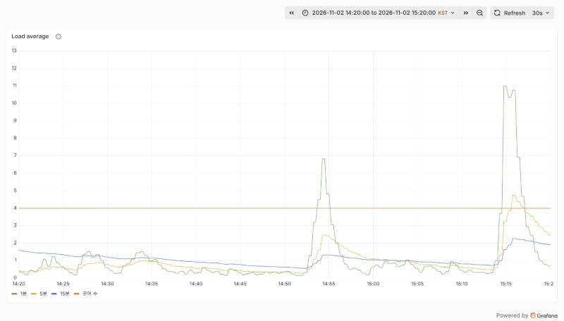

- 8건 1분 평균 약 6.8, 10건 약 11(코어 4). 실행을 기다리는 일이 코어 수의 2~3배다

### 컨테이너별 CPU

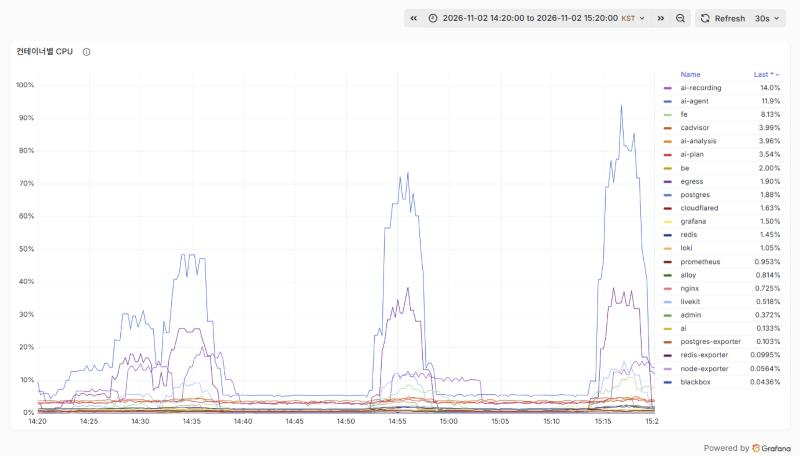

- 파랑이 ai-agent다. 5건 약 50%, 8건 약 73%, 10건 약 94%(5분 평균). 보라는 ai-recording(녹화 합치기 ffmpeg)으로 면접이 끝난 뒤 큐를 처리하며 약 38%까지 쓴다
- egress · livekit은 상대적으로 작다

### 면접방 · 참가자 · 녹화

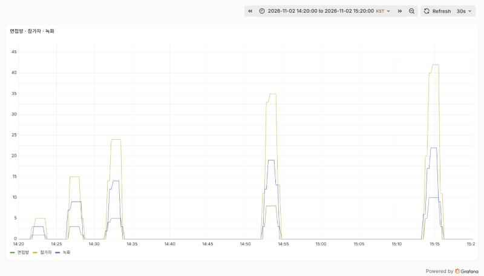

- **녹화(파랑)가 3 → 9 → 14 → 19 → 22로, 면접방(초록) × 3을 따라가지 못한다.** 5건부터 녹화가 빠진다

### 입장 실패 · 녹화 결과

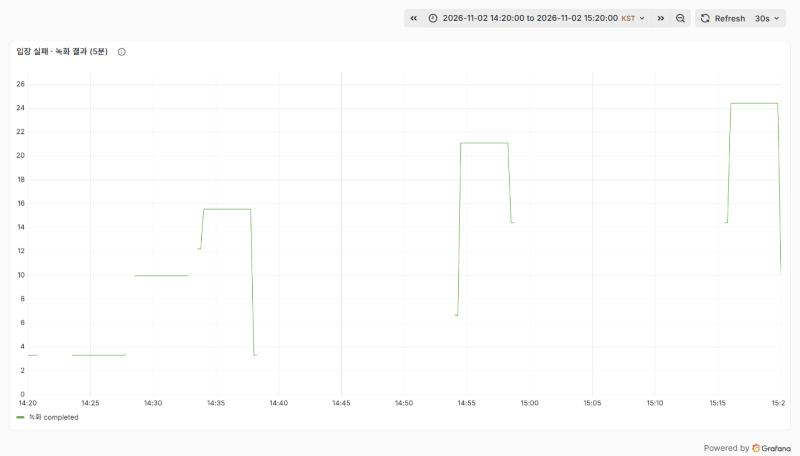

- 면접방 입장 실패는 0이다. 녹화 결과는 "completed"만 있다. 거절된 녹화는 시작조차 하지 않아 실패로 세지지 않는다. **이 패널로는 녹화 거절을 볼 수 없다**

### AI 작업 큐

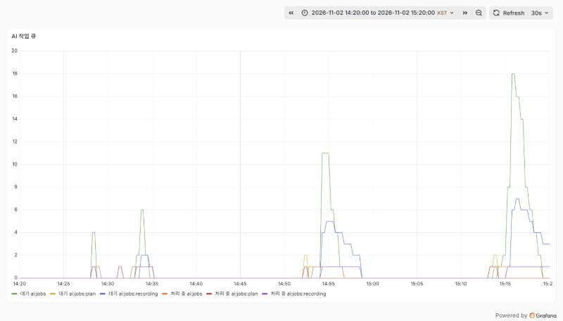

- 초록(채점 · 결과 대기)이 4 → 6 → 11 → 18, 파랑(녹화 합치기 대기)이 1 → 2 → 5 → 7로 쌓였다가 몇 분 안에 빠진다. 작업자 1개가 차례로 처리하는 모양이다

### 패킷 손실 · 왕복 지연 · 지터

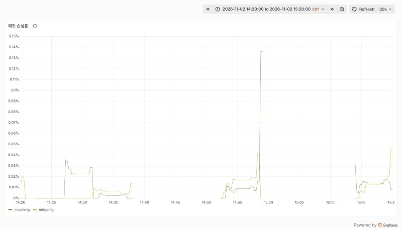

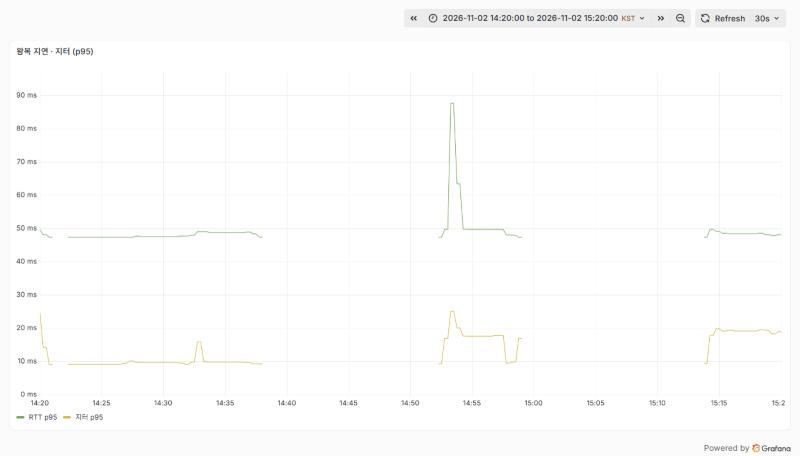

- 패킷 손실 최대 0.14%(기준 2%), RTT p95 약 48ms(8건 시작 때 한때 88ms), 지터 p95 10ms → 8 · 10건 18~20ms(기준 30ms). 미디어 품질은 10건까지 문제없다

### 컨테이너별 메모리

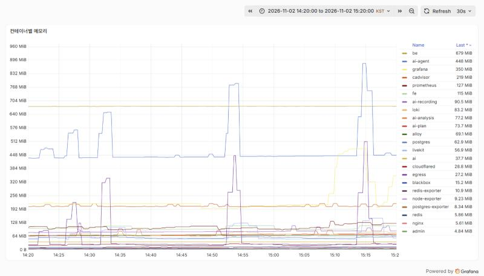

- ai-agent(파랑) 약 440MiB → 10건 약 890MiB. 보라(egress)도 녹화 수만큼 400MiB 가까이 오른다. 메모리 여유는 충분하다

## 5. 가설 판단

| 가설 | 판단 | 근거 |
|---|---|---|
| H6 에이전트가 넘치면 면접이 끊기거나 새 면접관이 안 들어온다 | **10건까지는 틀림** | 입장 실패 0, 첫 질문 4~7초. 서버 CPU가 70%를 넘었지만 면접이 30초 안에 모두 시작돼 배정이 그 전에 끝났다. 면접 진행 중에 새 면접이 들어오는 경우는 보지 않았다 |
| H7 LiveKit · Egress가 먼저 CPU · 대역폭을 쓴다 | **Egress가 먼저 막힘(CPU 사용이 아니라 수락 판정 설정 때문)** | Egress 자체 CPU는 낮지만 기본 설정이 녹화 1개를 0.5코어로 15초 예약해 15초에 약 6개만 받는다(7장). LiveKit · 미디어 품질은 여유 |
| H8 결과 · 채점 작업자 1개라 밀린다 | **맞음** | 결과 대기 최대 18초 → 204초, 채점 큐 최대 18. 1건에 약 20초씩 밀림. 단순 계산으로 동시에 약 30건이 끝나면 10분 마감을 넘긴다 |
| H9 녹화 합치기 작업자(1코어 · 1개)가 밀린다 | **맞음(아직 마감 안)** | 합치기 큐 최대 7, 다시보기 대기 최대 167초. 1건 약 10초라 약 90건이 몰려야 15분을 넘긴다 |
| H1 질문 준비(PLAN) 작업자 1개 | 신호 있음 | 동시 10건 질문 준비 최대 18.6초(1건 6.8초). S4에서 확인 |

## 6. 발견한 것

1. **녹화 거절이 조용히 지나간다.** BE가 Egress에 녹화를 요청하고 22초 동안 응답이 없어도(`no response from servers`) BE 로그에 남지 않는다. 면접이 끝난 뒤 합치기에서야 `TRACK_NOT_FOUND`로 드러나고, 사용자는 "녹화를 불러오지 못했어요"만 본다. 녹화 시작 실패를 로그로 남기고 다시 시도하는 처리가 필요하다
2. **Grafana로는 녹화 거절이 보이지 않는다.** "녹화 결과" 패널은 시작된 녹화의 결과만 센다. "면접방 × 3 대비 녹화 수"나 BE의 녹화 시작 실패 수 같은 지표가 있어야 알 수 있다
3. **AI 작업자 1개 구조는 동시에 끝나는 면접에 약하다.** 결과 · 질문 준비 · 합치기가 모두 줄을 선다. 마감까지는 여유가 있지만, 사용자가 화면 앞에서 기다리는 결과 대기가 10건에서 3분을 넘는다
4. **스크립트 개선(이번 실행 뒤 반영)**: 다시보기가 실패해도 그 면접의 첫 질문 · 질문 간격 · 결과 시간을 남기고, 면접 실패(`interview_failed`)와 녹화 실패(`replay_failed`)를 나눠 센다. 다시보기 화면에 "녹화를 불러오지 못했어요"가 나오면 15분을 기다리지 않고 바로 실패로 본다
5. 이번 면접은 가짜 답변이 짧아(면접 1건 약 2분) 실제 면접(계획 추정 약 10분)보다 면접 중 겹치는 시간이 짧다. 실제로는 면접 시작 · 끝이 흩어져 결과 큐가 덜 몰리는 대신, 녹화 · 에이전트가 더 오래 겹친다

## 7. 녹화 거절 원인(회차 뒤 추가 확인)

Egress `v1.15.0` 소스(`pkg/config/service.go` · `pkg/stats/monitor.go`)와 테스트 서버 로그로 확인했다.

**수락 판정**: `쓸 수 있는 CPU = CPU 수 × max_cpu_utilization − 예약 − Egress 녹화들의 실제 CPU`가 요청 비용 이상이면 받는다. 받으면 그 비용을 **15초 동안 예약**한다(`cpuHoldDuration`). 받지 못하면 응답하지 않아 LiveKit에 `no response from servers`로 남는다. 다른 컨테이너의 CPU는 계산에 들어가지 않는다.

| 기본값(설정 없음) | 값 |
|---|---|
| `cpu_cost.track_cpu_cost`(트랙 녹화 1개) | 0.5 |
| `cpu_cost.max_cpu_utilization` | 0.8 |
| Egress가 보는 CPU 수 | 4(`nproc`) |
| 15초 안에 받을 수 있는 트랙 녹화 | 4 × 0.8 ÷ 0.5 ≈ **6개** |

**실측과 대조**(녹화 시작 `egress_active`와 LiveKit 거절 시각)

| 단계 | 녹화 시작 | 15초 안 최대 | 거절 | 녹화 부족(면접 × 3 − 동시 녹화) |
|---|---|---|---|---|
| 5건 | 14개(34초) | 6 | 1 | 1 |
| 8건 | 13개(34초) | 6 | 5 | 5 |
| 10건 | 22개(55초) | 7 | 8 | 8 |

- 거절 수가 녹화 부족분과 정확히 같고, 15초 안에 받은 수가 계산(약 6개)과 맞는다
- 실제 트랙 녹화는 트랜스코딩 없이 받은 그대로 저장해 10건 · 녹화 22개에서도 egress CPU가 0.16~0.48코어(1개당 약 0.02~0.03코어)였다. 예약값 0.5는 실제보다 약 20배 크다
- 운영 compose(`deploy/prod/compose.yml`의 `EGRESS_CONFIG_BODY`)에도 `cpu_cost`가 없어 같은 기본값이다

**조정안**

| 안 | 내용 | 15초 안 받을 수 있는 녹화 | 비고 |
|---|---|---|---|
| A(추천) | `cpu_cost.track_cpu_cost: 0.1` | 약 32개(면접 약 10건) | 실제 사용량(약 0.03)보다 여전히 크다. 시작된 녹화는 실제 CPU로 계산되므로 정말 넘치면 그때 막힌다 |
| B | A + `max_cpu_utilization: 0.9` | 약 36개 | 이득이 작다 |
| C | BE가 녹화 시작 실패를 로그로 남기고 몇 초 뒤 다시 시도 | – | 설정과 별개로 빠지는 녹화를 막는다(BE) |

A를 테스트 서버에만 먼저 적용하고 S5(5 · 8 · 10건)를 다시 돌려 녹화가 모두 성공하는지 확인한다. 운영 반영은 그 결과를 보고 정한다.

## 8. 해석 · 다음

- **지금 구성의 한계는 "녹화까지 정상인 동시 화상 면접 약 4건"이다.** 면접 진행만 보면 10건까지 되지만, 녹화 · 다시보기가 핵심 기능(계획 1장)이라 4~5건을 기준으로 본다. 다만 녹화 한계는 서버 용량이 아니라 Egress 설정 때문이라(7장) 설정을 고치면 올라갈 가능성이 크다. 그때는 서버 CPU 기준(지속 가능 한계 약 5건)이 다음 한계다
- [S1 보고서](s1-2026-11-02.md)의 화면 부하(30 req/s에서 CPU 56%)와 합치면, 실제로는 면접과 화면 이동 · 폴링이 같은 4코어를 나눠 써 이보다 낮아진다(S6에서 확인)
- 스케일 아웃 · 개선 후보(대응은 이 문서 범위 밖)
  - **녹화**: Egress `track_cpu_cost` 조정(7장 안 A), BE 녹화 시작 실패 로그 · 재시도(안 C)
  - **에이전트**: 동시 면접이 늘면 CPU를 가장 많이 쓴다. 에이전트 분리 · 서버 키우기
  - **AI 작업자**: 채점 · 결과 작업자를 늘리면 결과 대기가 줄어든다(큐 구조는 이미 여러 작업자를 받을 수 있는지 확인 필요)
- 다음 회차
  - **S5 다시**: 테스트 서버에 안 A를 적용하고 녹화 한계가 바뀌는지. 면접 시작을 몇 분씩 흩어 진행 중에 새 면접이 들어오는 경우(H6)
  - **S6 혼합**: S1 화면 부하 + S5 면접을 함께

## 부록: 단계별 시각 · 다시 보는 법

| 단계 | 시작 | 끝 | 비고 |
|---|---|---|---|
| 1건 | 14:21:07 | 14:23:39 | |
| 3건 | 14:25:41 | 14:28:52 | |
| 5건 | 14:30:54 | 14:49:06 | 녹화 실패 1건의 다시보기 15분 대기 포함 |
| 8건 | 14:51:30 | 15:10:46 | 〃 4건 |
| 10건 | 15:12:49 | 15:33:46 | 〃 6건 |

단계 구간을 색으로 칠한 그래프(Grafana와 같은 질의, rate 1분 · 컨테이너 CPU 2분):

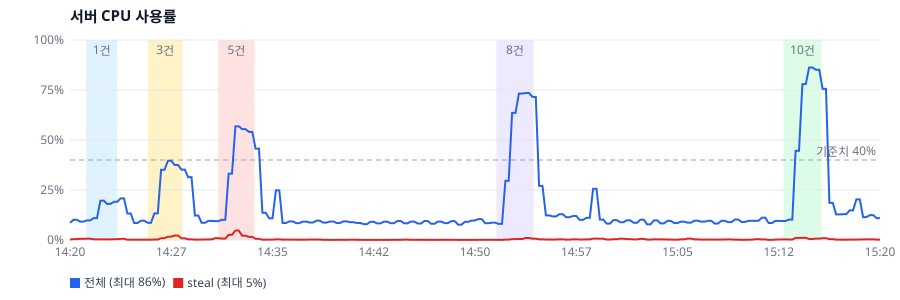
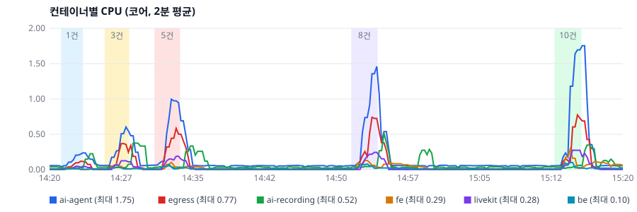
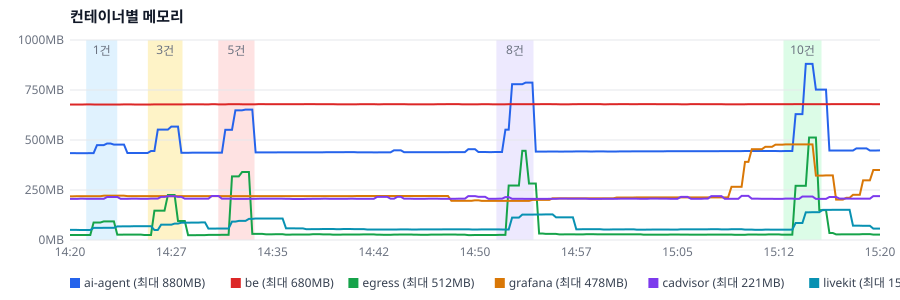
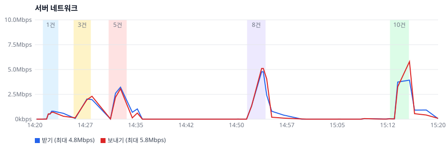

```bash
bash loadtest/s5-levels.sh                                  # 동시 1 · 3 · 5 · 8 · 10건
node loadtest/report/charts.mjs 1793596800 1793600400 loadtest/report/img/s5-2026-11-02 '<단계 JSON>'
```

Grafana 패널 주소: `https://grafana-lt.hangguet.co.kr/d/a301-prod?from=1793596800000&to=1793600400000&timezone=Asia%2FSeoul&viewPanel=panel-<id>&kiosk&theme=light`. 패널 id: CPU 112 · Load 113 · 컨테이너 CPU 141 · AI 작업 큐 14 · 면접방 · 녹화 121 · 패킷 손실 122 · 지연 · 지터 123 · 입장 실패 · 녹화 결과 124 · 컨테이너 메모리 143. 단계별 원본 출력은 `loadtest/results/s5-*`(커밋하지 않음)에 있다.
