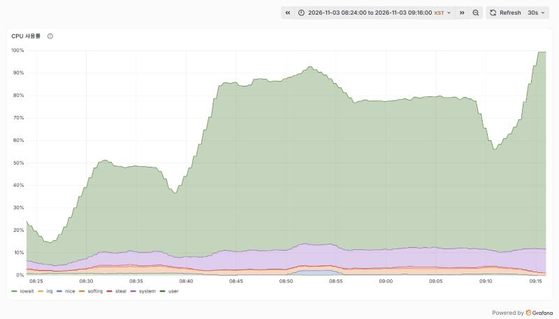
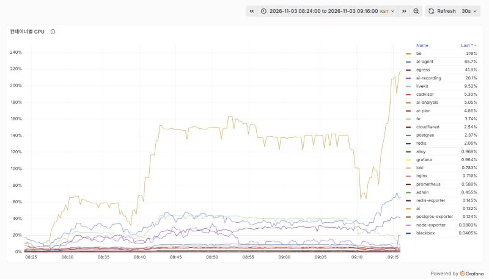
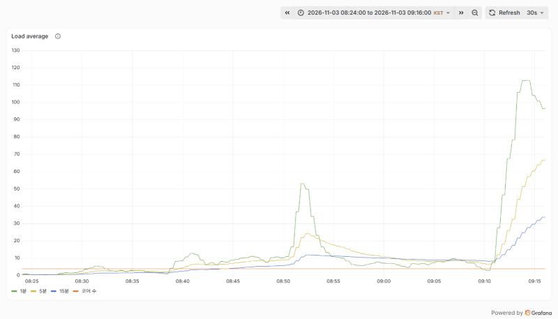
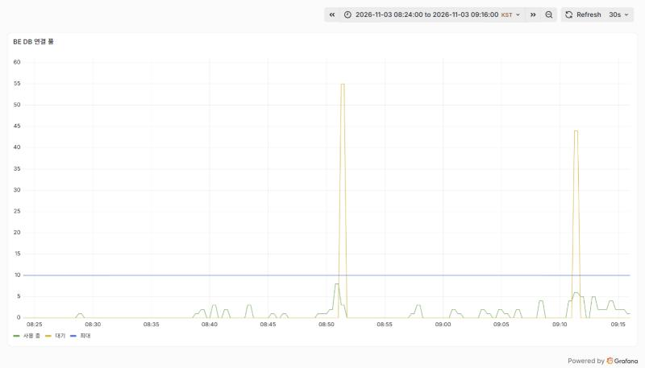
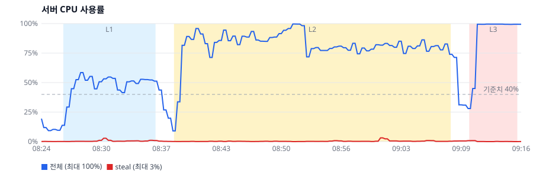
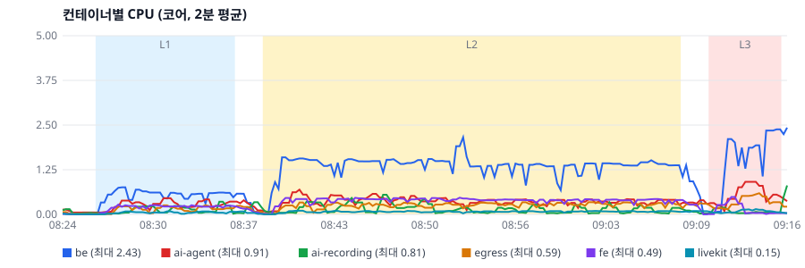
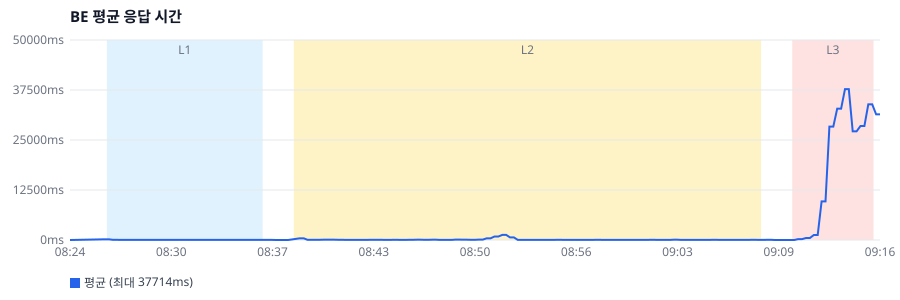
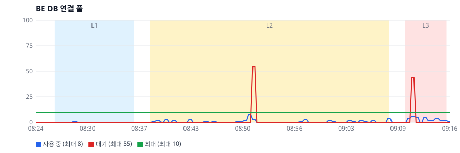

# S6 피크 혼합 중간 결과 (2026-11-03)

[부하 테스트 계획](../../이해준/load_test_plan/README.md) 6장의 S6 첫 회차다. S1 화면 · S2 로그인 · S4 면접 만들기 · S5 화상 면접을 한 스크립트에서 같이 돌리고 L1 → L2 → L3로 올렸다. **L3 5분 시점(09:15)에 멈췄다**(STT를 스텁으로 바꾸기로 해서 중단). 그래서 L1 · L2는 끝까지, L3는 5분만 있다. 외부 API는 모두 실제 API다.

## 요약

- **따로 잰 한계는 더해지지 않는다.** 각 흐름을 따로 잰 한계의 25%씩만 섞은 L1에서 이미 서버 CPU 평균 **48%**로 지속 가능 기준(40%)을 넘었다. 50%씩인 L2는 30분 평균 **82%**, 75%씩인 L3는 **94%**였다
- **섞였을 때 CPU를 가장 많이 쓴 것은 BE(로그인 비밀번호 해시)다.** L2 평균 1.38코어(서버 전체 사용량의 약 40%), L3 2.30코어. 그다음이 FE(0.40) · 에이전트(0.39) · Egress(0.27)다
- **로그인이 먼저 무너진다.** 로그인 p95가 L1 0.96초 → L2 **10.2초** → L3 **60초(시간 초과)**. L3에서는 로그인 83%가 실패했다. S2 단독일 때 분당 200건 p95가 0.90초였는데, 섞이니 분당 150건(L2)부터 10초가 됐다
- **L3에서는 다른 흐름도 같이 무너졌다.** 화면 p95 60초, 질문 준비 화면 p95 60초, 처리 중 요청이 Tomcat 상한(200)에 닿았고, Load 1분 평균 113(코어 4). 화상 면접은 면접관 입장 실패 1건, 브라우저 로그인 실패 3건이 났다(H3 · H6)
- **질문 준비 · 채점 · 녹화는 섞여도 버텼다.** 질문 준비 실패 0(L3 최대 112초), 채점 · 결과 최대 56초, 녹화(다시보기) 실패 0
- **L2의 화상 면접 실패 2건은 부하가 아니라 서버 자동 업데이트 때문이다(6장).** 08:50에 Ubuntu 자동 업데이트(`unattended-upgrades`)가 라이브러리를 올리고 `needrestart`가 네트워크 · DNS 서비스를 재시작했다. 그 순간 에이전트의 STT 연결이 실패했고, **에이전트가 다시 시도하지 않아 면접이 그대로 멈췄다**(AI 복원력 문제)
- 한계(계획 5.1)

  | 한계 | 단계 | 근거 |
  |---|---|---|
  | 지속 가능 한계(서버 CPU 평균 40%) | **L1** | L1 10분 평균 48% |
  | 품질 한계(로그인 p95 ≥ 1초) | **L2** | L2 10.2초(L1 0.96초는 기준 바로 아래) |
  | 품질 한계(화면 p95 ≥ 1.5초) | **L3** | L2 0.77초, L3 60초 |
  | 기능 한계(오류율 ≥ 1% · 면접관 입장 실패) | **L3** | 로그인 83% 실패, 면접관 입장 실패 1건 |

## 1. 환경 · 방법

| 항목 | 값 |
|---|---|
| 시각 | 2026-11-03 08:26:22~09:15:36(L3 5분 시점에 중단) |
| 대상 | 테스트 서버 `https://lt.hangguet.co.kr`(EC2 `t3.xlarge`, 이미지 `e9874c74`, Egress `track_cpu_cost: 0.1`) |
| 스크립트 | `loadtest/scenarios/s6-peak-browser.js`(기본 `MIX`) |
| 발생기 | 인프라 노트북 1대, Docker k6 `2.3.0-with-browser`. CPU 평균 2.6코어 · 최대 7.0코어(22스레드 중 32%), 메모리 최대 2.5GB. 80% 기준 아래라 모든 단계를 쓴다 |
| 네트워크 | SSAFY 네트워크 |
| 외부 API | 실제 GMS · Soniox · ElevenLabs · Jev |

| 단계 | 시각 | 화면 | 로그인 | 면접 만들기 | 동시 화상 면접 |
|---|---|---|---|---|---|
| L1 | 08:26~08:36(10분) | 5 req/s | 70건/분 | 3건/분 | 2건 |
| L2 | 08:38~09:08(30분) | 10 req/s | 150건/분 | 6건/분 | 3건 |
| L3 | 09:10~09:15(5분, 중단) | 15 req/s | 220건/분 | 9건/분 | 5건 |

단계 값은 따로 잰 한계(화면 지속 약 19 req/s · 로그인 약 290건/분 · 질문 준비 약 12건/분 · 화상 면접 지속 약 5건)의 약 25 · 50 · 75%다.

## 2. 단계별 결과(k6)

| 지표 | L1 | L2 | L3(5분) |
|---|---|---|---|
| 화면 p95 | 0.41초 | 0.77초 | **60초** |
| 로그인 p95 · 실패 | 0.96초 · 0.1%(1/713) | **10.2초** · 0.9%(41/4,583) | **60초 · 83%**(1,148/1,387) |
| 질문 준비 화면 p95 | 0.44초 | 1.18초 | **60초** |
| 질문 준비(만들기 → 준비 완료) 최대 · 실패 | 12초 · 0 | 71초 · 0 | 112초 · 0 |
| 화상 면접 끝까지 | 8건 | 20건 | 0건 |
| 화상 면접 실패 | 0 | 2(6장, 자동 업데이트) | 4(면접관 입장 1 · 로그인 3) |
| 첫 질문 최대 · 질문 간격 p95 | 4.3초 · 22.1초 | 6.3초 · 22.1초 | – |
| 채점 · 결과 최대 | 36초 | 56초 | – |
| 다시보기(녹화) 실패 | 0 | 0 | 0 |

- 로그인 실패는 대부분 k6 요청 제한(60초) 초과다(1,134건). 서버가 거절한 것이 아니라 줄을 서다 시간이 다 됐다
- L3에서 면접 만들기(5.1) 20건도 실패했다(18건이 60초 초과). 질문 준비까지 간 면접은 모두 준비 완료
- k6가 VU를 늦게 만들어 보내지 못한 요청이 3,095건 있다. 대부분 L3에서 응답이 느려 VU가 상한(화면 200)에 닿은 뒤다. 그래서 L3에 실제로 보낸 양은 계획보다 적다
- L3의 화상 면접 지표(첫 질문 등)가 비어 있는 것은 5분 안에 끝까지 간 면접이 없어서다

## 3. 서버 자원(단계 전체 구간)

| 지표 | L1(10분) | L2(30분) | L3(5분) |
|---|---|---|---|
| **서버 CPU 평균(최대)** | **48%**(58%) | **82%**(100%) | **94%**(100%) |
| BE CPU 평균(최대) | 0.63(0.78) | **1.38**(1.71) | **2.30**(2.53) |
| FE | 0.24 | 0.40 | 0.18 |
| ai-agent | 0.31 | 0.39 | 0.58 |
| Egress | 0.17 | 0.27 | 0.39 |
| ai-recording | 0.10 | 0.15 | 0.05 |
| LiveKit | 0.05 | 0.08 | 0.07 |
| 로그인 처리량 평균(최대) | 71건/분(90) | 150건/분(258) | **159건/분**(242) |
| 처리 중 요청 최대 | 2 | 134 | **200**(Tomcat 상한) |
| DB 풀 대기 최대 | 0 | 55(08:51 한 번) | 44(09:11 한 번) |
| Load 1분 최대 | 5.5 | 53(08:51) | **113** |
| 질문 준비 큐 최대 | 0 | 4 | 4 |
| 동시 면접방 최대 | 2 | 3 | 7 |
| steal 최대 | 2.8% | 3.1% | 0.9% |

- **L2에서 로그인은 평균으로는 따라갔지만(150건/분) 서버 CPU를 30분 내내 80% 넘게 썼다.** BE가 해시에 1.4코어를 쓰는 동안 FE · 에이전트 · Egress가 나머지를 나눠 써 CPU 대기가 생기고, 로그인 하나하나가 느려졌다(p95 10초)
- **L3에서 로그인 처리량이 분당 약 160건에서 멈췄다.** S2 단독일 때의 상한(약 290건)보다 훨씬 낮다. 다른 흐름이 CPU를 나눠 쓰기 때문이다
- **DB 풀 대기는 꾸준히 쌓인 것이 아니라 두 순간에만 튀었다.** 08:51은 자동 업데이트로 네트워크가 재시작된 직후 밀린 요청이 한꺼번에 들어온 때, 09:11은 L3가 시작된 때다. CPU가 꽉 찬 순간에 DB 연결을 잡은 요청이 늦게 끝나 풀(10개)이 모자랐다. 풀이 원인이라기보다 CPU 포화의 결과로 본다(H4는 몰리는 순간의 신호만 있음)
- cAdvisor 메모리가 상한의 97~99%였다(OOM 위험, 운영 compose 설정 확인 필요)

## 4. Grafana 화면

테스트 서버 Grafana "A301 운영 서버"를 08:24~09:16으로 캡처했다. 대시보드는 rate()에 5분을 써서 값이 완만하다(1분 단위는 부록).

### 서버 CPU 사용률



- L1 약 50%, L2 약 78~93%, L3 시작 뒤 100%까지 오른다. L1과 L2 사이 2분 쉼에서만 내려간다

### 컨테이너별 CPU



- 노랑(BE)이 L2 약 140~160%, L3 220%로 다른 컨테이너보다 3~5배 크다. 파랑(에이전트) · 보라(Egress)는 L3에서 오르지만 BE에 비하면 작다

### Load average



- 08:51의 봉우리(53)는 자동 업데이트 직후, L3(09:11~)는 1분 평균 113까지 오른다

### BE DB 연결 풀



- 대기(노랑)가 08:51(55) · 09:11(44)에만 튀고 나머지는 0이다

## 5. 가설 판단

| 가설 | 판단 | 근거 |
|---|---|---|
| 섞이면 따로 잰 한계보다 낮아진다(S6 목적) | **맞음** | 각 25%인 L1에서 지속 가능 기준을 넘음. 로그인 처리 상한이 약 290 → 약 160건/분 |
| H3 로그인 해시가 CPU를 차지해 다른 API도 느려진다 | **맞음(섞이면 더 심함)** | BE가 L2 1.38 · L3 2.30코어로 가장 큼. L3에서 화면 · 질문 준비 화면 p95 60초 |
| H4 커넥션 풀 대기 | 몰리는 순간의 신호 | 대기 55 · 44가 한 순간씩. CPU 포화의 결과로 본다 |
| H6 에이전트가 넘치면 면접관이 안 들어온다 | **신호 있음** | L3에서 면접관 입장 실패 1건(동시 면접방 최대 7). 에이전트 자체 CPU는 0.58코어로 작아, 서버 CPU 포화 때문에 에이전트가 느려진 것으로 본다 |
| H1 · H8 · H9(질문 준비 · 채점 · 합치기 작업자) | 이번 부하에서는 버팀 | 질문 준비 큐 최대 4, 채점 최대 56초, 녹화 실패 0 |

## 6. 08:50 화상 면접 2건 실패: 서버 자동 업데이트

| 시각(KST) | 일 |
|---|---|
| 08:49:40 | `apt-daily-upgrade.timer` 실행(매일 06:00 + 최대 60분 무작위, `Persistent=true`라 꺼져 있던 동안 놓친 실행을 켠 뒤 따라잡음. 서버는 08:14에 켬) |
| 08:49:56~08:51:03 | `unattended-upgrade`가 git · xz(liblzma) · zlib · libnss3 · libbrotli 등 7번에 나눠 올림. CPU 55.6초 사용 |
| **08:50:20** | `needrestart`가 바뀐 라이브러리를 쓰는 **`systemd-networkd` · `systemd-resolved`(DNS)를 재시작** |
| 08:50:20 | Docker DNS가 `stt-rt.soniox.com` 조회 실패(`127.0.0.53:53 connection refused`) → 면접 351 · 358의 에이전트가 답변을 STT로 보내지 못함 |
| 08:50:25~31 | 로그인 연결 실패 · 502 16건(화면 부하 쪽 처음 로그인) |
| 08:50:53 | Cloudflare Tunnel 연결 하나 끊김 → 08:51:10 다시 등록 |
| 08:51 | 밀린 요청이 한꺼번에 들어와 Load 53 · DB 풀 대기 55 |
| 09:09~09:10 | 면접 351 · 358이 20분 제한(스크립트)에 걸려 실패 |

- **에이전트가 STT 실패 뒤 다시 시도하지도, 면접을 실패로 끝내지도 않았다.** 사용자는 면접관이 말없이 멈춘 화면을 보게 된다. AI 파트에 넘길 버그다(STT 다시 연결 또는 면접 실패 처리)
- **운영 서버도 같은 일이 생길 수 있다.** 운영도 Ubuntu라면 매일 06~07시에 자동 업데이트가 돌고, 라이브러리에 따라 네트워크 · DNS · Docker가 재시작될 수 있다. 업데이트 시간대를 사용이 적은 때로 고정하거나 `needrestart` 자동 재시작 범위를 정해야 한다(인프라, 배포 계획에 반영 필요)
- 테스트 서버는 회차 전에 자동 업데이트를 끄거나 미리 돌려 둔다

## 7. 해석 · 다음

- **지금 구성에서 "모든 흐름이 같이 도는 상태"의 지속 가능 한계는 L1(각 25%) 정도다.** 단독 한계를 기준으로 서버 크기를 잡으면 과대평가된다
- **이번 MIX는 로그인 비중이 실제보다 크다.** 분당 150건을 30분 내내 유지했다(4,500건). 액세스 토큰이 9시간 유효해 실제 사용자는 접속 때 한 번 로그인한다. 동시 접속 100명이면 1분에 100명이 몰려도 분당 100건이 잠깐이다. 그래서 이 결과의 "로그인이 먼저 무너진다"는 **로그인이 몰리는 순간(발표 직후)**에 해당한다. 평소 혼합 부하는 로그인 비중을 줄인 MIX로 다시 재야 한다
- 구조 개선과 연결
  - **에이전트 분리**([설계](../../이해준/agent_autoscale_plan/README.md)): 이번 L2에서 에이전트 몫은 0.39코어(면접 3건)로, 서버 CPU의 약 12%다. 동시 면접이 늘수록 커진다(S5 10건 1.2~1.6코어). 메인 서버 CPU를 BE · 녹화에 돌리는 효과는 면접 수가 많을 때 크다
  - **로그인 격리(bulkhead)**: 섞였을 때 BE 해시가 가장 큰 CPU 소비라, 동시 해시 계산 수를 제한하면 L3처럼 모든 흐름이 같이 무너지는 것을 막을 수 있다
- 다음
  - 에이전트 분리 뒤 **같은 MIX**(이번과 비교)와 **로그인 비중을 줄인 MIX**(예: 로그인 20건/분)를 돌린다
  - 회차 전에 테스트 서버 자동 업데이트를 끄거나 미리 돌린다

## 부록: 단계별 시각 · 다시 보는 법

| 단계 | 시작(유닉스 초) | 끝 |
|---|---|---|
| L1 | 1793661982(08:26:22) | 1793662582(08:36:22) |
| L2 | 1793662702(08:38:22) | 1793664502(09:08:22) |
| L3 | 1793664622(09:10:22) | 1793664935(09:15:35, 중단) |

단계 구간을 색으로 칠한 그래프(Grafana와 같은 질의, rate 1분 · 컨테이너 CPU 2분):






```bash
bash loadtest/run.sh scenarios/s6-peak-browser.js
node loadtest/report/charts.mjs 1793661840 1793664960 loadtest/report/img/s6-2026-11-03 '<단계 JSON>'
```

Grafana 패널 주소: `https://grafana-lt.hangguet.co.kr/d/a301-prod?from=1793661840000&to=1793664960000&timezone=Asia%2FSeoul&viewPanel=panel-<id>&kiosk&theme=light`. 패널 id: CPU 112 · Load 113 · 컨테이너 CPU 141 · BE DB 연결 풀 11. k6 원본 출력 · 발생기 기록은 `loadtest/results/s6-run1-stopped/`(커밋하지 않음)에 있다.
