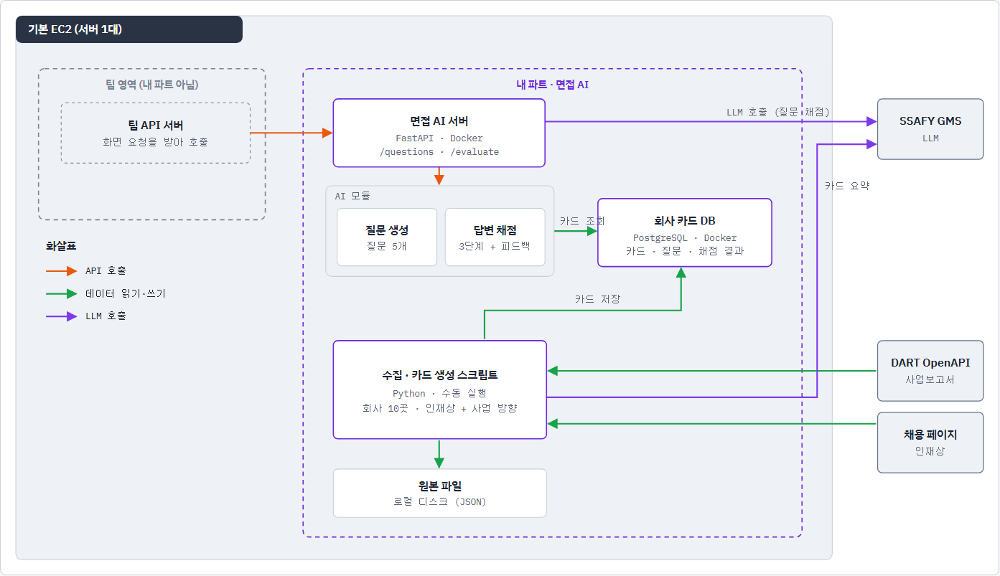

# 면접 AI: 질문 생성 · 답변 평가

> 이 회사 면접에서 나올 질문을 만들고, 사용자의 답이 이 회사에 맞는지 채점한다.

담당: 박다빈 · 관련 이슈: [S15P31A301-31](https://ssafy.atlassian.net/browse/S15P31A301-31)

| 문서 | 내용 |
|---|---|
| [overview.md](overview.md) | 하는 일 3단계, 회사 카드 형식, 평가 기준표, 팀원과 주고받는 데이터 |
| [decisions.md](decisions.md) | 정해야 할 것과 MVP 결정 |
| [architecture.md](architecture.md) | MVP 구조, 고도화 로드맵(분산처리 포함) |

