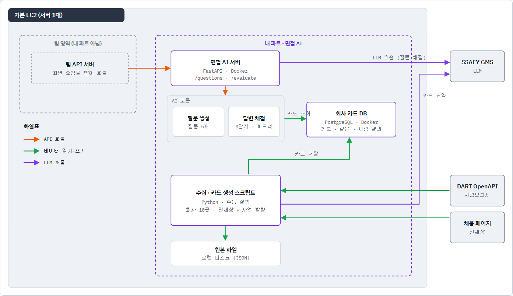

# 내 담당: 아키텍처

[← 내 담당 문서로 돌아가기](overview.md) · [정해야 할 것](decisions.md)

원칙: **MVP로 질문 → 채점을 먼저 돌리고, 분산처리는 고도화 단계에서 반드시 넣는다.**
API 입출력 형식은 MVP 때 고정해서, 뒤에서 수집 방식을 바꿔도 팀원 쪽은 영향이 없게 한다.

## 1. MVP 구조

서버는 기본 지급 EC2 1대. 컨테이너로 나눠 띄운다.



```
[수집 스크립트]  DART API · 채용 페이지 (회사 10곳)
      ↓  Python, 수동 실행
[카드 생성]  LLM(GMS)으로 인재상 · 사업 방향 요약, 출처 포함
      ↓
[DB]  PostgreSQL — 회사 카드(JSON 칼럼), 질문, 채점 결과
      ↑↓
[면접 AI 서버]  FastAPI
   ├─ POST /questions : 회사 + 공고 → 질문 5개
   └─ POST /evaluate  : 질문 + 답변 → 판정 + 피드백
      ↑↓
[팀원 쪽]  API 서버 / 화면이 두 API 호출
```

| 구성 | 선택 | 이유 |
|---|---|---|
| 언어 | Python | 크롤링, LLM, PySpark까지 한 언어 |
| 서버 | FastAPI | 가볍고 API 문서 자동 생성 |
| DB | PostgreSQL | 나중에 pgvector만 추가하면 됨 |
| LLM | SSAFY GMS | 교보재 신청함 |

## 2. 고도화 로드맵 (분산처리 포함)

| 단계 | 추가 | 바뀌는 곳 | 결과물 |
|---|---|---|---|
| MVP | 위 구조 | — | 질문 생성 · 채점 API 동작 |
| 고도화 1 | 회사 100곳, 카드 항목 4개, **Airflow**로 수집→카드 생성 자동화 | 수집 스크립트를 Airflow 작업으로 감쌈 | 주 단위 자동 갱신 |
| 고도화 2 | **Kafka**(뉴스 스트림), **Spark**(정제·중복 제거·기업명 매칭), **MinIO**(원본 저장), 추가 EC2 | Airflow의 "정제" 작업을 Spark 작업으로 교체 | 전체 상장사 처리, 단일 서버 대비 성능 비교 |
| 고도화 3 | **pgvector** 근거 검색, 꼬리질문, 이력서 반영 | /evaluate 내부만 변경 | 공시 원문 단위로 근거 제시 |

API(/questions, /evaluate) 형식은 모든 단계에서 그대로 유지한다.

## 3. 분산처리 성과 측정 (고도화 2)

MVP의 단일 서버 버전을 기준선으로 두고, 같은 데이터로 비교한다.

- 처리 시간: 단일 Python vs Spark (worker 수별)
- 중복 제거율: 원본 기사 수 → 사건 묶음 수
- LLM 입력 토큰 절감률: 필터 전 → 필터 후

## 4. 팀원과 정해야 할 것

1. 면접 AI 서버를 팀 API 서버 뒤에 별도 서버로 둘지, 팀이 Python으로 통일할지
2. 팀 서비스 DB를 같이 쓸지, 내 파트 전용 DB를 둘지
3. /evaluate를 동기(응답 대기)로 할지 비동기(결과 나중에 조회)로 할지
