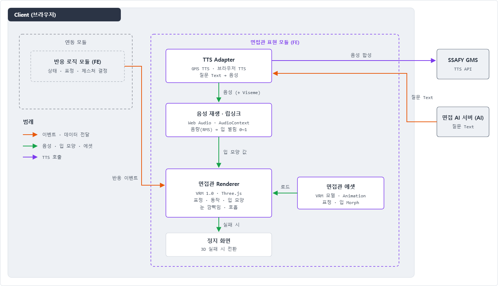

# 면접관 표현 모듈 (FE) · TTS

> 질문을 면접관 음성으로 출력하고, 경청·생각·발화 상태를 3D 면접관으로 표현한다.

담당: 박연수, 한결 · 관련 이슈: [S15P31A301-34](https://ssafy.atlassian.net/browse/S15P31A301-34)

| 문서 | 내용 |
|---|---|
| [overview.md](overview.md) | 모듈 기능, 면접관 상태, 준수 사항, 타 모듈 연동 |
| [decisions.md](decisions.md) | 결정 사항과 MVP 범위 |
| [architecture.md](architecture.md) | MVP 구조, 고도화 로드맵 |

