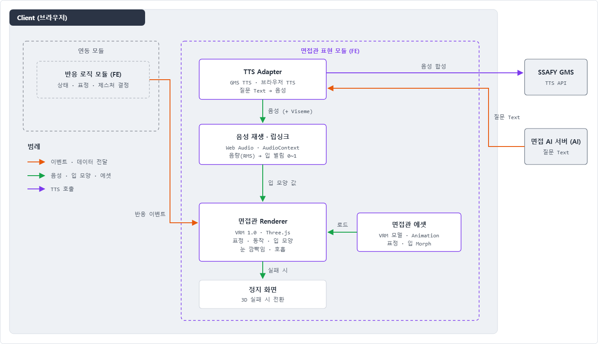

# 면접관 표현 모듈: 아키텍처

[← 개요](overview.md) · [결정 사항](decisions.md)

원칙: **3D 렌더링이 실패해도 면접은 끝까지 진행된다.**
반응 이벤트 형식을 MVP 단계에서 고정하여, 이후 모델이나 립싱크 방식을 변경해도 타 모듈에 영향이 없도록 한다.

## 1. MVP 구조

모든 구성 요소는 Client(브라우저)에서 동작하며, TTS만 SSAFY GMS를 호출한다.



```
[면접 AI 서버]  질문 Text
      ↓
[TTS Adapter]  GMS TTS → 음성
      ↓
[음성 재생 · 립싱크]  Web Audio, 음량 → 입 벌림 0~1
      ↓
[면접관 Renderer]  VRM + Three.js  ← 반응 이벤트 (반응 로직 모듈)
      ↓ 실패 시
[정지 화면]
```

| 구성 요소 | 선정 기술 | 선정 사유 |
|---|---|---|
| 3D 렌더링 | Three.js + VRM | 브라우저에서 별도 설치 없이 동작, 표정·입 모양 표준 제공 |
| 음성 합성 | GMS TTS | 교보재로 제공 |
| 립싱크 | Web Audio API | 별도 라이브러리 없이 음량 측정 가능 |

## 2. 반응 이벤트 (반응 로직 모듈 → 면접관 표현 모듈)

```ts
type ReactionEvent =
  | { type: 'state'; state: 'idle' | 'listening' | 'thinking' | 'speaking' }
  | { type: 'expression'; expression: 'neutral' | 'attentive' }
  | { type: 'gesture'; gesture: 'small_nod' };
```

정의된 값만 처리하며, 정의되지 않은 값은 무시하고 현재 상태를 유지한다.

## 3. 고도화 로드맵

| 단계 | 추가 기능 | 변경 범위 | 결과물 |
|---|---|---|---|
| MVP | 1장 구조 | — | 발화·경청·생각 상태를 표현하는 3D 면접관 |
| 고도화 1 | 모음별 입 모양(Viseme), 표정 5종·제스처 4종 | 립싱크·동작 | 입 모양·표정 자연스러움 향상 |
| 고도화 2 | 2D 캐릭터(Live2D) 대체 화면, 성능·자연스러움 A/B 비교 | Renderer 추가 | 저사양 기기 대응 |

반응 이벤트 형식은 전 단계에서 유지하며, 표정·제스처는 값만 추가한다.

## 4. 협의 필요 사항

1. 반응 이벤트 형식 (반응 로직 모듈)
2. 질문 Text 길이 상한 (면접 AI 모듈): 길이가 짧을수록 TTS 지연이 줄고 자연스럽다
3. 면접관 표시 크기·위치, 대상 노트북 사양 (UI)
