# 면접관 표현 모듈: 프로토타입 검증 결과 및 MVP 구현 권장안

[← 개요](overview.md) · [결정 사항](decisions.md) · [아키텍처](architecture.md)

> 계획한 구조를 시험 코드로 구현해 확인한 결과, **MVP 구현에 충분히 활용할 수 있다.** 이 문서는 그 근거가 되는 결과물, 구현 방식, 코드 구현 방식, 수치 조절 방식, 최종 MVP 권장안을 정리한다.

- 검증일: 2026-10-13
- 검증 환경: Windows 11, Intel Core Ultra 7 155H, Chrome 154 (Intel Arc 내장 GPU, 120Hz 화면)
- 시험 코드: 핵심 파일만 [spike/](spike/README.md)에 발췌했다(실행용 아님). 정식 구현은 브랜치 계획에 따라 feature 브랜치에서 새로 작성한다.

## 1. 결론

| 항목 | 결과 |
|---|---|
| 동작 범위 | 페르소나 3종(3D 2종, 2D 그림 1종) 모두 5문항 면접을 끝까지 진행. 상태 4종, 태도·순간 표정, 끄덕임·갸웃, 음량 립싱크, 질문 모드 3종, 실패 처리 확인 |
| 자동 검사 | 단위 테스트 212개, 스모크 테스트 49개, Lint, 타입 검사 모두 통과 |
| 성능 | 3D 120fps(화면 최대치), 프레임당 JS 1ms 이내, 모델 로딩 약 170ms(4.4MB) |
| 비용·라이선스 | 런타임 비용 없음(TTS 제외). 사용 에셋은 CC0·MIT·Apache 2.0, 결과물 배포에 문제 없음 ([8장](#8-라이선스-확인)) |
| 남은 위험 | 실제 Chirp 키 미검증, 사람이 직접 듣고 본 립싱크 확인 없음, 저사양 기기 미측정 ([7장](#7-남은-검증)) |

### 1.1 검증 방법

자동 검사는 시험 코드의 단위 테스트(212개)와 스모크 테스트(49개, 서버를 띄운 상태의 통합 확인)로 했다. 사람이 본 확인은 면접 화면·샌드박스·헤드리스 크롬 캡처(2장 이미지)로 했다.

| 구분 | 위치 | 확인한 것 |
|---|---|---|
| 반응 이벤트 처리 | `avatar/test/eventFilter.test.ts` | 출처별 `sequence` 역전 무시, `ttlMs` 만료(받은 시각 기준), 미정의 `type` 무시, "답변 완료" 이후 이벤트 버림, 발화 연계 반응의 실행 시점 재확인 |
| 표정·태도 | `expression.test.ts` | 기본값 × 페르소나 배율 × `intensity`, 같은 모프 합산 후 최대 0.8, 들을 때/말할 때 표 전환, 순간 표정 `durationMs`·태도 보간, 여러 메시에 같은 값 |
| 제스처·상태·대기 | `gesture.test.ts`, `state.test.ts`, `idle.test.ts` | 끄덕임·갸웃 각도와 길이(0.4~1.2초 제한), 쿨다운, 머리 이동 ±12° 제한, 상태 자세 보간, 회전 누적 없음, 깜빡임 간격 |
| 립싱크 | `mouth.test.ts` | 음량 → 입 벌림, 열림 50ms·닫힘 120ms 보간, HeadAudio 입 모양 보간 |
| 음성·질문 모드 | `speech.test.ts` | 음성·글·둘 다 3종, 글 모드 표시 시간 `max(2초, 글자 수 ÷ 7초)`, `utteranceId`·`stop`, 음성 로드 실패 시 글 모드 전환 |
| 3D 모델·실패 처리 | `glbRig.test.ts`, `avatar.test.ts` | 모프 이름 매핑, `jawOpen` 상한(0.55), 숨김 메시, 팔 내림 대기 자세, WebGL 미지원·로드 실패·Timeout 시 정지 이미지, `dispose` 두 번 안전 |
| 2D 그림 면접관 | `sprite.test.ts` | 그림 25장 로드, 가장 큰 표정 하나 → 단계 그림 선택과 경계 여유, 다른 표정은 기본 경유, 깜빡임 5단계·입 5단계, 웃는 얼굴이면 웃으며 말하는 입, 로드 실패 시 정지 이미지 |
| 페르소나 | `personas.test.ts` | 3종 배율·쿨다운·깜빡임·카메라 값 |
| 계약 | `contract/test/schema.test.ts` | JSON Schema와 예시(정상·미정의·역전·만료·범위 초과·답변 완료 후) |
| BE·AI·FE mock | `be/test`, `ai/test`, `fe/test` | Presigned URL 서명·만료, 세션·턴 흐름, 반응 이벤트 생성 범위, TTS 실패 시 글만, WebSocket 재연결, 종료 화면 요약 |
| 스모크 (49개) | `scripts/smoke.mjs` | 세션 생성과 질문 5개 진행, 음성 URL 200·CORS·위조 서명 403, 3초 안에 반응 수신·`sequence` 증가, 답변 완료 후 이벤트 중지, 페르소나 3종 모델·그림·정지 이미지 제공, FE 프록시 |

## 2. 근거 결과물

### 2.1 3D 면접관 (페르소나 2종)

Blender + MPFB와 CC0 에셋으로 직접 제작했다. 두 모델 모두 ARKit 표정 52종과 Oculus 입 모양 15종을 갖추고 glTF 검증 오류 0건이다.

| 악마 면접관 (검은 정장) | 개발자 커피챗 (체크 셔츠) |
|---|---|
| 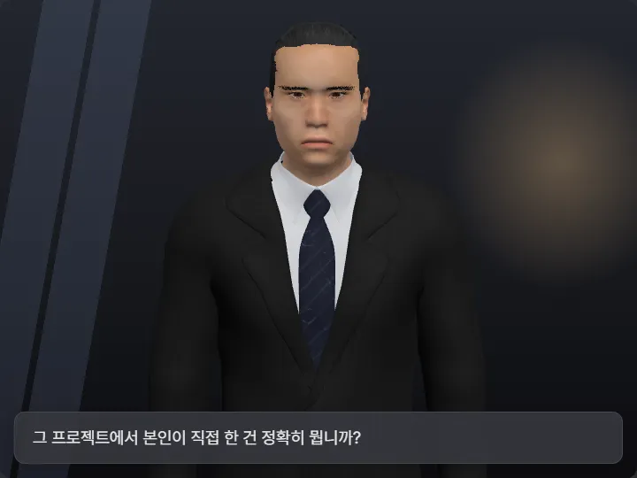 | 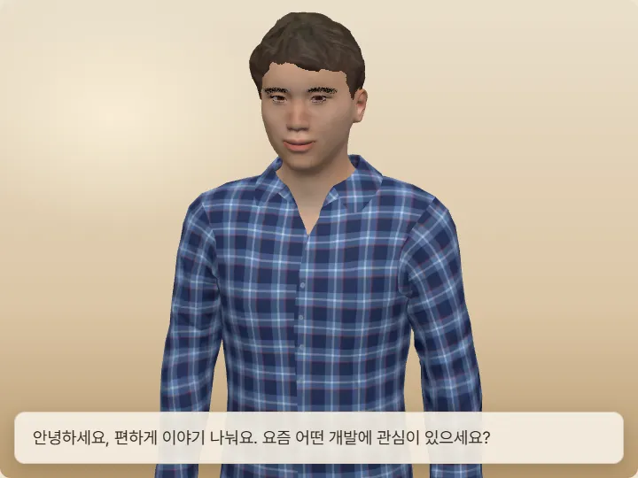 |

반응 이벤트별 표정(들을 때, intensity 1). 각 칸 아래 숫자가 실제 들어간 모프 값이다.

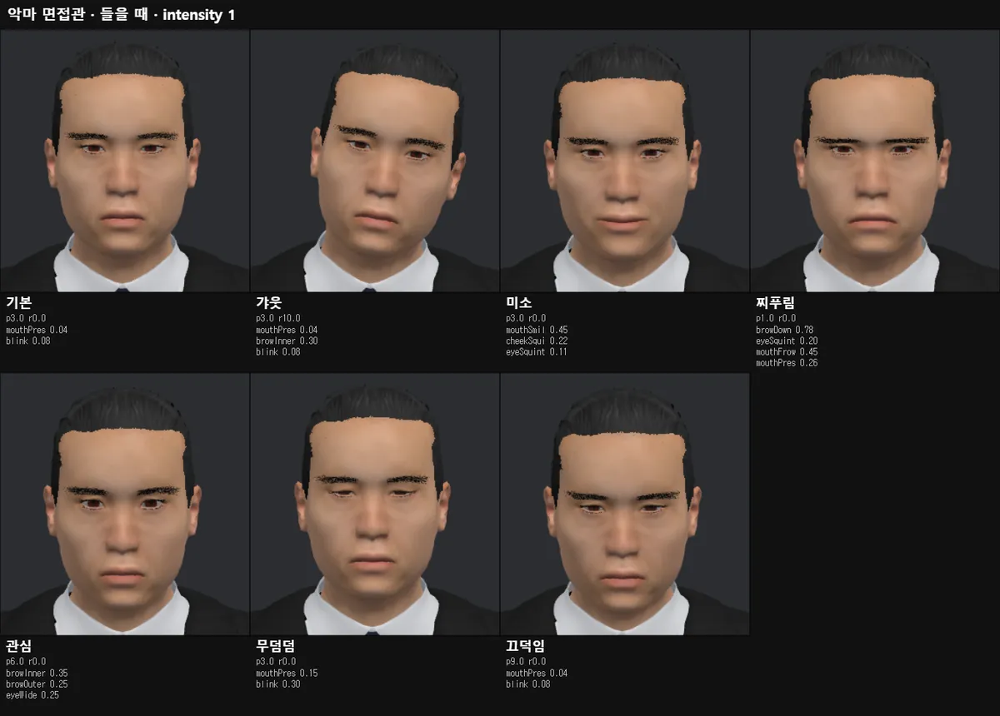

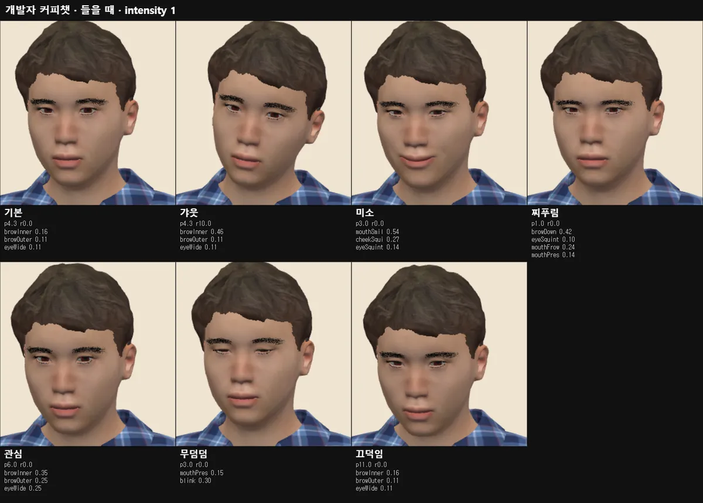

말할 때 표정. 턱·입은 립싱크가 쓰므로 표정은 눈·눈썹·볼로 표현한다.

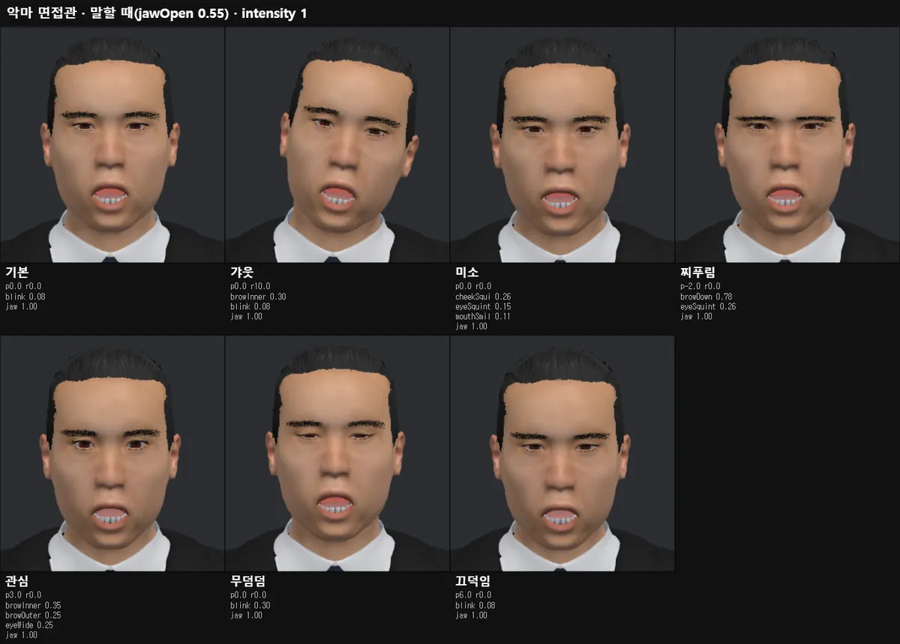

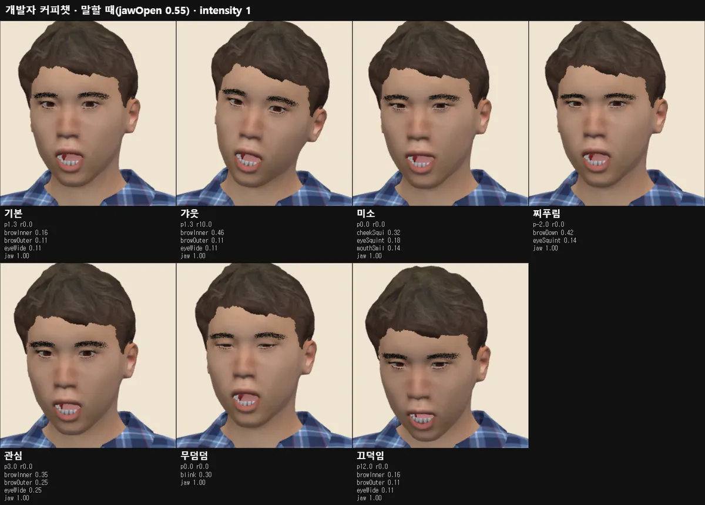

수치 조정 전 결과(미소·찌푸림·관심이 기본 얼굴과 거의 구분되지 않음)는 [3d_devil_expressions_before.webp](images/verification/3d_devil_expressions_before.webp)에 있다. 조정 내용은 [5장](#5-수치-조절-방식).

### 2.2 렌더러 비교 (v0 실측)

같은 모델·같은 한국어 샘플 음성(8.1초)으로 측정했다.

| 항목 | TalkingHead 1.7.0 | 자체 three.js 컨트롤러 |
|---|---|---|
| 로딩 (meshopt 4.4MB) | 187~221ms | 163~176ms |
| 평균 FPS | 최대 72 (라이브러리 자체 상한) | 120 |
| 번들 증가 | +226kB | +7kB |
| 대기 중 얼굴 흔들림 (30초) | 가로 114px | 0 |
| 우리 동작 층 구조와 충돌 | 표정·깜빡임·고개·자세를 자동으로 계속 움직여 겹침 | 없음 |

립싱크는 HeadAudio(영어 학습 모델)가 한국어 "아"를 한 번도 `viseme_aa`로 분류하지 못했다. 음량 → `jawOpen` 방식이 소리와 가장 잘 맞았다.

### 2.3 2D 그림 면접관 (장난꾸러기 악마)

Codex(OpenAI 이미지 생성)로 표정 그림 25장을 그렸다. 기본 그림의 해당 부위만 고쳐 그리게 해서, 바뀐 픽셀은 얼굴 부위 주변 1~5%뿐이다.

면접 화면(질문을 말하는 중, 3D 페르소나와 같은 화면):

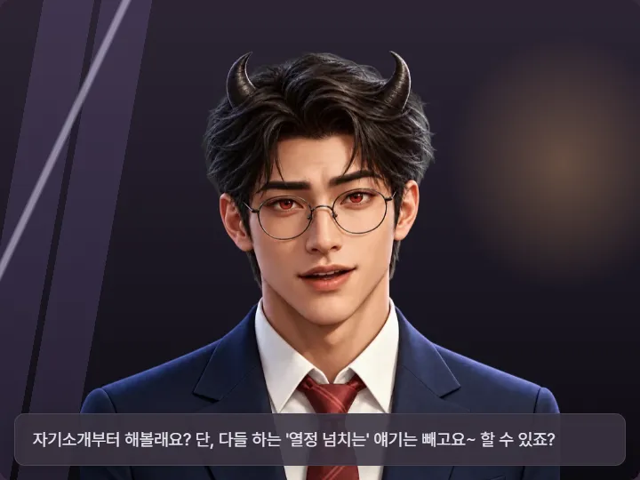

주요 표정 7장과 중간 단계 13장:

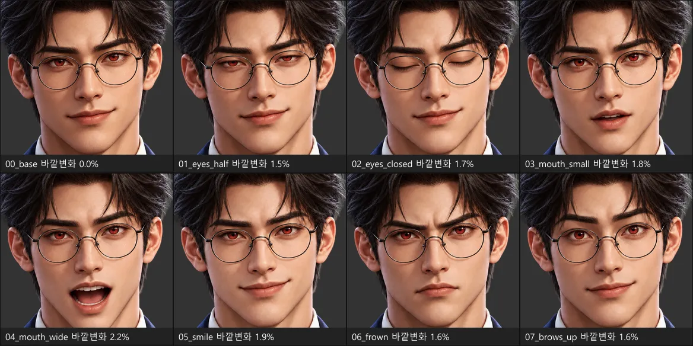

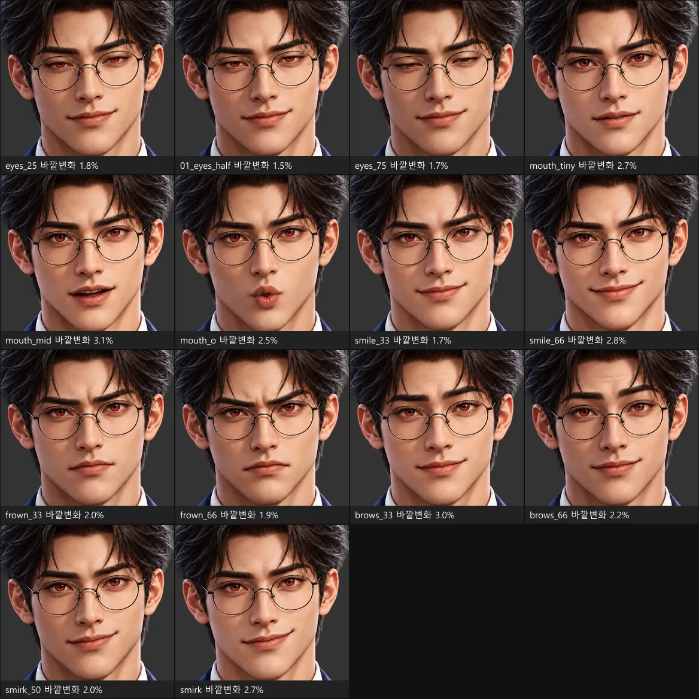

표정 그림 위에 눈·입 그림을 겹친 조합. 위는 무표정으로 말하는 입, 아래는 웃으며 말하는 입이다.

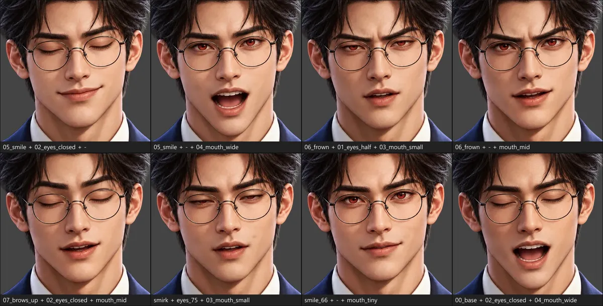

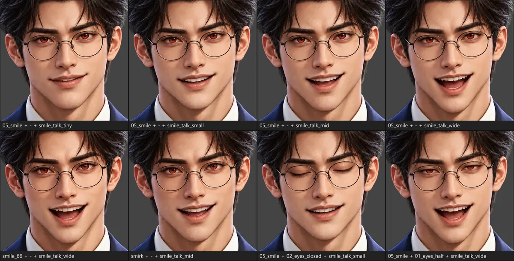

실제 렌더러 화면(미소 중 입 크게 벌림 → `smile_talk_wide`, 120fps):

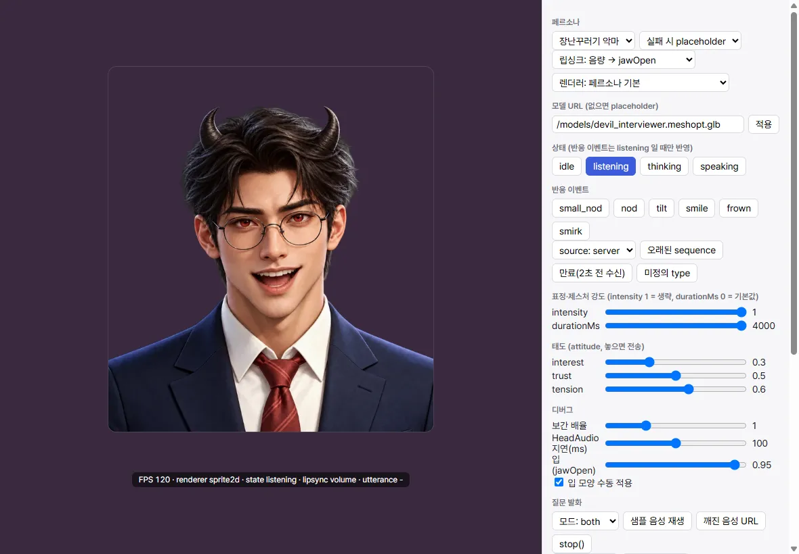

**실패했던 방식:** 처음에는 타원 마스크로 부위를 겹쳤는데, 표정 그림의 입꼬리 주름이 마스크 밖에 남아 입이 두 겹으로 보였다([2d_combos_ellipse_mask_bad.webp](images/verification/2d_combos_ellipse_mask_bad.webp)). 그래서 "부위 조각" 방식(3.4절)으로 바꿨다.

### 2.4 실사 면접관 시험판 (2차 후보)

실사 그림 11장과 MediaPipe 얼굴 기준점 478개로 표정 사이를 휘어 맞춘 뒤 섞는 방식이다. 120fps로 동작하고, 3D용 ARKit 표정 값을 그대로 넣어 움직일 수 있다.

| 미소 70% | 미소 + 반쯤 감은 눈 + 말하기 | 얼굴 삼각형 1006개 |
|---|---|---|
| 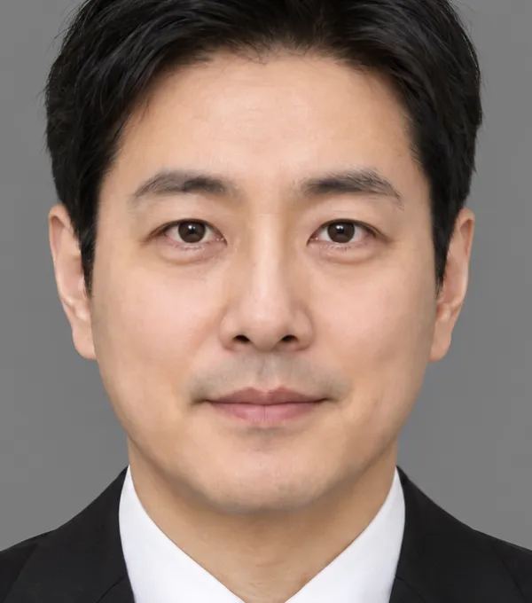 |  | 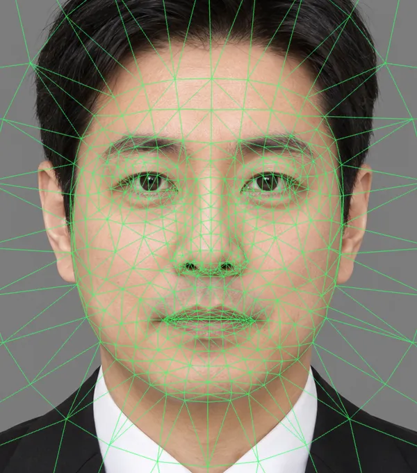 |

한계: 입을 조금 벌릴 때 이가 눌려 보이고, 그림마다 피부 밝기가 미세하게 다르며, 고개를 크게 움직일 수 없다.

### 2.5 대안으로 검토한 외형

외형은 **실사에 가까운 사람 모습을 우선**한다는 기준으로 골랐다. 아래 대안은 기술적으로는 동작했지만 이 기준에서 탈락했다.

| 대안 | 결과 | 탈락 이유 |
|---|---|---|
| VRoid Studio (VRM) | 검토만 함 | 애니메이션풍 외형만 가능. 코드로 만들 수 없음 |
| 픽사풍 2D 악마 (UI 목업 기준, Codex 그림 21장) | 2D 렌더러로 표정 전환·깜빡임·입 모양까지 동작 | 실사화 우선. 카툰 화풍 |
| 뿔 달린 3D 악마 (MPFB + CC0 뿔·안경) | 표정 52종·입 모양 15종, 4.2MB, 뿔·안경이 고개를 따라 움직임 | 실사화 우선. 쓸 수 있는 CC0 뿔이 크게 옆으로 뻗은 황소 뿔뿐이라 시안과도 다름 |
| 붉은 피부 사람형 악마 | 기본 얼굴 시안 1장 | 실사화 우선. 사람 피부가 더 자연스러움 |

| 픽사풍 2D 악마 | 뿔 달린 3D 악마 |
|---|---|
| 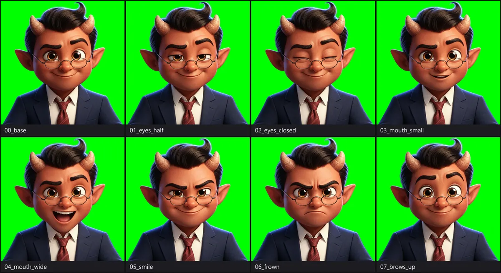 | 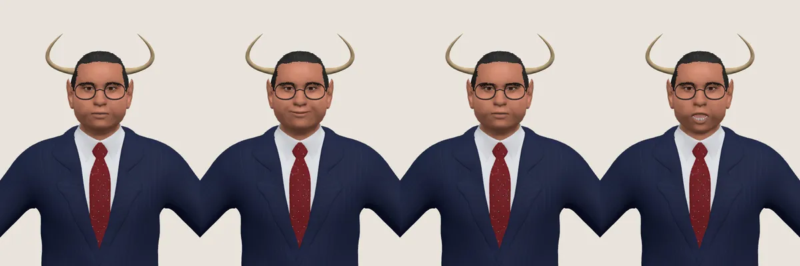 |

사람 피부(채택, 왼쪽)와 붉은 피부(탈락, 오른쪽):

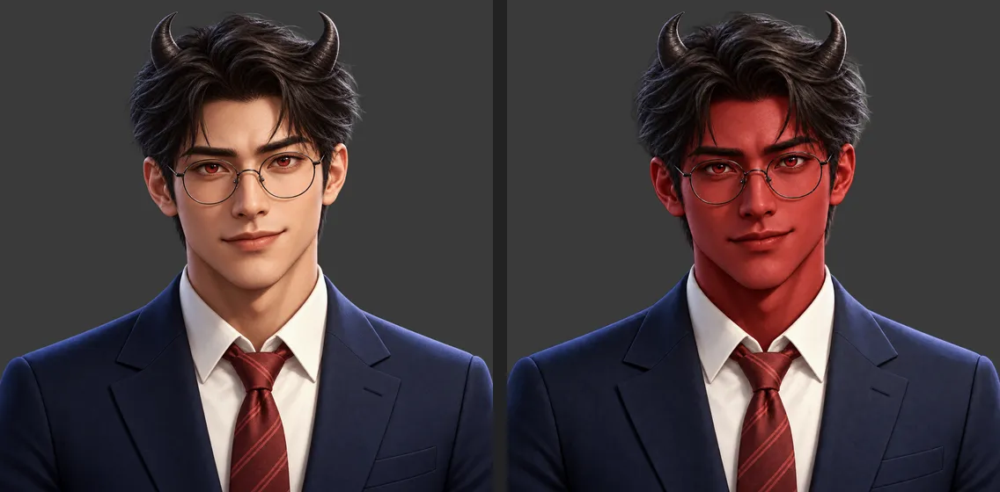

픽사풍 그림과 뿔 달린 3D 모델로 만든 표정 전환·깜빡임·입 모양 동작은 그대로 사람형 그림과 정장 모델에 옮겨 썼다. 외형만 바꿨고 구현 방식은 같다.

### 2.6 구현 방식 대안 검토

면접관을 만들고 움직이는 방식의 대안이다. **검증 수준**은 실측(같은 조건으로 측정), 시험(직접 만들어 확인), 조사(문서·약관 확인만)로 구분한다. 조사만 한 항목은 직접 확인하지 않았으므로 다시 고려할 때 시험부터 한다.

**렌더러·립싱크**

| 대안 | 검증 수준 | 결과 | 판단 |
|---|---|---|---|
| TalkingHead 라이브러리 | 실측 (2.2절) | 대기 동작·기분 표정이 우리 동작 층 구조와 충돌, FPS 상한 72 | 탈락. 자체 컨트롤러 채택 |
| HeadAudio 립싱크 | 실측 (2.2절) | 영어 학습 모델이라 한국어 모음을 잘못 분류 | 2차 (한국어 학습 또는 입 모양 정보를 주는 TTS) |

**3D 모델 출처**

| 대안 | 검증 수준 | 결과 | 판단 |
|---|---|---|---|
| VRoid Studio (VRM) | 조사 | 애니메이션풍 외형만 가능, 코드로 제작 불가 | 탈락 (2.5절) |
| TalkingHead 예제 `mpfb.glb` | 시험 | CC0, 규격(ARKit 52 + 입 모양 15) 충족. 외형이 파란 티셔츠의 젊은 여성 | 기능 확인·비교용으로만 사용 |
| MPFB + MakeHuman CC0 에셋 직접 제작 | 시험 (2.1절) | 페르소나별 외형을 코드로 만들 수 있고 결과물 배포에 제한 없음 | **채택** |
| Microsoft Rocketbox | 조사 | MIT 라이선스, 2022.6부터 ARKit 호환 표정 제공 | 시험하지 않음. 우리 페르소나 외형을 직접 만들 수 있는 MPFB를 먼저 택함 |
| Avaturn (사진 → 아바타) | 조사 | 실사에 가깝고 GLB로 내보냄. 상업 이용 조건은 확인하지 못함 | 보류 |
| Character Creator (Reallusion) | 조사 | 유료, 게임·앱에 쓰려면 Export License 필요. glTF 직접 내보내기는 확인되지 않음 | 탈락 (비용) |
| MetaHuman (Epic) | 조사 (아래 상세) | 실사 품질은 가장 높고 라이선스도 우리 용도에 맞음. 다만 웹용 공식 내보내기가 없어 커뮤니티 변환을 거쳐야 하고, 결과 파일이 현재 모델의 약 10배 | 2차 후보 (외형 품질 개선). MVP는 MPFB 유지 |

MetaHuman 상세 (2026-10-14 조사, 직접 시험하지 않음)

| 항목 | 내용 | 출처 |
|---|---|---|
| 라이선스 | 2025.6(UE 5.6)부터 Unity·Godot 등 다른 엔진과 제작 도구에서 사용 가능. 연 매출 100만 달러 미만은 무료. AI를 쓰는 작업 흐름에는 사용 가능하나, AI 모델 학습·개선에는 사용 불가 | Epic 발표, CG Channel (Epic 약관 원문은 접근 불가로 직접 확인 못 함) |
| 제작 환경 | Unreal Engine 5.6 이상 편집기 안에서 제작 | Epic 발표 |
| 얼굴 구조 (LOD0) | 정점 24,000, 표정 모양 669개, 관절 713개, 정점당 영향 12. 텍스처 최대 8192(PC) | Epic 공식 사양 문서 |
| 웹(three.js) 내보내기 | Epic 공식 경로 없음. Unreal glTF 내보내기는 모프 이름이 빠지고, 표정 모양 858개를 모두 넣으면 약 700MB | 커뮤니티 변환 도구 README |
| 커뮤니티 변환 결과 | Unreal Sequencer + Blender를 거쳐 ARKit 표정 51종 GLB, 텍스처 1024·Draco 압축 후 약 40MB. `tongueOut`은 기본 리그로 안 됨 | [metahuman-to-glb](https://github.com/sociofuture/metahuman-to-glb) (MIT) |
| 우리 구조와의 궁합 | ARKit 이름을 그대로 쓰므로 표정 매핑 코드는 거의 그대로 쓸 수 있음. 다만 파일이 현재 모델(약 4MB)의 약 10배라 휴대폰 로딩이 부담 | 위 내용에서 판단 |

다시 고려할 때 할 일:

- 커뮤니티 변환 도구로 시험 모델 1개를 만들어 파일 크기·로딩 시간·FPS·표정 품질을 MPFB 모델과 같은 조건으로 측정한다.
- AI 학습 활용 계획과 맞는지 확인한다. 예를 들어 립싱크 모델 한국어 학습(2차)이나 면접 데이터로 AI를 개선할 때 MetaHuman의 화면·애니메이션 값을 학습 자료로 쓰면 금지 조건에 해당할 수 있다. 범위는 Epic 약관 원문으로 확인한다.

**2D 구현 방식**

| 대안 | 검증 수준 | 결과 | 판단 |
|---|---|---|---|
| 코드로 원본 그림 변형 (눈썹·입꼬리를 휘고 감은 눈·벌린 입을 덧그림) | 시험 | 눈썹·입꼬리·고개는 자연스럽지만 감은 눈·입안을 지어내야 해서 티가 남 | 탈락. 새 내용은 그린 그림이 필요하다는 결론 |
| 표정 사이 그림을 전부 그리기 (손그림 애니메이션식) | 검토 | 조합마다 그림이 필요해 수백 장, AI 그림은 장마다 미세하게 달라 떨림 | 탈락. 단계 그림 + 부위 조합으로 대체 |
| **그림 바꿔 끼우기 + 부위 조각** | 시험 (2.3절) | 그림 25장(1.1MB)으로 표정 단계·깜빡임·입 모양·웃으며 말하는 입 | **채택** |
| Live2D | 조사 | 개인·소규모 사업자는 무료. 그림을 부위별 레이어로 다시 그리고 움직임을 설정해야 함(숙련자 1~3주) | 탈락 (작업량) |
| AI 그림 → 3D 변환 (Meshy, Tripo 등) | 조사 | 외형은 비슷하나 뼈대·표정이 없는 조각상이라 표정을 따로 다 만들어야 함 | 탈락 |
| 상황별 짧은 영상 바꿔 틀기 | 검토 | 입이 실제 말과 맞지 않고 영상 전환 때 끊김 | 탈락 |
| 점 찍어 휘기 (그린 표정 사이 아무 강도·섞은 표정) | 시험 (2.4절, 실사 그림으로) | 실사 그림에서 동작 확인, 120fps | 2차 |

**실사 방식**

| 대안 | 검증 수준 | 결과 | 판단 |
|---|---|---|---|
| 사전 생성 토킹헤드 영상 서비스 | 검토 (예시 영상) | 대본을 넣고 기다려 받는 영상이라 실시간 질문·듣는 중 반응 불가 | 탈락 |
| 실시간 실사 아바타 서비스 (LiveAvatar, HeyGen, D-ID 등) | 조사 | 실시간 대화는 되지만 사용 시간만큼 과금, 듣는 중 끄덕임·찌푸림 같은 세밀한 제어는 서비스마다 제한적 | 탈락 (비용·제어) |
| 자체 실사 립싱크 모델 (MuseTalk, Audio2Face 등) | 조사 | GPU 서버 필요, 턴마다 지연 | 탈락 (인프라) |
| 실사 그림 + 얼굴 기준점 휘기 | 시험 (2.4절) | 정지 화면은 사진 수준, 이·입술선·피부 밝기에 한계 | 2차 후보 |

조사 출처: [VRoid Studio 약관](https://policies.pixiv.net/en.html#vroidstudio), [MakeHuman 라이선스](https://static.makehumancommunity.org/about/license.html), [TalkingHead](https://github.com/met4citizen/TalkingHead), [Microsoft Rocketbox](https://github.com/microsoft/Microsoft-Rocketbox), [Avaturn 문서](https://docs.avaturn.me/docs/what-is-avaturn/), [Reallusion 콘텐츠 라이선스](https://www.reallusion.com/contentstore/charactercreator-official.html), [Unreal Engine 5.6 발표(MetaHuman 라이선스)](https://www.unrealengine.com/news/unreal-engine-5-6-is-now-available), [CG Channel: MetaHuman 라이선스 변경](https://www.cgchannel.com/2025/06/you-can-now-sell-metahumans-or-use-them-in-unity-or-godot/), [MetaHuman LOD 사양](https://dev.epicgames.com/documentation/metahuman/platform-support-and-lod-specifications-for-metahumans), [Live2D SDK 라이선스](https://www.live2d.com/en/sdk/license/)

## 3. 구현 방식

### 3.1 공개 인터페이스

렌더러(3D·2D)와 관계없이 같다. FE는 이 함수만 호출한다.

```ts
createAvatar({ container, persona, renderer?, modelUrl?, fallbackMode?, onFallback?, onSpeechStart?, onSpeechEnd? })
setState(state)                               // idle | listening | thinking | speaking
react(event, receivedAtMs?)                   // 반응 이벤트, 반영되면 true
speak({ utteranceId, text, audioUrl, mode })  // mode: voice | text | both
stop(utteranceId?)                            // 해당 발화의 음성·입·예약 반응 함께 취소
onSpeechEnd({ utteranceId, reason })          // audio_ended | read_time → 답변 시작 신호
onFallback({ from, to, cause })               // 3d → static, voice → text
dispose()
```

### 3.2 동작 층 구조

매 프레임 기본 자세에서 다시 계산한다(회전 누적 없음, 프레임 간격 상한 0.1초). 아래 층부터 적용하고 위 층이 덮어쓴다.

| 층 | 내용 | 속도 | 입력 |
|---|---|---|---|
| 1. 상태 자세 | 상태별 고개·상체 각도 | 0.3~0.5초 | `setState` |
| 2. 대기 동작 | 호흡, 눈 깜빡임 | 상시 | 렌더러 |
| 3. 태도 표정 | 관심 ↔ 무덤덤 | 2~3초 | 반응 이벤트 `attitude` |
| 4. 순간 표정 | 미소, 찌푸림, 히죽 → 끝나면 태도로 복귀 | 200~300ms | `expression` |
| 5. 제스처 | 작은 끄덕임, 끄덕임, 갸웃 | 0.4~1.2초 | 로컬(쉴 때) + 서버 |
| 6. 입 | 음량 → `jawOpen` | 매 프레임 | 음성 |

같은 모프·뼈를 두 층이 동시에 쓰지 않는다. 말할 때는 턱·입을 립싱크가 소유하므로 표정 표에서 입 모프를 줄이거나 뺀다.

### 3.3 반응 이벤트

AI가 판단하고 BE가 WebSocket으로 전달한다. 쉴 때 끄덕임만 FE 안에서 바로 발생한다.

| 필드 | 의미 |
|---|---|
| `type` | `state` · `attitude` · `expression`(`smile`·`frown`·`smirk`) · `gesture`(`small_nod`·`nod`·`tilt`) |
| `sequence` | 출처(`local`·`server`)별로 단조 증가. 마지막 처리값 이하이면 무시 |
| `ttlMs` | 상대 만료. 받은 시각 + `ttlMs`가 지나면 무시. 서버 시각(`expiresAt`)은 PC 시계 차이 때문에 쓰지 않음 |
| `intensity` | 0~1, 기본 1. 최종값에 곱함 |
| `durationMs` | 순간 표정 유지 시간, 갸웃 전체 길이(0.4~1.2초로 제한) |
| `utteranceId`·`offsetMs` | 발화 연계 반응. 발화 시작 + `offsetMs`에 실행, 실행 시점에 만료 다시 확인 |

정의되지 않은 값은 무시하고, "답변 완료" 이후 도착한 이벤트는 버린다. Schema는 [spike/reaction-event.schema.json](spike/reaction-event.schema.json)에 있다.

### 3.4 렌더러

| | 3D (`glb`) | 2D (`sprite2d`) |
|---|---|---|
| 형식 | GLB(Mixamo 호환 뼈대 + ARKit 52 + Oculus 15), meshopt 압축 | 768×768 투명 WebP 25장 |
| 표정 | ARKit 모프에 값 적용. 같은 이름 모프를 가진 모든 메시(얼굴·눈썹·속눈썹·치아·혀)에 같은 값 | 가장 큰 표정 하나 → 가까운 단계 그림(0·1/3·2/3·1), 단계 사이 70ms씩, 다른 표정은 기본 경유 |
| 눈·입 | `eyeBlink`, `jawOpen` 모프 | 눈 5단계·입 5단계 + 오/우 그림을 표정 그림 위에 겹침. 웃는 얼굴이면 웃으며 말하는 입 |
| 끄덕임·갸웃 | 머리·목 뼈 회전 | 그림 전체 이동(약 6px)·회전(최대 5°) |
| 실패 처리 | WebGL 미지원·로드 실패·10초 Timeout·컨텍스트 손실 → 정지 이미지 | 그림 로드 실패·10초 Timeout → 기본 그림 |

**2D 부위 조각 방식:** 눈·입 그림의 투명도(alpha)를 "겹칠 영역"으로 미리 바꿔 둔다. 눈 그림은 기본 그림과 실제로 달라지는 눈꺼풀만 남기고(눈썹을 올린 표정 위에 겹쳐도 눈썹이 덮이지 않음), 입 그림은 미소·히죽·찌푸림 그림이 입 주변에서 달라지는 영역까지 덮는다(입꼬리가 두 겹으로 보이지 않음). 화면에서는 마스크 없이 그대로 겹치기만 한다.

## 4. 코드 구현 방식

아래는 시험 코드의 파일 구성이다. 굵게 표시한 파일은 [spike/](spike/README.md)에 발췌했다.

| 파일 | 역할 |
|---|---|
| `index.ts` | `createAvatar` 공개 인터페이스, 렌더러 선택, 실패 시 정지 이미지 |
| `renderer/controllers/AvatarBrain.ts` | 매 프레임 상태·표정·제스처·입을 합쳐 `AvatarFrame` 생성 (WebGL 없이 테스트 가능) |
| **`renderer/controllers/EventFilter.ts`** | `sequence`·`ttlMs`·답변 완료 후 무시 |
| **`renderer/controllers/ExpressionController.ts`** | 태도·순간 표정 보간, 최종 모프 값 계산 |
| **`renderer/controllers/MouthController.ts`** | 립싱크 보간(여기서만) |
| **`renderer/reactionMap.ts`** | 논리 표정 → ARKit 모프 표(들을 때 / 말할 때) |
| **`renderer/personas.ts`** | 페르소나별 모델·배율·카메라·2D 그림 설정 (수치는 여기서만 정의) |
| `renderer/loadGlb.ts` | GLB 로드(MeshoptDecoder, 10초 Timeout, 숨김 메시), 뼈·모프 적용, 팔 내림 대기 자세 |
| **`renderer/SpriteAvatar.ts`** | 2D 렌더러(DOM `` 겹치기, opacity만 변경) |
| `speech/SpeechPlayer.ts` | 음성 재생·질문 모드 3종·`utteranceId`·text 모드 표시 시간 |

**표정 매핑 (`reactionMap.ts`)**: 표정마다 들을 때와 말할 때 표를 따로 둔다.

```ts
listening: {
  smile: { ...both('mouthSmile', 0.6), ...both('cheekSquint', 0.3), ...both('eyeSquint', 0.15) },
  frown: { ...both('browDown', 0.6), ...both('eyeSquint', 0.15), ...both('mouthFrown', 0.35), ...both('mouthPress', 0.2) },
},
speaking: {
  // 턱·입은 립싱크 소유 → 눈·볼로 표현
  smile: { ...both('cheekSquint', 0.35), ...both('eyeSquint', 0.2), ...both('mouthSmile', 0.15) },
  frown: { ...both('browDown', 0.6), ...both('eyeSquint', 0.2) },
},
```

**최종 모프 값 (`ExpressionController.ts`)**: 같은 모프는 합산한 뒤 최대 0.8로 자른다.

```ts
out[name] = (out[name] ?? 0) + weight * scale * amount; // 기본값 × 페르소나 배율 × 세기(intensity 반영)
out[name] = clamp(out[name] ?? 0, 0, MAX_EXPRESSION_WEIGHT); // 0.8
```

**립싱크 (`MouthController.ts`)**: 음량(RMS)을 입 벌림 목표로 바꾸고, 열 때 50ms·닫을 때 120ms 시정수로 보간한다. 3D는 이 값에 `jawOpenMax`(0.55)를 곱해 `jawOpen`에 넣는다.

```ts
export function volumeToMouth(volume: number): number {
  return clamp((volume - NOISE_GATE) * GAIN, 0, 1); // NOISE_GATE 0.01, GAIN 6
}
const tau = target > cur ? MOUTH_OPEN_TAU : MOUTH_CLOSE_TAU; // 0.05 / 0.12초
```

**2D 표정 단계 선택 (`SpriteAvatar.ts`)**: 경계에서 값이 흔들려도 그림이 깜빡이지 않도록 기본 ↔ 1단계에만 여유(±0.15 단계)를 둔다.

```ts
const raw = value < config.minExpressionLevel ? 0 : clamp(value, 0, 1) * steps;
if (prev?.level === 0 && raw < 0.5 + H) return BASE_TARGET;
const level = Math.round(raw);
```

**웃으며 말하는 입 (`SpriteAvatar.ts`, `personas.ts`)**: 지금 보이는 표정 그림이 미소 2/3 단계 이상이거나 완전한 히죽이면 다른 입 목록을 쓴다.

```ts
expressionMouth: {
  smile: { fromLevel: 2, mouth: SMILE_TALK },
  smirk: { fromLevel: 2, mouth: SMILE_TALK },
},
```

**에셋 다시 만들기**

| 대상 | 방법 |
|---|---|
| 3D 모델 | Blender 헤드리스 빌드 → 하체 제거 → WebP 텍스처 → meshopt. Windows 260자 경로 문제는 `subst M:`로 회피 |
| 2D 그림 | Codex 요청문(`prompt_*.txt`) → `convert.mjs`(768px WebP) → [`bake.mjs`](spike/bake.mjs)(부위 조각) |
| 실사 시험판 | Codex 실사 그림 → MediaPipe 얼굴 기준점·표정 점수 추출 → 삼각형 분할 후 휘어 맞춰 섞기 (2.4절) |

Codex로 그림을 그릴 때 지킬 것: 기본 그림을 편집 대상으로 넣고 한 파일당 이미지 생성 1회, 섞거나 잘라 붙이기 금지, Codex는 한 번에 하나만 실행(동시에 돌리면 다른 작업의 그림을 가져감).

## 5. 수치 조절 방식

### 5.1 공식

```
최종 모프 값 = 기본값(reactionMap.ts) × 페르소나 배율(personas.ts) × intensity(반응 이벤트), 최대 0.8
```

- 반응을 낼지와 얼마나 자주는 반응 로직 모듈, 얼마나 강하게 보일지는 표현 모듈이 정한다. 같은 반응을 두 곳에서 강하게 만들지 않기 위해서다.
- 모델을 바꾸면 같은 수치라도 얼굴이 다르게 보이므로, **모델 교체 후 화면을 보며 기본값부터 다시 맞춘다.**
- 바꾼 값은 이유와 함께 기록하고 전후 사진을 남긴다(2.1절).

### 5.2 페르소나별 값 (가안)

| 항목 | 악마 면접관 | 개발자 커피챗 | 장난꾸러기 악마 |
|---|---|---|---|
| 시작 태도 interest / tension | 0.3 / 0.6 | 0.7 / 0.2 | 0.6 / 0.4 |
| 미소 / 찌푸림 배율 | 0.75 / 1.3 | 0.9 / 0.7 | 0.8 / 1.0 |
| 끄덕임 배율 / 쿨다운 | 0.6 / 6초 | 1.2 / 2.5초 | 0.6 / 5초 |
| 눈 깜빡임 간격 | 3~6초 | 2~4초 | 2~5초 |
| 목소리 (Chirp 3: HD) | 낮은 톤 1.05배 | 밝은 톤 1.0배 | 장난기 있는 톤 1.0배 |

### 5.3 화면을 보고 바꾼 값 (2026-10-13)

| 값 | 전 → 후 | 이유 |
|---|---|---|
| 미소 `mouthSmile` (들을 때) | 0.5 → 0.6 | 새 모델은 입꼬리 모프가 약해 배율을 곱하면 거의 안 보임 |
| 찌푸림 `browDown` | 0.5 → 0.6, `eyeSquint` 추가 | 눈썹만으로는 약해 눈가를 함께 좁혀야 분명함 |
| 관심 `browInnerUp` / `eyeWide` | 0.25 → 0.35 / 0.1 → 0.25 | 이전 값은 기본 얼굴과 구분 안 됨 |
| 무덤덤 `eyeBlink` | 0.15 → 0.3 | 눈꺼풀을 반쯤 내려야 관심과 차이가 느껴짐 |
| 악마 면접관 미소 배율 | 0.4 → 0.75 | 0.4면 미소가 거의 안 보임. 0.75면 옅지만 알아봄 |
| 커피챗 찌푸림 배율 | 0.5 → 0.7 | 0.5면 찌푸림이 안 보임 |
| `jawOpenMax` | 1.0 → 0.55 | 그 이상이면 혀·치아가 과하게 보임 |

### 5.4 그 밖의 조절값

| 값 | 기본 | 위치 |
|---|---|---|
| 립싱크 열림 / 닫힘 시정수 | 50ms / 120ms | `MouthController.ts` |
| text 모드 표시 시간 | `max(2초, 글자 수 ÷ 7초)` | `personas.ts` `readCharsPerSec` |
| 머리 이동 범위 | ±12° | 피드백 모듈 시선 기준 보호 |
| 2D 단계 사이 시간 | 70ms | `personas.ts` `stepMs` |
| 2D 입 단계 경계 | 0.15 / 0.35 / 0.6 / 0.88 | `personas.ts` `mouthThresholds` (크게는 아주 큰 소리 때만) |

## 6. 최종 MVP 권장안

| 항목 | 권장 | 근거 |
|---|---|---|
| 렌더러 | **자체 three.js 컨트롤러 + GLB** | 2.2절. TalkingHead는 쓰지 않음 |
| 3D 모델 | MPFB + CC0 에셋으로 제작한 페르소나별 GLB(약 4MB), 하체 메시 삭제·뼈대 유지 | 2.1절, 8장 라이선스 |
| 2D 면접관 | 그림 바꿔 끼우기 + 부위 조각 (장난꾸러기 악마) | 2.3절. WebGL 없이 동작, 그림 25장 1.1MB |
| 립싱크 | 음량 → `jawOpen`, 상한 0.55 | 2.2절. HeadAudio는 토글로만 남김 |
| TTS | Chirp 3: HD, AI 파트가 호출, 키는 AI 서버에만 | [architecture.md](architecture.md) 1장 |
| 반응 이벤트 | 3.3절 필드로 `common` 계약 정의 | 시계 차이·순서 역전·답변 완료 후 처리 검증 |
| 페르소나 | 3종(악마 면접관·개발자 커피챗 3D, 장난꾸러기 악마 2D) | 5.2절 값으로 시작 |
| 질문 표시 | 화상·채팅 모두 음성 + 말풍선(`both`) | UI 디자인(S06) |
| 동작 파일 | Mixamo 애니메이션 미사용, 제스처는 코드로 | 웹 배포 시 원본 재배포 문제 |

**2차로 미룰 것**: HeadAudio 한국어 학습 또는 Azure 입 모양 정보, 끼어들기(발화 큐·취소), 굳음·기다림 표정, 2D "점 찍어 휘기"(그린 표정 사이 아무 강도·섞은 표정), 실사 면접관(2.4절), 문장 단위 음성 스트리밍.

## 7. 남은 검증

- [ ] Chirp 3: HD 실제 키로 음질·지연 확인 (지금은 로컬 테스트용 Windows Heami 음성으로만 확인)
- [ ] 립싱크를 사람이 직접 보고 들어 확인 (자동 검증은 수치·스크린샷까지)
- [ ] 저사양 노트북·휴대폰 FPS 측정, FPS 기반 화질 단계 조정
- [ ] 피드백 모듈 MediaPipe 동시 실행 시 FPS (피드백 모듈 구현 후 `common` E2E)
- [ ] 3D 모델 수정: 악마 면접관 이마 위 머리카락 경계, 커피챗 입안 왼쪽 위 빨간 조각

## 8. 라이선스 확인

| 대상 | 라이선스 | 사용 |
|---|---|---|
| Blender 5.2.2, MPFB 2.0.18 | GPL (도구, 결과물은 만든 사람 소유) | 3D 모델 제작 |
| MakeHuman 에셋 (system, Suits 01, Eyebrows 01, Eyelashes 01, Visemes 02) | CC0 | 3D 모델. CC-BY 팩은 쓰지 않음 |
| TalkingHead MPFB 뼈대·가중치 파일 | MIT | 3D 모델 뼈대. MIT 전문을 모델 라이선스 기록에 포함 |
| `mpfb.glb` (TalkingHead 예제) | CC0 | 비교용 모델 |
| TalkingHead 1.7.0, HeadAudio 0.1.0 | MIT | v0 비교, 립싱크 토글 |
| MediaPipe Face Landmarker | Apache 2.0 (구성 모델 3개 설명서 원문 확인) | 실사 그림 분석(미리 1회), 서비스에 포함 안 함 |
| Codex 생성 그림 | 생성한 사용자 계정 소유 | 2D 면접관, 실사 시험판. 참고한 UI 시안은 아이디어 스케치라 별도 권리 문제 없음 |
| Windows Heami 음성 | Windows 사용권 | 로컬 테스트 전용, 배포 금지 |
