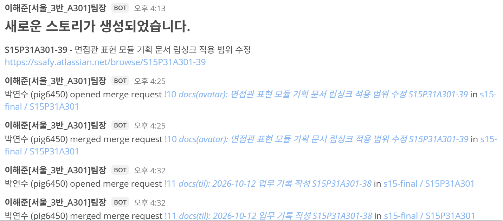

# 개인 학습 기록 — 이해준

> 담당: 피드백 (언어 · 비언어 분석) · 기록 기간: 2026.10.12 ~
>
> 파트 기획 문서: [feedback/](feedback/README.md)

---

### 📅 2026-10-13 (화)

**오늘 한 것**

- GitLab Runner 연동
- 검사 항목
  - 브랜치 이름 (형식 : `15P31A301-<번호>/<fe|be|ai|infra|common>/<feature|fix|hotfix|docs>/<영문·숫자·-·_>`)
  - 병합 대상(`master`에는 `develop` 브랜치나 `hotfix` 브랜치만 병합 가능. 그 외는 develop에 병합 가능)
  - 커밋 메시지 (형식 : `<feat|fix|docs|style|refactor|test|chore>(<scope>): <내용>`)
- 

**배운 것 / 정리**
- **GitLab Runner**: GitLab이 만든 CI/CD 잡을 실제로 실행하는 프로그램
  - GitLab 서버는 어떤 잡을 돌릴지만 정하고, 빌드, 테스트, 검사는 러너가 직접 함
  - 러너가 없으면 파이프라인이 만들어져도 잡이 pending에서 멈춤
- **동작 방식**:
  - 잡의 태그와 러너의 태그가 맞아야 그 러너가 잡을 가져감
  - Docker executor는 잡마다 새 컨테이너를 띄워 코드 받기 → script 실행 → 결과 보고 → 컨테이너 삭제
  - 매번 깨끗한 환경이라 의존성 설치가 반복됨 → cache로 줄일 수 있음

**막힌 것 & 해결**
| 문제 | 원인 | 해결 |
|---|---|---|
| | | |

**내일 할 것**
- [ ] 프로젝트 기본 셋팅?
- [ ] 소나큐브 연동 (MR 시 검사 진행)

**참고 링크**
-

---

### 📅 2026-10-12 (월)

**오늘 한 것**

- Jira 브랜치 생성 자동화 파이프라인 구축
- Jira 스토리 생성 Mattermost 알림 구축
- CI/CD를 위한 gitlab Runner 셋팅
- sonarqube 셋팅
- 자율 프로젝트 Field Trip 활동 보고서 제출
- 자율 프로젝트 계획서 및 1차 교보재 신청서 제출
- 언어적, 비언어적 피드백 요소 시장조사, 연구 조사, 기술 조사

**배운 것 / 정리**
- **언어 피드백**:
  - 군말: 받아쓰기에서 "음, 어" 등 목록 대조 + Kiwi 형태소 분석으로 습관어("그, 저, 이제") 거르기
  - 속도 · 쉼: 단어 시각으로 초당 음절 수, 250ms 이상 간격을 쉼으로 계산
  - 목소리: parselmouth(Praat)로 음높이 · 음량 변화 폭 → 단조로움, 말끝 흐리기
- **비언어 피드백**:
  - 시선: 눈 표정 점수 + 고개 각도. 카메라가 아니라 "화면 속 면접관을 볼 때"를 기준으로 보정
  - 표정: `mouthSmile` 점수로 미소. 감정 이름은 붙이지 않고 관찰한 사실만
  - 영상은 서버로 보내지 않고 숫자(이벤트)만 보냄 → 개인정보 부담 ↓
- 주의: 
  - 생각할 때 시선을 돌리는 건 정상. 임계값은 대부분 검증된 기준이 없어 본인 기준값 대비로 판단

**막힌 것 & 해결**
- X

**내일 할 것**
- [ ] gitlab - gitlab runner - sornaqube 파이프라인 구축

**참고 링크**
-

---

<!-- ↓ 이 블록을 복사해서 위(최신 날짜가 위)에 추가하세요 ↓
### 📅 2026-__-__ (_)

**오늘 한 것**
-

**배운 것 / 정리**
-

**막힌 것 & 해결**
| 문제 | 원인 | 해결 |
|---|---|---|
| | | |

**내일 할 것**
- [ ]

**참고 링크**
-

---
-->
