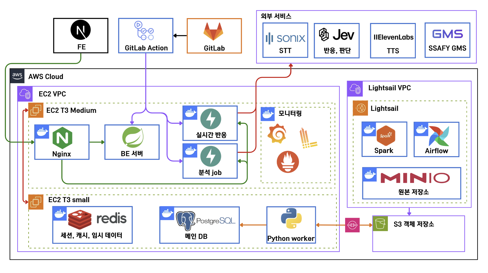
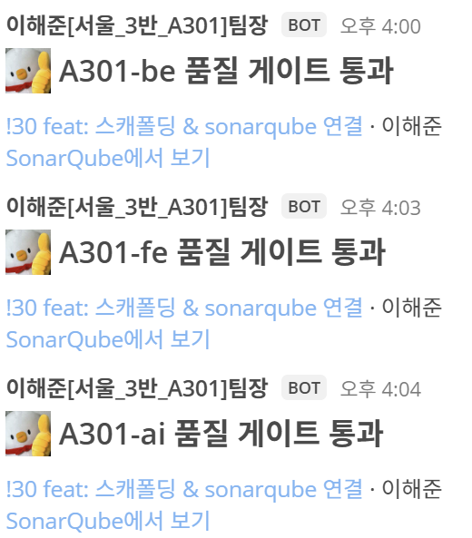
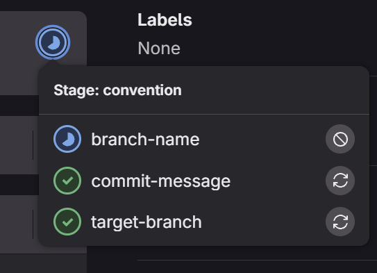

# 개인 학습 기록 — 이해준

> 담당: 피드백 (언어 · 비언어 분석) · 기록 기간: 2026.10.12 ~
>
> 파트 기획 문서: [feedback/](feedback/README.md)

---

### 📅 2026-10-16 (금)

**오늘 한 것**
- 중간 발표 팀간 평가 작성
- mock server 배포 - [목서버 주소](https://hangguet.yobistory.com/mock/be/docs)
  - 미니PC에 배포 전용 GitLab Runner 등록 (shell executor, 태그 `a301-mock-deploy`, Protected)
  - CI에 develop push 파이프라인과 `mock-deploy` 잡 추가 → develop 병합 시 자동 배포
  - `deploy/mock/compose.yml`, Nginx 설정 예시 작성

**배운 것 / 정리**
- **배포 흐름**
  - develop 병합 → push 파이프라인 → mock-build → mock-test → mock-deploy(미니PC) → `docker compose up -d --build` → 헬스체크
  - 요청 경로: Cloudflare Tunnel → Nginx 컨테이너 → `a301-mock:8080` (같은 Docker 네트워크)
  - `resource_group`으로 배포를 한 번에 하나만, `interruptible: false`로 중간 취소 방지
- **Nginx (컨테이너)**
  - `proxy_pass`에 이름을 바로 쓰면 시작할 때 한 번만 DNS 조회 → 대상이 없으면 Nginx가 안 뜨고, 재배포로 IP가 바뀌면 502
  - `resolver 127.0.0.11`(Docker 내장 DNS) + 변수 `proxy_pass` → 10초 캐시 후 다시 조회
  - 변수 `proxy_pass`는 location 접두사를 자동으로 안 떼므로 `rewrite`로 `/mock/be`를 뗌
- **리버스 프록시 뒤의 Spring**
  - TLS는 Cloudflare에서 끝나고 Nginx까지는 HTTP → `X-Forwarded-Proto/Host/Port/Prefix`로 원래 주소를 알려 줌
  - `forward-headers-strategy: framework`가 이 헤더로 Swagger `servers` 주소를 만듦 → 확인: `/v3/api-docs`의 `servers`
  - springdoc의 `swagger-ui.path`(`/docs`)는 `/swagger-ui/index.html`로 가는 리다이렉트용 별칭
- **CORS**
  - 브라우저가 다른 출처로 요청할 때만 적용. 서버 간 요청·curl은 상관없음
  - FE를 같은 도메인(`hangguet.yobistory.com`)에 배포하면 CORS 설정이 필요 없음

**막힌 것 & 해결**

**내일 할 것**
- [ ]

**참고 링크**
-

---

### 📅 2026-10-15 (목)

**오늘 한 것**
- 교보재 수령(결제) 및 자료 제출
- AWS 셋팅
  - IAM 사용자 그룹, IAM 사용자 세팅
  - budget 설정

- 인프라 아키텍쳐 초안

**배운 것 / 정리**
- **IAM 사용자 · 그룹**
  - 루트 계정은 결제, 계정 설정에만 쓰고, 평소 작업은 IAM 사용자로 함 → 루트는 MFA 걸고 액세스 키 만들지 않음
  - 권한은 사용자에게 직접 붙이지 않고 그룹에 정책을 붙인 뒤 사용자를 그룹에 넣음
  - 정책은 JSON(`Effect` / `Action` / `Resource`)으로 정의, 명시적 `Deny`가 `Allow`보다 우선
  - 최소 권한 원칙: 필요한 서비스만 허용하고, 필요해지면 그때 늘림

**막힌 것 & 해결**
| 문제 | 원인 | 해결 |
|---|---|---|
| | | |

**내일 할 것**
- [ ]

**참고 링크**
-

---

### 📅 2026-10-14 (수)

**오늘 한 것**

- 프로젝트 스캐폴딩(be, fe, ai)
- CI 파이프라인 개선
  - convention -> build -> test -> sonar
- Sonarqube 정적 분석 연결
  - relay 서버를 통한 MM 알림 구현
- img -> 3d 모델 조사

**배운 것 / 정리**
- **GitLab Runner 잡 실행**
  - 러너가 GitLab을 polling해 태그가 맞는 잡을 받아 옴
  - 잡마다 컨테이너를 새로 띄움: helper(checkout, cache, artifacts) / service(postgres 등) / build(script 실행)
  - 순서: checkout → cache 복원 → artifacts 다운로드 → script → cache 저장 → artifacts 업로드 → 삭제
  - cache는 러너 로컬에 zip으로 저장 → 다른 러너와 공유 안 됨
  - artifacts는 GitLab 서버에 저장 → 러너가 달라도 다음 잡에 전달
  - 파이프라인은 모든 잡이 끝나야 완료 → 오래 걸리는 잡은 `when: manual` + `allow_failure: true`
  - Gradle Build Cache: 태스크 입력의 해시가 같으면 실행 없이 출력 재사용(`FROM-CACHE`)
- **SonarQube 분석**
  - 러너: 스캐너가 서버에서 엔진·규칙·플러그인을 받아 코드 분석 → 리포트 업로드 후 종료
    - 파일 분류(main/test) → 언어별 분석기가 AST 파싱 후 규칙 실행 → 중복(CPD) 계산
    - git blame으로 줄별 수정일 수집, 테스트 도구의 커버리지 리포트를 줄 단위로 매핑
  - 서버: 업로드된 리포트를 Compute Engine이 비동기 처리
    - 이전 분석과 이슈 매칭 → 지표 집계 → 새 코드(최근 30일) 분리 → Quality Gate 판정 → Webhook

**막힌 것 & 해결**
| 문제 | 원인 | 해결 |
|---|---|---|
| | | |

**내일 할 것**
- [ ]

**참고 링크**
-

---

### 📅 2026-10-13 (화)

**오늘 한 것**

- GitLab Runner 연동
- 검사 항목
  - 브랜치 이름 (형식 : `15P31A301-<번호>/<fe|be|ai|infra|common>/<feature|fix|hotfix|docs>/<영문·숫자·-·_>`)
  - 병합 대상(`master`에는 `develop` 브랜치나 `hotfix` 브랜치만 병합 가능. 그 외는 develop에 병합 가능)
  - 커밋 메시지 (형식 : `<feat|fix|docs|style|refactor|test|chore>(<scope>): <내용>`)
- 

**배운 것 / 정리**
- **GitLab Runner**: GitLab이 만든 CI/CD 잡을 실제로 실행하는 프로그램
  - GitLab 서버는 어떤 잡을 돌릴지만 정하고, 빌드, 테스트, 검사는 러너가 직접 함
  - 러너가 없으면 파이프라인이 만들어져도 잡이 pending에서 멈춤
- **동작 방식**:
  - 잡의 태그와 러너의 태그가 맞아야 그 러너가 잡을 가져감
  - Docker executor는 잡마다 새 컨테이너를 띄워 코드 받기 → script 실행 → 결과 보고 → 컨테이너 삭제
  - 매번 깨끗한 환경이라 의존성 설치가 반복됨 → cache로 줄일 수 있음

**막힌 것 & 해결**
| 문제 | 원인 | 해결 |
|---|---|---|
| | | |

**내일 할 것**
- [ ] 프로젝트 기본 셋팅?
- [ ] 소나큐브 연동 (MR 시 검사 진행)

**참고 링크**
-

---

### 📅 2026-10-12 (월)

**오늘 한 것**

- Jira 브랜치 생성 자동화 파이프라인 구축
- Jira 스토리 생성 Mattermost 알림 구축
- CI/CD를 위한 gitlab Runner 셋팅
- sonarqube 셋팅
- 자율 프로젝트 Field Trip 활동 보고서 제출
- 자율 프로젝트 계획서 및 1차 교보재 신청서 제출
- 언어적, 비언어적 피드백 요소 시장조사, 연구 조사, 기술 조사

**배운 것 / 정리**
- **언어 피드백**:
  - 군말: 받아쓰기에서 "음, 어" 등 목록 대조 + Kiwi 형태소 분석으로 습관어("그, 저, 이제") 거르기
  - 속도 · 쉼: 단어 시각으로 초당 음절 수, 250ms 이상 간격을 쉼으로 계산
  - 목소리: parselmouth(Praat)로 음높이 · 음량 변화 폭 → 단조로움, 말끝 흐리기
- **비언어 피드백**:
  - 시선: 눈 표정 점수 + 고개 각도. 카메라가 아니라 "화면 속 면접관을 볼 때"를 기준으로 보정
  - 표정: `mouthSmile` 점수로 미소. 감정 이름은 붙이지 않고 관찰한 사실만
  - 영상은 서버로 보내지 않고 숫자(이벤트)만 보냄 → 개인정보 부담 ↓
- 주의: 
  - 생각할 때 시선을 돌리는 건 정상. 임계값은 대부분 검증된 기준이 없어 본인 기준값 대비로 판단

**막힌 것 & 해결**
- X

**내일 할 것**
- [ ] gitlab - gitlab runner - sornaqube 파이프라인 구축

**참고 링크**
-

---

<!-- ↓ 이 블록을 복사해서 위(최신 날짜가 위)에 추가하세요 ↓
### 📅 2026-__-__ (_)

**오늘 한 것**
-

**배운 것 / 정리**
-

**막힌 것 & 해결**
| 문제 | 원인 | 해결 |
|---|---|---|
| | | |

**내일 할 것**
- [ ]

**참고 링크**
-

---
-->
