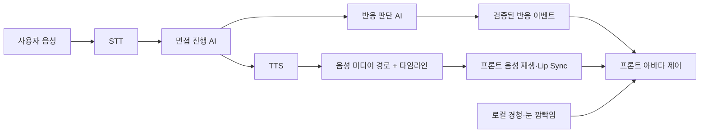

# AI 면접관 아바타 기술 조사 요약

2026년 10월 12일 · 한결 · 기술 조사 및 설계 제안

## 결론

**TalkingHead 기반 3D 아바타를 우선 검증하고, v1 → v2 → v3로 고도화하는 방향을 제안한다.**

- 3D는 표정·고개·시선 제어, 비용, 반응 속도의 균형이 좋다.
- 2D·3D 동시 개발은 피하고 공통 아바타 인터페이스로 렌더러를 분리한다.
- 저사양 성능이나 외형 문제가 반복되면 2D를 대안으로 추가한다.
- 실사형 API는 세션 비용과 개별 동작 제어 제약 때문에 후순위로 둔다.

> 기존 [면접관 표현 모듈 기획](../../박연수/interviewer-avatar/README.md)은 VRM 기반이다. 이 문서의 TalkingHead 선택은 추가 검토 제안이며, v0 결과와 팀 합의 후 확정한다. 구현·성능 테스트는 아직 진행하지 않았다.

## 아바타 방식 비교

| 방식 | 대표 기술 | 장점 | 단점 | 비용·난이도 |
| --- | --- | --- | --- | --- |
| 2D 스프라이트 | SVG/Canvas, [PixiJS](https://github.com/pixijs/pixijs) | 빠른 구현, 가벼움 | 움직임·입체감 제한 | 자체 에셋 기준 저비용 / 하 |
| 2D Live2D | [Cubism SDK for Web](https://www.live2d.com/en/sdk/download/web/) | 부드러운 표정·동작 | 리깅 숙련도 필요 | 공개 라이선스·모델 비용 확인 / 중~상 |
| **3D 아바타** | [TalkingHead](https://github.com/met4citizen/TalkingHead), [three-vrm](https://github.com/pixiv/three-vrm) | 고개·시선·표정 직접 제어 | 모델 호환·립싱크 조정 필요 | 라이브러리 MIT, TTS·에셋 별도 / 중 |
| 실사형 API | [LiveAvatar](https://docs.liveavatar.com/docs/lite-mode/overview), [D-ID](https://docs.d-id.com/reference/agents-sdk-overview) | 사실적인 외형, 음성 동기화 | 세션 비용·외부 서비스 의존 | 유료 / 기본 연동 중 |

기간은 담당자 1명 기준 **2D 약 1~2주, 기존 호환 모델을 활용한 3D 약 2~3주, 모델 제작·한국어 고도화 포함 시 3~5주**로 추정한다. 전체 면접 서비스 개발 기간은 제외한다.

## 추천 기술 조합 TOP 3

| 순위 | 조합 | 선택 조건 |
| --- | --- | --- |
| 1 — 우선 검증 | TalkingHead + 호환 GLB 모델 + HeadAudio + 한국어 TTS | 반실사 외형과 빠른 기능 연동 |
| 2 — 기존 기획 | Three.js + three-vrm + VRoid + Azure TTS | VRM 모델 활용과 직접 제어 |
| 3 — 일정·성능 대안 | SVG/Canvas 또는 PixiJS + 2D 캐릭터 + TTS | 3D 성능·모델 제작이 일정의 병목인 경우 |

TalkingHead는 브라우저 3D 렌더링, 표정·시선·제스처, 음성 스트리밍과 중단 기능을 제공한다. 한국어는 내장 텍스트 기반 립싱크 언어 목록에 없어 별도 경로가 필요하다. 공식 저장소에 실시간 브라우저 데모와 대화형 활용 사례가 있다.

## 3D 구현 스택

| 영역 | 우선 선택 | 확인 사항 |
| --- | --- | --- |
| 렌더링·제어 | TalkingHead | Mixamo 호환 리그, ARKit·Oculus viseme blendshape 규격 확인 |
| 모델 | 공식 예제 모델 → MPFB 제작 모델 | MPFB 출력을 바로 사용할 수 있다고 가정하지 않고 변환 검증 |
| 동작 | 기본 제스처·커스텀 포즈, 필요 시 Mixamo | 머리·표정·입 움직임 충돌 방지 |
| 초기 립싱크 | HeadAudio | 한국어 품질 직접 테스트 |
| TTS | Azure 우선 검토, ElevenLabs 대안 | 한국어 품질·무료 한도·지연 확인 |
| 최적화 | 텍스처·폴리곤 축소, 모델 압축 | 압축 형식과 로더 호환 확인 |

- [MPFB](https://static.makehumancommunity.org/about/license.html): 핵심 에셋 CC0, 프로그램 코드 GPL. 외부 의상·소재는 별도 확인.
- [Mixamo](https://helpx.adobe.com/creative-cloud/faq/mixamo-faq.html): Adobe ID로 무료 사용 가능. 원본 에셋 재배포 조건은 별도 검토.
- [VRoid Studio](https://vroid.com/en/studio): 무료 VRM 제작 도구. TalkingHead 사용 시 리그·표정 변환 검증 필요.
- [RocketBox](https://github.com/microsoft/Microsoft-Rocketbox/blob/master/LICENSE.md): MIT 모델 후보. TalkingHead 호환성은 별도 검증.
- Avaturn: 현재 가격·무료 범위·상업 이용 조건 미확인.

**v1은 오픈소스와 TTS 무료 한도로 시작한다.** 전체 운영 비용이 무료라고 단정하지 않는다. [Azure Neural TTS F0](https://azure.microsoft.com/en-us/pricing/details/speech/)는 월 50만 문자 무료이며, 이용 제한과 선택 음성 조건을 확인해야 한다.

실사형 참고: [LiveAvatar 과금](https://docs.liveavatar.com/docs/faq/credits)은 LITE 세션 1분당 1 credit, Essential 월 $99이다. 경청 시간도 세션 과금에 포함된다. 무료 플랜은 세션당 최대 2분으로 긴 면접 검증에 제한이 있다. 가격은 조사일 기준이며 계약 전 재확인한다.

## 반응과 Lip Sync

- 기본 경청·눈 깜빡임·미세 움직임은 브라우저에서 즉시 처리한다.
- 의미에 따른 갸웃·미소·후속 질문은 AI 판단 이벤트에 연결한다.
- 표정·몸 동작·입 제어를 분리하고, 보간·쿨다운·상태별 허용 반응을 적용한다.
- 입 움직임은 이벤트 도착 시간이 아니라 **실제 음성 재생 시간(AudioContext 시계)**을 기준으로 맞춘다.

| 단계 | 방식 | 주의점 |
| --- | --- | --- |
| 초기 | [HeadAudio](https://github.com/met4citizen/HeadAudio), 대안 [wawa-lipsync](https://github.com/wass08/wawa-lipsync) | 오디오 기반이지만 한국어 정확도는 실측 필요 |
| 우선 개선 | Azure Viseme ID → 모델 입 모양 매핑 | 한국어 지원 확인됨. 모델별 매핑 필요 |
| 추가 대안 | TTS 타임스탬프 + 한국어 발음→viseme 변환 | 문자 시간이 음소 시간과 같지는 않음. 연음·받침 처리 필요 |

[Azure 언어 지원](https://learn.microsoft.com/ko-kr/azure/ai-services/speech-service/language-support): 한국어 Viseme ID 지원, 한국어 얼굴 전체 blendshape 출력은 지원 목록에 없음. [ElevenLabs 타이밍 API](https://elevenlabs.io/docs/api-reference/text-to-speech/stream-with-timestamps)는 문자 타이밍을 제공하며 한국어 품질·요금과 입력 형식 변환은 별도 검증한다.

## 시스템 연동

반응 이벤트와 음성 미디어 경로는 분리하되 세션·턴·발화 ID로 연결한다. 기존 [협업 가이드](../../docs/CONTRIBUTING.md)에 따라 음성 Binary를 WebSocket이나 BE Application Body로 중계하지 않는다. 파일 기반 음성은 Storage URL 등을 활용하고 스트리밍 미디어 경로는 공통 계약으로 별도 합의한다.

| 프론트엔드 | 백엔드·AI |
| --- | --- |
| 아바타 렌더링·상태·반응 재생 | 질문 생성·반응 AI 호출 |
| 음성 출력·Lip Sync·중단 처리 | STT·TTS 연동, API 키 관리 |
| 마이크·웹캠·로컬 발화 감지 | 면접 진행·세션 관리·이벤트 전달 |

### 아바타 인터페이스 제안

| 호출 | 입력·역할 |
| --- | --- |
| 상태 변경 | 대기·경청·생각·발화 상태의 기본 표현 전환 |
| 반응 | 반응 이벤트 재생, 강도·쿨다운 적용 |
| 발화 | 미디어 소스·청크 및 타임라인으로 음성·입 동기화 |
| 중단 | 대상 발화 ID의 음성·Lip Sync·예약 동작 취소 |

반응 계약에는 행동·강도·지속 시간과 함께 sessionId, turnId, eventId, sequence, expiresAt을 포함한다. 발화 연계 반응에는 utteranceId와 offsetMs를 추가한다. 이는 제안이며 반응 AI 담당과 공통 계약을 합의한다.

끼어들기는 발언권·음성 큐·Lip Sync 취소를 함께 처리해야 하므로 고도화 단계에 둔다.

## 버전별 로드맵

| 버전 | 목표·범위 | 검증할 것 |
| --- | --- | --- |
| v0 — 1일 검증 | 예제 모델·TalkingHead·샘플 음성을 팀 노트북에서 실행 | 성능, 로딩, 모델 호환 |
| v1 — 말하고 듣기 | 아바타 1명, 상태 4개, TTS·오디오 기반 Lip Sync | 외형 인상, 음성·입 동기화 |
| v2 — 반응하기 | 끄덕임·미소·갸웃, AI 이벤트·로컬 경청 | 반응 타이밍·빈도 |
| v3 — 한국어 품질 | Azure Viseme 또는 한국어 모듈, 끼어들기 | 발음 표현, 중단·취소 |
| v4+ — 몰입감 | 성격 프리셋, 손 제스처, 배경, 다대일 면접 | 사용자 선호·성능 |

각 버전의 검증 결과로 다음 범위를 조정한다. v0에서 성능·모델 준비가 어려우면 2D 또는 기존 VRM 방향을 검토한다.

## 주요 리스크와 확인 항목

| 리스크 | 대응 |
| --- | --- |
| 저사양 성능 부족 | 목표 30fps, 텍스처·모델 경량화, 필요 시 2D 전환 |
| 모델 규격 불일치 | 예제 모델로 기능 개발, 외형 모델 별도 제작·검증 |
| 한국어 Lip Sync 부정확 | 대표 문장 테스트, Azure Viseme 우선 비교 |
| 전체 응답 지연 | 첫 질문 사전 생성, 문장 단위 스트리밍 |
| 표정·입·동작 충돌 | 영역별 제어권과 우선순위 설정 |
| 늦거나 과도한 반응 | 턴 ID·만료 시간·쿨다운 적용 |

상반신 카메라 구도만으로 계산량이 크게 줄지는 않으므로 실제 모델 경량화가 필요하다. Ready Player Me 종료일, Avaturn 조건, 추가 에셋 호환성은 이번 공식 확인이 충분하지 않아 확정 정보에서 제외했다.

다음 검증: 한국어 TTS 품질·한도·지연, HeadAudio 정확도, 모델 규격 변환, 카메라 분석 동시 실행 성능, 공통 이벤트·음성 전달 계약.
